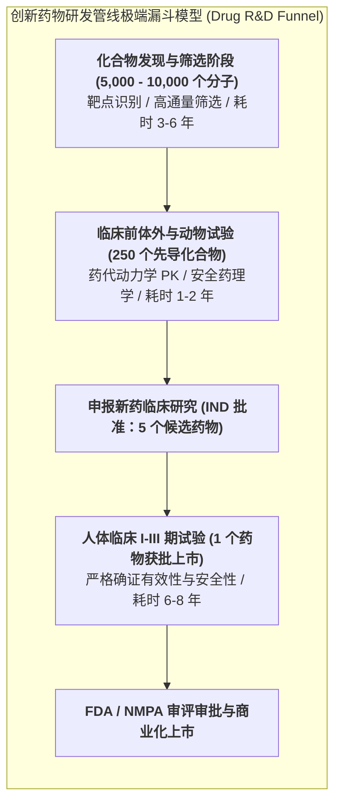

# Lec 1 创新药研发导论：疾病生物学机制与药物靶点发现（Drug Discovery & Target Identification）

## TL;DR

- 现代新药研发的漫长征程：10 至 15 年、数十亿美元资本投入与极低成功率（< 10%）。
- 疾病发病生物学机理与药物作用靶点（受体、酶、离子通道）的分子生物学识别验证。
- 高通量表型筛选（HTS）与基于结构的计算机辅助药物设计（CADD）双轮驱动。

## 一、生物医药产业的“双十定律”与极端高风险

在人类所有的工业与科技创新活动中，没有哪一个领域的研发风险与资本壁垒能够与**创新药研发（Innovative Drug Development）**相提并论。
医药界流传着著名的**“双十定律”**：
**一款真正的 First-in-class（同类首创）创新药物从最初实验室合成到最终获批上市，平均需要耗时 10 至 15 年，耗费超过 10 亿至 26 亿美元的巨额资本沉没！**

更残酷的是其极低的全流程通过率（Success Rate）：
- 在早期实验室合成与高通量筛选出的上万个候选化合物中，仅有百余个能进入动物临床前评估；
- 最终仅有区区 5 个分子能够获批开展人体临床试验（IND）；
- 进入人体临床试验后，由于人体内复杂的免疫、代谢毒性与相对药效不足，又有超过 90% 的在研药物在 I、II、III 期临床中惨遭淘汰；
- **全流程综合成功率不足 0.01%！**

## 二、疾病生物学机理与成药靶点（Target）确认

新药创制的第一步，是深入人类细胞与分子遗传学底层，寻找诱发疾病的**致病靶点（Therapeutic Target）**：

::: definition [成药靶点（Druggable Target）的分子生物学范畴]
1. **G 蛋白偶联受体（GPCRs）**：占据现有上市药物 30% 以上的作用靶标（如心血管高血压药、抗过敏药）；
2. **蛋白激酶与酶类（Kinases & Enzymes）**：在肿瘤异常信号传导中充当关键开关联锁（如针对肺癌 EGFR、白血病 BCR-ABL 酪氨酸激酶抑制剂）；
3. **离子通道（Ion Channels）**：调节神经与心肌电生理活动（如麻醉剂、抗心律失常药）；
4. **核受体与转录因子（Nuclear Receptors）**；
5. **新型生物大分子靶标**：如肿瘤免疫检查点 PD-1/PD-L1、CTLA-4 表面单抗靶点。
:::

靶点发现后，必须通过基因敲除（Knock-out）、RNA 干扰（RNAi）以及 CRISPR 基因编辑技术，在细胞和动物模型中严格确证：**抑制或激活该靶点，是否确实能够扭转或阻止疾病的病理进程**，防止在错误的假靶点上耗费数亿美元。

## 三、先导化合物发现技术演进：从盲筛到理性设计

在锁定有效靶点后，化学家与生物学家通过多种技术路径寻找能够与靶点精准结合的**苗头化合物（Hits）**与**先导化合物（Leads）**：

1. **高通量筛选（High-Throughput Screening, HTS）**：
   - 依赖高精自动化机械臂和微孔板读板机，在几天内将包含数百万种已知小分子化合物的实体化合物库与靶标蛋白逐一反应，通过荧光共振能量转移（FRET）等光学信号捕捉有效结合分子；
2. **基于结构的药物分子设计（Structure-Based Drug Design, SBDD）**：
   - 利用冷冻电镜（Cryo-EM）和 X 射线晶体学解析靶标蛋白的三维立体口袋构象；
   - 运用计算机辅助分子对接（Molecular Docking）和分子动力学模拟（MD），像“为特定钥匙孔配钥匙”一样在电脑中理性定制合成化学分子；
3. **AI 蛋白质结构预测与生成式化学**：
   - 以 AlphaFold、RoseTTAFold 及扩散生成模型为代表，将新药发现周期从过去数年压缩至数周。

## 我的理解

新药研发是人类智慧与大自然生化法则之间最壮丽的对话。它展现了一种极其崇高、近乎神圣的商业英雄主义——明知前路有 90% 以上的概率血本无归，科学家与冒险资本依然前赴后继地将数百亿美元掷向生命微观世界的无尽未知。每一粒最终躺在药房货架上的小小白片，背后都是上万名科学家十余年的执着守望，凝聚着人类攻克绝症、捍卫生命尊严的至高荣光。
