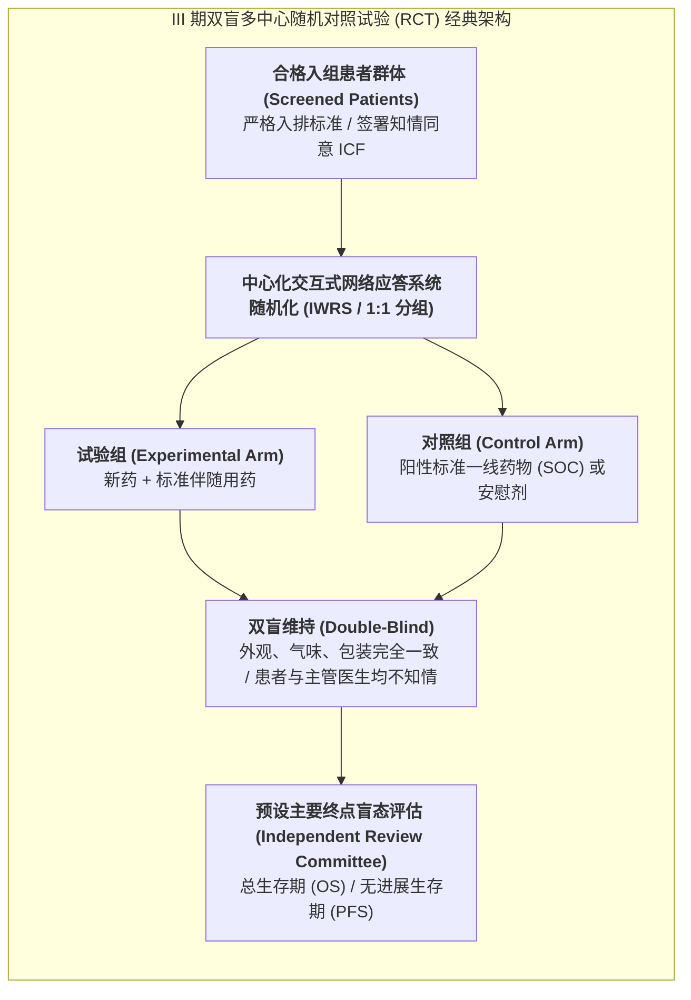

# Lec 10 III 期确证性试验：双盲随机对照临床试验设计与统计学功效考量（Phase III Pivotal Trials: Randomized Controlled Trial RCT Design）

## TL;DR

- 现代循证医学最高金标准：双盲大样本随机对照临床试验（Pivotal RCT）。
- 统计学功效（Power $1-\beta$）、优效性、等效性与非劣效性（Non-inferiority）检验界值。
- 意向性治疗分析（ITT）与符合方案集（PP）在防范磨损偏倚与方案违背中的裁决。

## 一、III 期关键性临床试验（Pivotal Trials）的豪赌属性

当在研新药以惊艳的 PoC 成绩走出 II 期后，便迎来了整个医药研发帝国最昂贵、最壮烈的一场决战——**III 期确证性关键试验（Phase III Pivotal / Registration Trial）**。
- **资本开支极其惊人**：单项跨国 III 期临床试验往往需要招募 **1,000 至 5,000 名患者**，耗费 **1 亿至 5 亿美元**的真金白银；
- **全方位决定企业生死**：对于中小型生物科技公司（Biotech），III 期试验的成败往往直接决定公司股价暴涨 300% 还是暴跌 90% 并在一夜之间破产清算；
- **法规终审判决**：FDA 和各国药监局的评审专家主要基于 III 期试验数据，评估药物在统计学上是否具有“无可争议、确凿无疑且显著优于对照组”的临床硬获益。

## 二、样本量估算与统计学功效（Statistical Power）数学推导

III 期试验的方案设计绝不允许拍脑袋决定“招 500 人还是 1000 人”，样本量必须由生物统计学家根据严格的假设检验公式精确算定：

::: theorem [两组比例优效性检验样本量计算公式]
设对照组有效率为 $p_c$，试验组预期有效率为 $p_t$，两组样本量按 $1:1$ 配比。
在显著性水平 $\alpha$（通常设为双侧 0.05，对应标准正态分位数 $z_{1 - \alpha/2} = 1.96$）与目标检验功效 $1 - \beta$（通常设为 80% 或 90%，对应 $z_{1 - \beta} = 0.84$ 或 $1.28$）下，每组所需的最少患者样本量 $n$ 为：
$$n = \frac{\left[ z_{1 - \alpha/2} \sqrt{2 \bar{p}(1 - \bar{p})} + z_{1 - \beta} \sqrt{p_t(1 - p_t) + p_c(1 - p_c)} \right]^2}{(p_t - p_c)^2}$$
其中 $\bar{p} = \frac{p_t + p_c}{2}$ 为合并加权有效率。
:::

::: example [样本量反比于疗效差值的平方]
公式分母中的 $(p_t - p_c)^2$ 具有决定性的运筹启示：
如果新药相比老药只微弱提高了 **3% 的有效率（$p_t - p_c = 0.03$）**，分母极其微小，计算出的所需样本量将暴增至每组数千人甚至上万人，试验成本将呈指数级爆炸！
而如果新药能带来 **20% 的断层式疗效飞跃（$p_t - p_c = 0.20$）**，样本量可骤降至几百人，研发周期和总投资直接缩减 80%！

## 三、优效性、等效性与非劣效性（Non-inferiority）检验

并非所有新药都追求在疗效上“战胜老药”，现代临床试验存在三大统计假设类型：

| 检验类型 | 核心检验假设 | 核心临床与商业价值 |
| :--- | :--- | :--- |
| **优效性检验 (Superiority)** | 试验组疗效在统计学上显著大于对照组（$p_t - p_c > 0$ 且 $p < 0.05$） | 确立崭新的行业金标准，享受顶级定价与专利独占 |
| **非劣效性检验 (Non-Inferiority)** | 证明新药疗效**不比老药差太多**：$p_t - p_c > -\Delta$（$\Delta$ 为临床可接受的微小非劣效界值） | 新药疗效相当，但**安全性更高（无严重副作用）、或者口服代替注射极大提升依从性** |
| **等效性检验 (Equivalence)** | 疗效严格落在指定微小双向区间内：$|p_t - p_c| < \Delta$ | **仿制药与生物类似药（Biosimilars）**上市申报的标准要求 |

## 四、意向性治疗分析（ITT）的终极裁判权

在长达数年的临床试验中，不可避免地会发生患者擅自停药、漏服药物甚至中途失访（Protocol Deviations）。在统计分析时：
- **符合方案集（Per-Protocol, PP 分析）**：仅分析那些 100% 严格听从医嘱吃完全部药品的完美患者；
- **意向性治疗分析集（Intention-to-Treat, ITT 分析）**：**只要患者经过随机化分组并服用了至少一次试验药物，无论该患者第二天是否私自退药、无论是否由于严重呕吐放弃治疗，在统计时强制按其最初被分配的组别进行最终生存期疗效统计（“Once randomized, always analyzed”）！**

::: insight
FDA 和医学权威期刊（NEJM / Lancet）永远以 **ITT 分析作为主要终点的唯一法定裁决准则**！因为在真实世界中，患者因为毒副作用不耐受而弃药，本身就是药物系统性缺陷的一部分。如果仅看符合方案的 PP 分析，等于人为筛选出了耐受性最好的天选幸存者，必然造成严重的“幸存者偏差（Survivorship Bias）”假象！
:::

## 我的理解

III 期确证性临床试验是现代循证医学理性逻辑的最高丰碑。它用双盲对照与随机化这两把锋利的手术刀，彻底剔除了人类心理暗示、医生主观偏见以及自发病程波动的全部伪装。统计学功效公式与 ITT 分析法则，展现了科学家对客观真理最纯粹的严苛坚守——在数十亿美元的商业诱惑与资本前途面前，不容许掺杂任何半点虚假的粉饰。这是人类社会以科学之名，对生命健康所立下的最庄严承诺。
