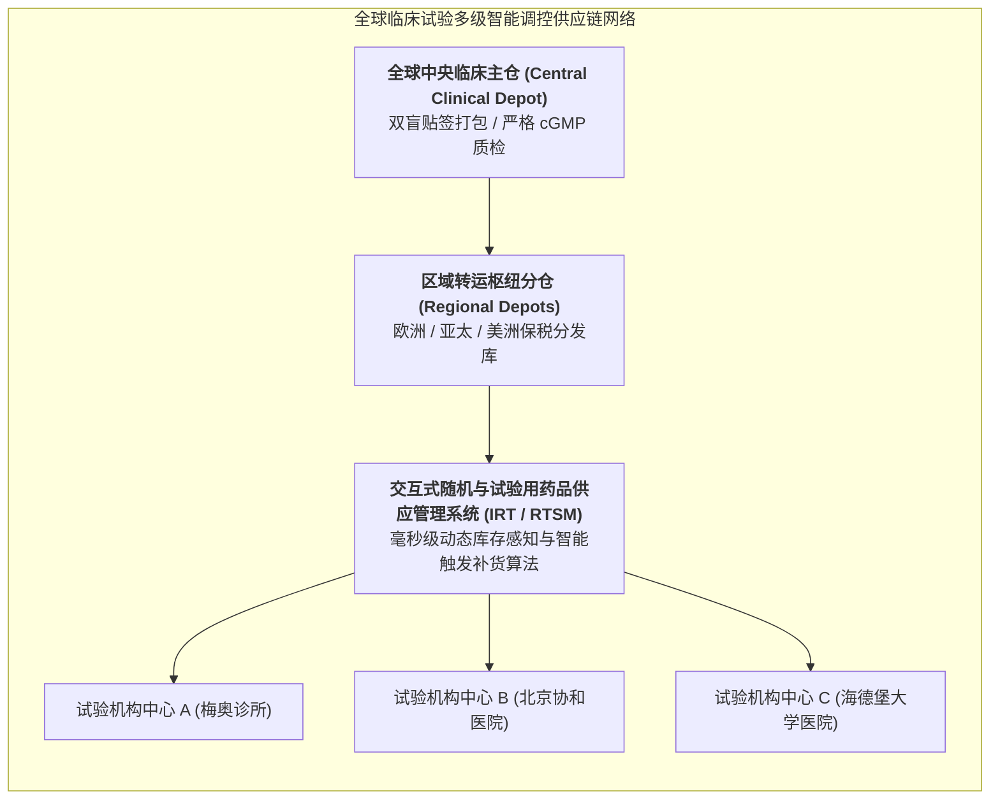

# Lec 11 全球多中心临床试验供应链管理与患者招募依从性保障（Clinical Trial Supply Chain Management & Patient Recruitment）

## TL;DR

- 临床试验供应链（CTSC）的极端严苛约束：双盲包装、严格温控冷链与不可预测消耗。
- 交互式响应技术（IRT / RTSM）在全网药品动态调拨与双盲解盲控制中的应用。
- 全球多中心试验（MRCT）患者招募入组滞后（Enrollment Delays）的运筹学优化。

## 一、临床试验供应链（CTSC）与商业供应链的巨大鸿沟

在普通商业物流中，卡车运送的是已知需求量、条形码公开透明的标准化消费品。
而在全球多中心临床试验（Multi-Regional Clinical Trials, MRCT）中，**临床试验物资供应链（Clinical Trial Supply Chain, CTSC）**面临着全球运筹学中最奇特、最严苛的物理与法规约束：

1. **绝对的双盲包装（Blind Packaging）**：
   - 试验用药品（IP）与阳性对照药或安慰剂，其药片颜色、重量、包衣、甚至味道必须做到**肉眼完全不可辨别的绝对一致**；
   - 包装瓶身只印有唯一的随机序列号，任何仓储物流与医护人员在扫描条码时，绝对看不到瓶子里装的究竟是真药还是假药；
2. **极度不确定的非平稳消耗流**：
   - 全球分布在 15 个国家、100 家医院中心；哪个中心下周会入组几个符合基因突变的患者完全是未知的；
3. **超长海运空运与全程温控冷链**：
   - 单克隆抗体与 mRNA 疫苗必须常年储存在 $-80^\circ\text{C}$ 超低温干冰保温箱中，途中任何一次超过 30 分钟的温度偏移（Temperature Excursion），整箱价值数百万美元的临床物资直接依法全数报废！

## 二、交互式响应技术（IRT / RTSM）的算法中枢

在传统手工作业时代，各医院中心为了防止患者来了没药吃，疯狂申请过度备药，导致全网 50% 以上的昂贵试验药品因为过期而被白白销毁。
现代临床试验全面依托 **IRT（Interactive Response Technology / RTSM）云端控制塔**：

::: definition [IRT 系统三大核心智能职能]
1. **中心化动态患者随机化（Central Randomization）**：
   当北京的医生在电脑上敲入新入组患者的临床指标时，IRT 系统瞬间基于分层区组随机化算法生成该患者的唯一受试者编号；
2. **预测性动态精益补货（Predictive Resupply Algorithm）**：
   系统实时监控该医院中心的手头未拆封库存、以及当前正在接受后续疗程患者的下一次返院随访日历，根据各国际航线的海关清关时延，**自动在安全水位精准触发小批量加急发运发货**；
3. **紧急安全揭盲控制（Emergency Unblinding）**：
   若某位患者在深夜突发严重过敏性休克，急诊抢救医生生命攸关必须知晓他到底吃了什么药：医生经伦理系统授权，可以在 IRT 系统中**一键对该特定单人实施单例精准破盲**，同时确保全网其他所有患者与医生的盲态丝毫不受破坏！
:::

## 三、患者招募滞后（Enrollment Delays）的运筹学优化

在全行业统计中，**超过 80% 的临床试验无法按预定时间表完成患者招募入组**，平均招募延误时间长达 1 至 6 个月。
在新药研发中，**临床试验每延误一天，因专利期流逝带来的潜在商业损失高达 100 万至 800 万美元！**

造成招募断流的两大核心痛点与破解方案：

| 招募核心瓶颈 | 临床传统通病 | 运筹学与数字化破局方案 |
| :--- | :--- | :--- |
| **入排标准过严（I/E Criteria）** | 临床方案制定者闭门造车，写下多达 50 条极其严苛的排除项（如轻微贫血即排除），导致全城找不到几个人符合要求 | 运行真实世界医疗大数据（RWD）沙盘仿真：**测算放宽某项次要生化指标对合格患者人群渗透率的杠杆提升倍数** |
| **患者依从性流失（Patient Drop-out）** | 患者每次随访需要请假长途奔波到省城三甲医院抽血化验，身心俱疲，脱落率高达 30% | 推行**分散式去中心化临床试验（Decentralized Clinical Trials, DCT）**：护士上门抽血、佩戴 IoT 智能可穿戴生命体征监测设备、药品直邮到家（DTP） |

## 我的理解

临床试验供应链是保障现代医学科学探索得以平稳运行的无名底盘。在实验室里合成出神奇的分子只是上篇，如何将这些极度脆弱、带有双盲密码的救命药剂，在毫厘不差的温控状态下准时跨越五大洲送入具体患者的口中，是一场惊心动魄的全球后勤战役。IRT 算法与 DCT 去中心化试验的兴起，展现了运筹系统如何用以人为本的科技力量，打破医院冰冷的高墙，在最艰难的时刻为患者搭建起温暖从容的生命通道。
