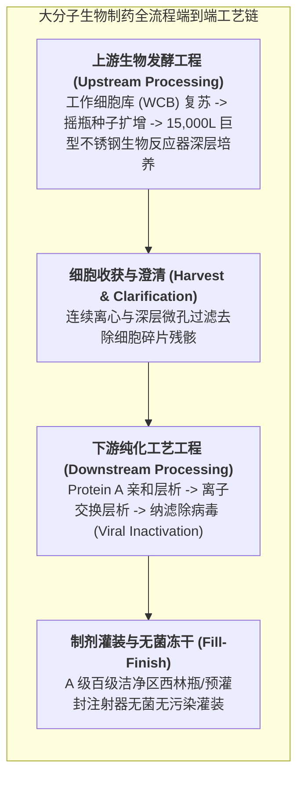

# Lec 12 生物药与小分子化学药工艺制造 CMC、工业化放大与 cGMP 生产质量控制（Biomanufacturing Operations: CMC, Scale-up & GMP Compliance）

## TL;DR

- 化学、制造与控制（CMC）：小分子有机合成与大分子生物药（抗体）工艺本质差异。
- 生物反应器工业化放大（Scale-up）：流体剪切力、溶氧传递与细胞代谢表型漂移挑战。
- 现行良好生产规范（cGMP）质量管理体系：数据完整性（ALCOA+）与批记录审计。

## 一、小分子化学药 vs. 大分子生物药的 CMC 鸿沟

在新药研发注册申报中，**CMC（Chemistry, Manufacturing, and Controls，化学、制造与控制）**是占据申报资料超过一半厚度的核心工程支柱。
在制药工业界，小分子化学药与大分子生物制品（单抗、重组蛋白、抗体偶联药物 ADC）在生产工艺上存在降维式的本质鸿沟：

| 比较维度 | 小分子化学药（Small Molecules） | 大分子生物制品（Biologics / mAbs） |
| :--- | :--- | :--- |
| **典型代表** | 阿司匹林、奥希替尼、帕罗韦德 | 帕博利珠单抗（K 药）、阿达木单抗（修美乐） |
| **分子量规模** | 极小（通常 $< 500\text{ Da}$，数十个原子） | **超大（约 } 150,000\text{ Da} \text{，数万个原子）** |
| **制造技术路径** | 纯有机化学合成反应、结晶纯化 | **活细胞工厂（CHO 仓鼠卵巢细胞）表达培养** |
| **结构均一性** | 确定、精确、具有明确的单一化学晶型 | **高度微观异质性（糖基化、电荷异构体、高级折叠构象）** |
| **产业名言** | **“产品就是分子本身（The Product is the Molecule）”** | **“工艺即是产品本身！（The Process IS the Product!）”** |

## 二、工业化放大（Scale-up）的工程流体力学挑战

在实验室中，生物化学家在 2 升玻璃培养罐里能稳定生产出高纯度、高活性的抗体；
但当工艺放大（Scale-up）到工厂商业化 **12,000 升甚至 20,000 升巨型生物反应器**时，流体力学环境发生了可怕的物理剧变：

::: definition [生物反应器放大的三大核心物理瓶颈]
1. **气-液溶氧传递系数（$k_L a$）不足**：
   万升反应罐深度达数米，底部气体压力巨大，如果加大空气通气量，产生的巨大气泡在液面破裂时会释放惊人的表面张力能量，将极其娇嫩的哺乳动物活细胞**瞬间活活撕裂粉碎**；
2. **搅拌剪切力损伤（Shear Stress）**：
   巨大搅拌桨叶尖端的线速度极高，剪切应力剧增；
3. **混合时延与局部微环境不均一（Mixing Deadzones）**：
   酸碱中和调节液滴入罐内，需要数十秒才能完全扩散均匀，导致罐底细胞长期处于缺氧或局部酸中毒状态，**诱发生物分子关键糖基化修饰（Glycosylation Profile）发生突变漂移**，导致最终抗体完全失去疗效或诱发严重的致死性免疫原性排斥！
:::

现代生物制药工程师利用计算流体力学（CFD）仿真与一次性生物反应器（Single-Use Bioreactors, SUB）技术，在微观流场剪切力与宏观传递效率之间寻找极其精确的平衡工况。

## 三、现行良好生产质量规范（cGMP）与数据完整性（ALCOA+）

药品是直接注入人类血管救命的特殊产品，其生产车间必须受到全天候、最严苛的**现行良好生产质量规范（Current Good Manufacturing Practice, cGMP）**监管。

在 cGMP 审计中，FDA 飞检官员一票否决的最核心红线是**数据完整性（Data Integrity）**。必须严格恪守国际权威的 **ALCOA+ 黄金九大原则**：

::: theorem [ALCOA+ 数据完整性铁律]
1. **可归属性（Attributable）**：每一步仪器操作必须由操作员独立指纹或数字证书签字，严禁共享密码；
2. **清晰易读（Legible）**：所有手写批记录必须清晰，严禁涂改（修改必须划单线并签名注明原因）；
3. **即时记录（Contemporaneous）**：动作发生的瞬间必须当场记录，严禁事后回忆补记或提前“预填”记录；
4. **原始性（Original）**：保留仪器打印出的第一手原始图谱和电子底层原始数据库；
5. **准确性（Accurate）**：无任何篡改修饰与虚假伪造；
6. **+ 完整性、一致性、持久性与可随时调阅获取**。
:::

一旦药企在批记录上犯下数据造假（如为了合格故意删去某批次重金属超标的色谱峰），FDA 会当场签发致命的**“483 表格警示信（Warning Letter）”并查封全厂**，对企业造成毁灭性打击！

## 我的理解

CMC 工艺制造是现代生命工业最坚固的物理硬核。它用冰冷不锈钢管道与微观流体力学，把天才科学家的分子梦想铸造成千千万万人触手可及的救命实物。大分子生物制药中“工艺即是产品”的至理名言，深刻揭示了工程控制的无上尊严——在活细胞复杂的生化脉动中，守住哪怕一个百分点的温度与搅拌剪切力，都是在与混沌博弈。而 cGMP 的铁血纪律，则是人类为纯粹的生命安全筑起的最高神圣祭坛。
