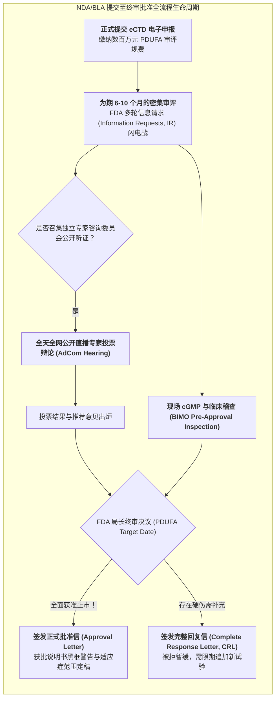

# Lec 13 药品注册申报上市：NDA/BLA 资料编撰、专家咨询委员会答辩与审评审批（Regulatory Submission: NDA/BLA Filings, Advisory Committees & Approval）

## TL;DR

- 新药申请（NDA）与生物制品许可申请（BLA）终审资料组织与电子申报（eCTD）。
- 处方药申报者付费法案（PDUFA）目标日期管理与多轮信息请求（IR）战术攻防。
- FDA 专家咨询委员会（AdCom）公开听证会模拟答辩与上市表决博弈心理学。

## 一、新药上市申报（NDA/BLA）的终局战役

当新药成功打赢 III 期确证性临床试验后，研发长征终于进入了最后向监管当局申请全面上市销售许可证的终极时刻：
- **化学小分子新药申请（New Drug Application, NDA）**；
- **大分子生物制品许可申请（Biologics License Application, BLA）**。

这是一场浩瀚的数字与法规战役。整套申报资料必须遵循人用药品注册技术要求国际协调会（ICH）制定的通用技术文件（Common Technical Document, CTD）规范，包含五大模块：
- **模块 1（行政信息与拟定标签）**：包含各国家地区特异性的法律文件、专利声明与说明书草案；
- **模块 2（CTD 概要）**：由首席科学家与医学总监撰写的临床前、CMC 与临床终点高度浓缩综述；
- **模块 3（质量 CMC）**：原料药合成路线、制剂工艺放大参数、杂质谱分析与 36 个月长期稳定性试验数据；
- **模块 4（非临床毒理研究报告）**：全套动物药代动力学、致畸性、致突变性与致癌性切片原始数据；
- **模块 5（临床研究报告 CSR）**：所有 I/II/III 期试验的完整临床总结、每个独立病例的病例报告表（CRF）、严重不良事件（SAE）叙述以及经 FDA 验证可复算的 SAS 原始统计代码与数据集。

药企监管事务部（Regulatory Affairs, RA）团队必须像精密的瑞士钟表一样，确保每一个交叉引用链接毫厘不差，任何格式错误都可能导致申报资料被药监局直接“拒收打回（Refuse to File, RTF）”！

在审评全过程中，药品监管机构不仅坐在办公室内审阅海量电子文档，还会派出由资深督查官组成的团队执行严苛的现场核查：
- **生产现场批准前检查（Pre-Approval Inspection, PAI）**：督查官直接进驻商业化生产车间，审查洁净区气流模式、验证批次批记录与培养基模拟灌装测试，确保工艺真实可放大；
- **生物研究监测（Bioresearch Monitoring, BIMO）稽查**：督查官深入关键临床研究中心（PI 所在医院），翻阅原始纸质病历与知情同意书签字原件，核查电子数据库录入记录是否存在篡改或遗漏。任何重大合规缺陷都会直接扼杀获批希望。

## 二、PDUFA 目标日期与信息请求（IR）高压攻防

美国国会于 1992 年通过划时代的**《处方药申报者付费法案》（PDUFA）**：
- 药企在提交 NDA 时向 FDA 支付数百万美元的高额申报费；
- 作为交换，**法律对 FDA 施加极其严苛的审评时限倒计时**：必须在确定受领后的规定期限（标准审评 10 个月，优先审评 6 个月）前，必须向企业出具最终裁决结论，该截止日期被称为 **PDUFA 目标日期（PDUFA Goal Date）**。

在长达数月的审评倒计时中，药企每天都处于高度戒备状态：
- FDA 审评团队会随时向企业抛出数十封极其刁钻的**信息请求函（Information Request, IR）**（如要求在 48 小时内用新的统计截断点重新跑全套临床生存期分析、或要求补充某微量降解杂质的致突变毒理说明）；
- 药企 RA 与医学统计团队必须 24 小时待命，在极限定时内提供无懈可击的数据答复，任何回答迟滞或漏洞都会直接导致审评钟表被按暂停键！

## 三、专家咨询委员会（Advisory Committee）公开展台博弈

当药物的作用机制极其前沿、或者 III 期临床试验数据存在争议（如有效性勉强达标但伴随罕见肝毒性）时，FDA 会召集由全美最顶尖独立肿瘤学家、生物统计学家、流行病学家和患者代表组成的**咨询委员会（AdCom）召开全天公开听证会**。

AdCom 听证会堪称医药界最残酷的“世纪大公堂”：
- **全程面向全球公众和媒体进行无延迟高清视频直播**；
- 上午由药企医学副总裁带领科学家团队进行陈述答辩，下午由 FDA 审评官员针锋相对地登台公布反方挑刺报告；
- 随后是催人泪下的**患者公开质询陈述（Public Hearing）**：患者家属推着轮椅登台哭诉新药如何奇迹般延长了生命、或者抗议严重的副作用；
- 最终，委员会全体专家当场按下投票器，对关键问题进行举手表决：“基于现有数据，该药物的临床获益是否显著大于潜在风险？”

::: insight
尽管 FDA 法律上不强制受 AdCom 投票结果约束，但历史上 **FDA 的终审裁决与 AdCom 专家投票结果的高度吻合率超过 85% 至 90%**！一场成功的 AdCom 答辩不仅需要钢铁般严密的统计证据，更需要高超的叙事修辞、真诚面对缺陷的谦逊态度，以及对患者深切痛苦的极大共情。
:::

## 我的理解

NDA 注册申报是现代科技文明在法治框架下最庄严的结案陈词。数千名科学家十余年的青春与数亿美元的冒险，最终全部汇聚在这场直面监管权威与全社会公众的终极大审判前。专家咨询委员会的公开辩论，展现了科学共同体面对生命决策时最宝贵的阳光与透明——在真理面前，没有黑幕，没有权威特权，唯有靠无懈可击的数据与不可动摇的良知，才能最终叩开上市拯救苍生的大门。
