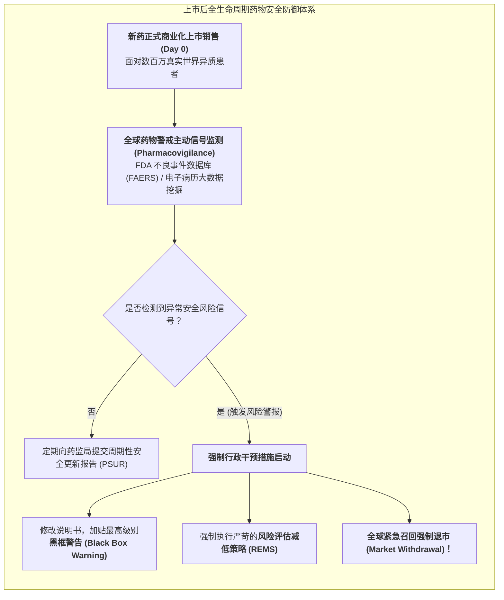

# Lec 14 上市后监测：IV 期真实世界研究、药物警戒与风险评估减低策略 REMS（Post-Market Surveillance: Phase IV Trials, Pharmacovigilance & REMS）

## TL;DR

- 上市绝非终点：从受控小样本临床向真实世界海量异质患者（RWD）的跃迁风险。
- 药物警戒（Pharmacovigilance）系统：不良事件自发报告（FAERS）与信号检测算法。
- FDA 风险评估与减低策略（REMS）全流程药物安全风险闭环管控工具集。

## 一、真实世界（Real-World）的残酷惊涛

许多非专业人士误以为只要拿到 FDA 的上市批文，新药研发就功德圆满大功告成了。
然而，在资深临床科学家眼中：**上市获批，恰恰是另一场更漫长、更凶险的实战大考的真正开端！**

III 期临床试验虽然严谨，但其固有限制无法回避：
- **样本量极其有限**：III 期最多入组几千人，根据概率二项分布法则，发生率低于 $1/10,000$ 的罕见但致命的严重不良反应（如特异质性急性肝坏死或重症多形红斑），在 III 期试验中极大概率**一次都不会出现（完全处于盲区）**！
- **受试人群被高度净化筛选**：排除了老年人、孕妇、儿童、以及合并有严重糖尿病和肾衰竭的复杂慢病患者；
- **给药依从性被严密监督**。

一旦药品获批正式推向大众市场：
新药在一夜之间注入成百上千万身体底子千差万别、每天同时服用 5 种其他降压药、甚至偶尔还偷偷饮酒的真实世界异质患者体内。任何潜伏在暗处的罕见致命毒性，瞬间会被海量人群呈放大镜式彻底引爆！

## 二、药物警戒（Pharmacovigilance）与统计学信号挖掘算法

药企与监管机构必须建立 24 小时全天候运转的**药物警戒（Pharmacovigilance, PV）中枢**：
- 医生、药师、护士甚至患者本人，通过美国 FDA 不良事件报告系统（FAERS）或黄卡系统（Yellow Card Scheme）自发上传用药后出现的意外不良事件（AE）；
- PV 团队必须在法定时限内（如致死性突发事件必须在 7 至 15 天内）向监管当局提报个例安全性报告（ICSR）。

### 比例失衡测量法（Disproportionality Analysis）
面对海量报告库，如何从嘈杂的背景噪声中判断某种罕见疾病究竟是“患者自身基础疾病偶发”，还是“该新药真实诱发”？
生物统计学运用**报告比值比（Reporting Odds Ratio, ROR）**与**比例报告比（Proportional Reporting Ratio, PRR）**进行四格表卡方检验：
$$PRR = \frac{a / (a + b)}{c / (c + d)}$$
其中 $a$ 为目标药物引起目标不良事件的报告数，$b$ 为目标药物引起其他所有事件数，$c$ 为全库所有其他药物引起该目标事件数。
当 $PRR \ge 2$ 且卡方值 $\chi^2 \ge 4$ 时，算法自动点亮红色预警灯——**判定出现明确的潜在安全危险信号（Safety Signal）！**

## 三、FDA 风险评估与减低策略（REMS）全流程工具集

对于那些疗效确切卓越但伴随严重已知毒副作用的高危药物，FDA 不会一棍子打死禁止上市，而是依法强制附带**风险评估与减低策略（Risk Evaluation and Mitigation Strategies, REMS）**：

::: theorem [REMS 四大严酷管控等级]
1. **用药指南发放（Medication Guide）**：强制药剂师在向患者发药时，必须逐人发放易于阅读的安全须知折页；
2. **医护人员沟通计划（Communication Plan）**：向全国主治医生寄送“致医疗专业人士公开信（Dear Healthcare Provider Letters）”，普及禁忌与毒性早期先兆；
3. **确保安全使用的强制要素（ETASU，最严厉级别！）**：
   - **处方医师资质认证**：医生必须先在 FDA 官网通过专项安全培训考试并取得认证代码，才有权开具该药处方；
   - **定点特许药房发药**：普通社区药店严禁铺货，仅允许少数几家专业特药药房发货；
   - **患者强制登记与用药前化验闭环**：例如口服异维A酸（治疗重度痤疮）由于具有强致畸性，患者必须在专用系统注册，**必须每月提供三甲医院阴性妊娠化验单，系统才允许药房释放当月的 30 天药量！**
:::

## 我的理解

上市后监测与药物警戒是医学伦理在商业世界漫长岁月中的无声守望。它粉碎了“一劳永逸、上市大吉”的短视幻象。面对庞大未知的人体宇宙，科学家的认知永远是局限而谦逊的。从海量真实世界数据中敏锐捕捉那微弱的一丝异常信号，宁可自断臂膀在包装盒上印上刺目的黑框警告，也要保全千千万万患者的无辜生命。这不仅是法律法规的硬性枷锁，更是一个崇高的行业流淌在血液中最坚实的良知底色。
