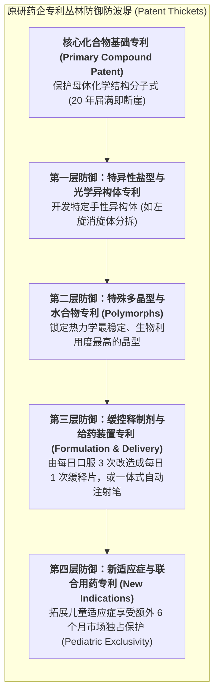
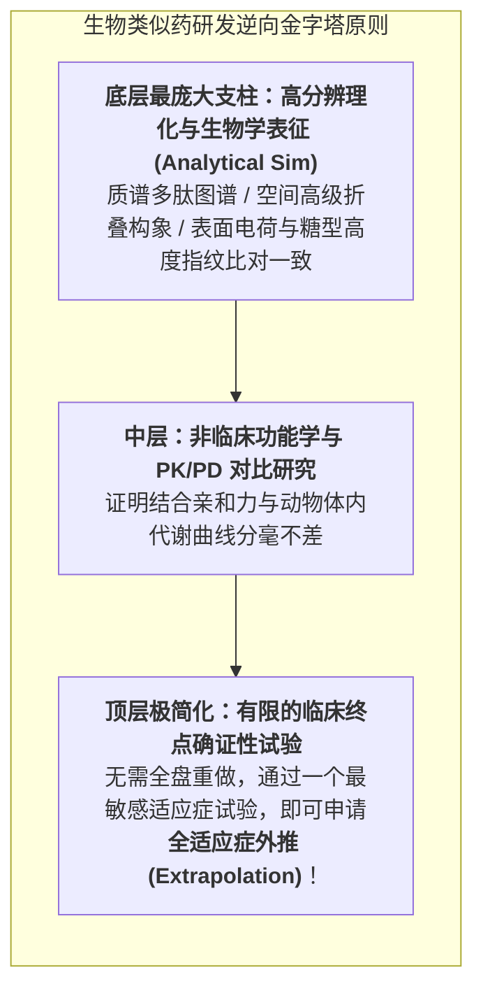

# Lec 15 医药知识产权保护、专利悬崖防御策略与生物类似药竞争（Pharmaceutical IP, Patent Cliff, and Biosimilars）

## TL;DR

- 医药专利常青化（Patent Evergreening）：晶型、手性、制剂与适应症专利保护群布局。
- 美国 1984 年《哈奇-韦克斯曼法案》（Hatch-Waxman Act）与仿制药简略申请（ANDA）博弈。
- 生物类似药（Biosimilars）法规审批技术路径（BPCIA）与微观相似性确证体系。

## 一、专利悬崖（Patent Cliff）的灭顶之灾

在制药行业，跨国巨头最恐惧的梦魇被称为**“专利悬崖（Patent Cliff）”**。
以辉瑞（Pfizer）旗下降血脂“世纪重磅炸弹”立普妥（Lipitor，阿托伐他汀）为例：
- 在专利保护期内，立普妥全球年度峰值销售额曾突破 **130 亿美元**，以极高的毛利率源源不断为辉瑞输送数以百亿计的现金流；
- 2011 年底，立普妥的美国核心化合物专利正式届满到期；
- 仅仅在专利失效后的**短短几天之内**，十余家仿制药药企的廉价版本瞬间涌入各大连锁药房；
- 药品的销售单价暴跌 90% 以上，**辉瑞在该药上的季度销售额瞬间发生断崖式暴跌 80% 以上！**

这种商业模式特征在整个工业界绝无仅有：
- 一架波音飞机即使设计图纸公开，其他工厂若没有数十年的精密航天制造积淀，也绝不可能在一夜之间仿造出合格的干线客机；
- 但化学小分子药物的化学式与晶型结构一旦公之于众，仿制药化工厂只需要数周时间就能在反应釜中合成出质量毫无二致的活性成分。
- 因此，对于重磅药物而言，核心专利失效的瞬间便意味着暴利时代的戛然而止。

面对专利悬崖的无情吞噬，原研药企动用了极其庞大的顶尖知识产权法务团队，构建起复杂的**专利丛林（Patent Thickets）与常青化战略（Patent Evergreening）**。其核心战略并不是依赖单一的化合物专利，而是在产品全生命周期中持续挖掘第二代、第三代防御性专利圈层：

通过这一层层精密布设的专利丛林，原研药企往往能够将药品的实质性垄断市场独占期延长 5 至 10 年之久。例如将原本每日需要口服三次的普通平片改造成每日仅需口服一次的渗透泵缓释控释片，或者为注射剂开发专利保护的智能预充式自动注射笔，从而诱导医生与患者在原研药专利到期前完成用药习惯转移，使廉价仿制药即便上市也只能抢夺萎缩的老剂型市场。

## 二、1984 年《哈奇-韦克斯曼法案》与仿制药博弈

美国国会于 1984 年通过的**《药品价格竞争与专利期补偿法案》（即著名的《哈奇-韦克斯曼法案》，Hatch-Waxman Act）**，彻底奠定了现代全球仿制药产业的微观博弈规则：

::: theorem [哈奇-韦克斯曼法案的两大历史性妥协]
1. **给原研药企以“补偿（Patent Term Restoration）”**：
   考虑到新药在漫长研发和审批期间浪费的专利期，法律允许原研药企在获批后申请**最长 5 年的专利期补偿延展**；并确立了 FDA 橙皮书（Orange Book）专利登记制度；
2. **给仿制药企以“绿灯（ANDA & Bolar Amendment）”**：
   - 确立了**简略新药申请（Abbreviated New Drug Application, ANDA）**：仿制药企**无需重复烧钱开展耗时数年的漫长毒理和临床试验**，只需在一二十名健康人身上证明其与原研药达到**生物等效性（Bioequivalence, BE）**，即可合法获批上市！
   - **波拉例外条款（Bolar Exemption）**：允许仿制药企在原研药专利尚未到期前数年，即可合法采购原料药开展前期的 BE 试验准备，确保专利到期的次日凌晨仿制药能瞬间上架！
3. **“第四类专利挑战（Paragraph IV Certification）”首仿暴利奖励**：
   如果仿制药企敢于主动向法庭起诉，证明原研药企外围的常青化专利是“无效且不侵权的”；**第一家成功推翻专利的“首仿药企”，将享有长达 180 天的独家仿制药市场独占期！**在这半年内，全美只有原研药和这家首仿药两家分食市场，首仿药企单凭这 180 天就能净赚数亿美元暴利！
:::

## 三、生物类似药（Biosimilars）的极高技术壁垒

当专利悬崖席卷单抗等大分子生物药时，游戏规则再次被改写。
根据美国 2010 年《生物制品价格竞争与创新法案》（BPCIA）与欧洲 EMA 规定：
- 活细胞表达的单抗分子极其巨大复杂，根本不存在像小分子那样 100% 化学绝对复制的“仿制药”；
- 只能被称为**生物类似药（Biosimilars）**！

生物类似药的研发门槛高达 **1 亿至 2 亿美元**（远超传统化学仿制药的几百万美元），需要极高水平的逆向工程与细胞发酵控制能力，使得大分子专利悬崖的降价曲线远比小分子平缓温和得多。

## 我的理解

医药知识产权与专利悬崖博弈，是现代资本主义微观法学与工程智慧交织的最精妙棋局。它是全社会在“激励原创科学冒险”与“保障平民平价救命用药”之间艰难寻找动态平衡的产物。原研药企用专利丛林拼死捍卫其合法的资本回报，而仿制药先锋则如同手握屠龙刀的破壁者，凭借高超的逆向工程与法务奇袭，将昂贵的天价药打入寻常百姓家。这种在法律擂台上的激烈抗衡，正是推动人类医药文明生生不息、滚滚向前的核心原动力。
