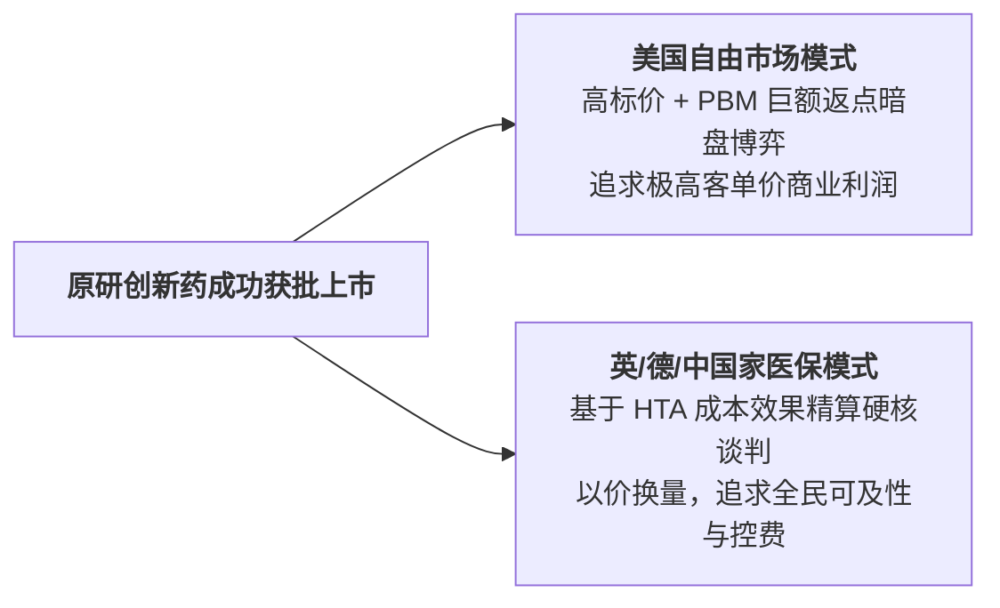
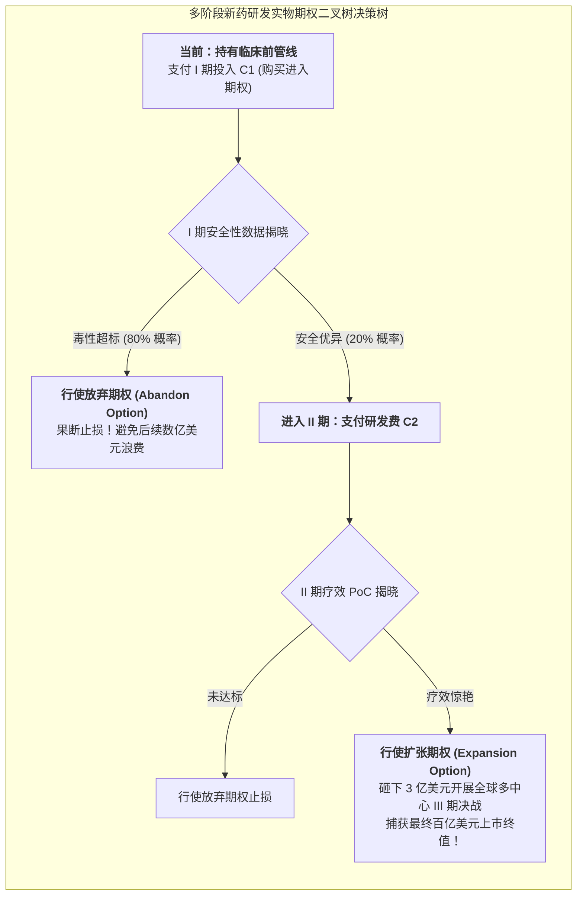
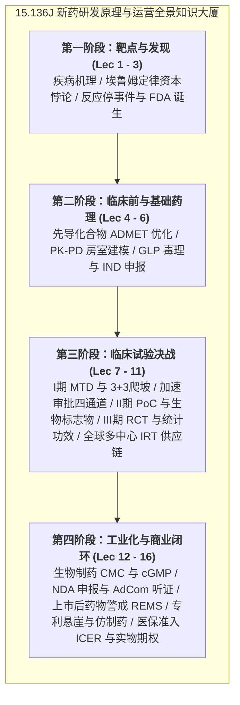

# Lec 16 创新药医保准入定价策略、卫生技术评估 HTA 与研发管线期权估值模型（Drug Pricing, Market Access, and Portfolio Valuation）

## TL;DR

- 全球创新药定价双轨制：自由市场自主定价（美国）vs. 国家单一买方医保控费谈判。
- 卫生技术评估（HTA）核心数学工具：质量调整寿命年（QALY）与增量成本效果比（ICER）。
- 跨国药企研发管线组合管理的实物期权（Real Options）动态价值评估与全课程总结。

## 一、全球药品定价与市场准入（Market Access）的双轨世界

一款新药哪怕疗效再惊艳、哪怕拿到了 FDA 的最高等级批准，如果在**市场准入（Market Access）与定价报销谈判**中惨遭滑铁卢，其商业化命运依然是一具冰冷的僵尸。
当今世界存在两大截然相反的定价哲学体系：

1. **美国模式：自由市场资本驱动（Free Market Pricing）**：
   - 法律禁止联邦政府直接干预新药出厂标价（List Price / WAC）；
   - 药企拥有极高的自主定价权（单疗程数十万美元的抗癌药比比皆是）；
   - 随后由强势的第三方**药品福利管理者（Pharmacy Benefit Managers, PBMs，如 CVS Caremark、Express Scripts）**代表各大商业保险公司，与药企进行幕后极为残酷的**高额隐形返点回扣（Rebates）谈判**，换取进入保险报销目录（Formulary）；
2. **欧洲与中国模式：国家单一买方主权谈判（Single-Payer monopsony）**：
   - 英国国家卫生与临床优化研究所（NICE）、德国 G-BA、以及中国国家医保局（NHSA）；
   - 政府作为全纳税人的唯一采购代理人，手握“十四亿人超大单一市场”的绝对主权谈判筹码，通过**卫生经济学模型精算与现场极限拉锯谈判**，直接将药价砍去 50% 至 80%！

## 二、卫生技术评估（HTA）：质量调整寿命年与 ICER 判定门槛

在现代卫生经济学（Health Economics）中，评价一款新药到底“值不值这个天价”，拥有一套严密的数学量化工具：

::: definition [质量调整寿命年（Quality-Adjusted Life Year, QALY）]
将患者存活的纯物理寿命年数，乘上反映生活健康质量的权重系数 $q \in [0, 1]$（1 代表完全完全健康，0 代表死亡，负数代表生不如死的极端痛苦）：
$$QALY = \sum_{t=1}^T q_t$$
例如：某款新药让晚期癌症患者多存活了 2 年，但这 2 年内患者因严重副作用卧床不起，健康生活质量评价仅为 0.5；则该药带来的净临床获益为 $2 \times 0.5 = 1.0\text{ 个 QALY}$。
:::

::: theorem [增量成本效果比（Incremental Cost-Effectiveness Ratio, ICER）]
设新药相比现有老药的治疗总花费增量为 $\Delta C = Cost_{new} - Cost_{old}$；
带来的健康寿命增量为 $\Delta E = QALY_{new} - QALY_{old}$。
增量成本效果比定义为：
$$ICER = \frac{\Delta C}{\Delta E} = \frac{Cost_{new} - Cost_{old}}{QALY_{new} - QALY_{old}}$$
其物理含义为：**为了帮患者多争取 1 个完全健康的生命年（QALY），全社会医疗体系需要额外支付多少净金钱代价！**
:::

### 意愿支付门槛（Willingness-to-Pay, WTP Threshold）
世界卫生组织（WHO）与英国 NICE 确立了严格的支付门槛：
- 如果 $ICER < 1 \sim 3 \times \text{人均 GDP}$（在英国通常为 30,000 英镑/QALY）：表明该药**具有极佳的卫生经济学性价比，医保予以全额报销纳保！**
- 如果 $ICER > 3 \times \text{人均 GDP}$：表明该药过度昂贵、性价比极低，医保机构断然拒绝支付，除非药企主动跳水降价！

## 三、研发管线组合管理的实物期权（Real Options）估值

在大型跨国制药巨头（如罗氏、诺华、辉瑞）的战略总监办公室内，每天需要统筹管理着数十个甚至上百个处于不同研发阶段的在研分子项目。
传统的静态现金流贴现模型（Discounted Cash Flow, DCF）与净现值（NPV）模型存在致命缺陷：
- 静态 NPV 假设项目一旦启动就必须一条路走到黑，完全忽略了管理层在研发过程中根据不断揭晓的临床试验数据调整决策的动态灵活性；
- 这种缺陷在面对长周期、高风险的新药研发时，往往会系统性地低估高风险早期项目的真实战略价值，导致许多潜在重磅药物被错误地扼杀在摇篮里。

现代生物医药金融工程全面采用**实物期权估值模型（Real Options Valuation, ROV）**：
- 将每一阶段的临床研发费用视为购买下一阶段试验权利的期权费（Option Premium）；
- 将研发推进至下一阶段视为行使期权（Exercise Option）；
- 将中途终止试验视为行使放弃期权（Abandonment Option）。

实物期权模型深刻揭示出：**研发流程中每一个阶段门的“中途叫停放弃权”，本质上是一份极其昂贵且宝贵的看跌期权（Put Option）！**
- 这种期权价值随着基础资产波动率（研发不确定性）的上升而单调递增；
- 正是由于药企拥有在临床数据不达标时迅速叫停项目、斩断后续高达数亿美元资金黑洞的主动选择权，高风险早期管线在组合管理中才展现出巨大的期权凸性（Convexity）；
- 这种在不确定性逐步揭晓过程中敏捷配置资本、灵活调整航向的战略选择权，构成了创新型药企应对巨大宏观波动的终极护城河。

## 四、MIT 15.136J 全课程终极大盘点

回顾麻省理工学院 15.136J 新药研发原理与实践运营的全部篇章，我们跨越了现代生化科学、临床医学、工程制造、法律监管与金融商业最惊心动魄的跨学科征途。从最早的致病靶点筛选，到最终的医保价值定价，全课程十六讲内容环环相扣，构筑起现代生物医药工业的完整知识大厦：

在这座知识大厦中，每一个模块都对应着工业界极其严密的方法论沉淀：
- **科学发现与机制验证**：在微观分子与细胞水平上找到疾病发生的关键开关，将基础生命科学突破转化为可成药的候选先导化合物；
- **机体互动与转化桥梁**：通过定量药理学与动物毒理模型，跨越基础科研与人体临床试验之间深不见底的“死亡之谷”；
- **循证临床与严谨确证**：在真实患者群体中通过大规模双盲随机对照试验，用坚不可摧的数理统计证据向全球监管机构证明药品的生存获益；
- **工业化放量与商业闭环**：通过严苛的 GMP 质量体系保障数以千万计患者的用药安全，并通过精密的知识产权布局与医保卫生经济学评估实现研发资本的正向循环回流。

::: insight
新药研发不仅是一门关于分子的生化科学，更是一套关于风险、资本、法律与伦理的宏伟系统工程。它融合了人类最顶尖的智力创造、最勇敢的商业冒险，以及对同胞疾苦最深沉的悲悯关怀。
:::

## 我的理解

15.136J 是一堂真正关于生命尊严与人类勇气的终极课程。从试管中微弱的纳摩尔级分子结合，到万人双盲随机对照临床中的生死搏杀；从巨型生物发酵罐中对流体剪切力的极致驯服，到联合国与国家医保谈判桌前对每一分钱卫生效益的严苛算计——新药研发展现了人类文明在面对疾病与死亡时所能迸发出的最高秩序意志。掌握了这套端到端的全景工程图谱，我们就真正读懂了现代生物医药产业的底层密码，也更加坚定了用科学与理性点亮人类生命希望的崇高信仰。
