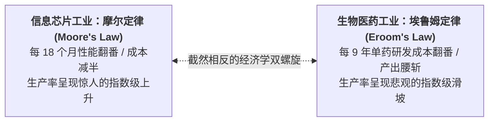

# Lec 2 生物医药产业演进经济学：高研发资本支出与生产率悖论（Evolving Economics of the Pharmaceutical Industry）

## TL;DR

- 医药产业经济学奇观：埃鲁姆定律（Eroom's Law）对摩尔定律（Moore's Law）的倒错映射。
- 研发资本化支出折现与资本成本加权平均（WACC）：创新药管线净现值（rNPV）估值。
- 专利保护独占期（Exclusivity）与研发沉没投资回收的微观经济学博弈。

## 一、埃鲁姆定律（Eroom's Law）：医药界的生产率悖论

在信息技术行业，摩尔定律（Moore's Law）统治了半个世纪：半导体芯片的计算性能每 18 个月翻倍而成本减半。
然而，在生物医药行业，杰克·斯坎内尔（Jack Scannell）于 2012 年在《自然》杂志上提出了令人窒息的**埃鲁姆定律（Eroom's Law，即 Moore 反向拼写）**：
**自 1950 年以来，全球每十亿美元通胀调整后研发支出所能换来的 FDA 获批新药数量，大约每隔 9 年就严格腰斩减半（呈现出持续的指数级暴跌！）！**

### 为什么技术越先进，新药研发却越来越贵？
1. **“低垂的果实已被摘尽”假说（Better-Than-The-Beatles Problem）**：
   在过去，青霉素、阿司匹林、降压药等容易发现且药效震撼的基础化学药早已上市。今天任何在研新药必须证明自己**显著优于现有的存量标准疗法（SOC）**，研发难度呈几何级数陡增；
2. **监管安全红线极其严苛（The Cautious Regulator）**：
   经历历史悲剧后，FDA 对微小副作用的容忍度降至冰点，临床试验招募的患者样本量从过去的几百人暴增到数万人，临床费用呈天文数字膨胀；
3. **临床前有效性在人体内的脱节**：
   小鼠动物实验的成功，极难转化为人体内复杂异质环境的临床获益。

## 二、研发资本成本与管线风险调整净现值（rNPV）

在华尔街与生物医药风投（Biotech VC）眼中，一个新药研发管线不仅是一组分子，更是一张**跨越 10 年的高风险现金流折现表**。

由于研发周期跨度长达十余年，资本是有极其昂贵的时间价值的（药企的加权平均资本成本 WACC 通常高达 **10% 至 12%**）。
传统 DCF 模型无法处理极高的临床失败淘汰率，必须引入**风险调整净现值（Risk-adjusted Net Present Value, rNPV）**：

::: theorem [rNPV 计算模型]
设新药研发分为 $T$ 个阶段，第 $t$ 阶段的研发费用为 $C_t$，该阶段通过的累积联合概率为 $P_t$，上市后第 $k$ 年的商业化自由现金流为 $CF_k$：
$$rNPV = \sum_{k=上市}^{专利到期} \frac{P_{上市} \cdot CF_k}{(1 + WACC)^k} - \sum_{t=1}^{研发期} \frac{P_t \cdot C_t}{(1 + WACC)^t}$$
:::

::: example [资本时间价值的残酷惩罚]
假设一款抗癌药在 12 年后上市，每年带来 10 亿美元净现金流。按 11% 的折现率：
第 12 年获得的 10 亿美元，折现到今天仅值：
$$\frac{10 \text{ 亿}}{(1 + 0.11)^{12}} \approx 2.85 \text{ 亿美元}！$$
这意味着：**研发周期每延误或拉长 1 年，管线的资本现值就会被无情蒸发削减上亿美元！** 这也解释了为什么跨国药企对临床试验进度施加了近乎疯狂的严苛催促。

## 三、专利独占期（Patent Exclusivity）与资本回收窗口

创新药研发能够维持万亿美元规模资本运转的唯一支柱，是世界各国法律赋予的**专利排他独占权（Patent Monopoly）**。

- 专利有效期通常为 20 年（从提交化合物分子结构专利申请之日算起）；
- 但由于研发和临床试验耗去 10 至 12 年，**新药获批上市后实际享受的“无竞品垄断收割期”往往仅剩下极其短暂的 6 至 9 年**；
- 在这短短几年内，药企必须定出极高的高昂价格，不仅要收回本药的研发支出，更要弥补此前失败的数十个夭折项目的全部沉没损失；
- 独占期一旦届满，将遭遇断崖式的**“专利悬崖（Patent Cliff）”**，仿制药涌入将价格瞬间打掉 90%！

## 我的理解

医药产业演进经济学是一部充满悲壮与狂赌色彩的现代资本史诗。埃鲁姆定律冷峻地嘲弄着人类对技术线性的盲目自负，它提醒我们生命系统的极端复杂性绝非晶体管开关那般简单。在这场长达十余年的资本马拉松中，专利制度如同保护创新火种的唯一防风罩。理解 rNPV 和折现率的残酷算法，才能深刻领悟为什么医药企业的核心竞争力不仅是实验室的化学合成，更是在风险汪洋中精细运筹资本生命周期的金融架构能力。
