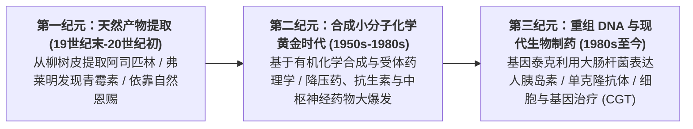
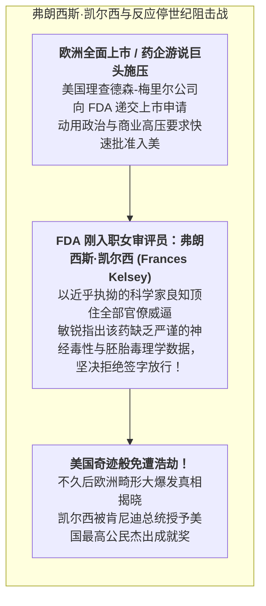

# Lec 3 世界现代药学史、反应停事件与全球药品监管体系演化（History of Pharmaceuticals & Regulatory Framework Evolution）

## TL;DR

- 世界药学史的三大技术浪潮：天然产物提取、合成小分子化学到现代重组蛋白生物制药。
- 全球药品监管的惨痛分水岭：反应停（Thalidomide）致畸灾难与弗朗西斯·凯尔西的传奇阻击。
- 美国《柯弗瓦-哈里斯修正案》（1962）确立现代 FDA“安全且有效（Safe and Effective）”双重金标准。

## 一、世界现代药学的三大历史纪元

人类与疾病的博弈史，是一部伴随着基础化学、实验物理学、微生物学与分子生物学底层技术范式跃迁的宏伟史诗。在过去的两个世纪中，药物创制从最初依靠经验主义的草药神农尝百草，逐步进化为建立在量子化学计算、高精度冷冻电镜和精准基因工程之上的现代生命工业科学。

纵观整个现代药学科技的发展脉络，全球制药工业经历了三次决定性的技术飞跃与产业重构，每一次跨越都将人类对抗绝症与细菌病毒的防线推向了崭新的维度：

这三次技术纪元的交替，不仅深刻重构了全球制药工业的研发与制造供应链，更在一次次血与泪的惨痛教训中，推动了全球现代药品法律与伦理监管体系的浴血重生。

然而，在产业早期狂飙突进的背后，监管法律的滞后曾酿成数起人类历史上最惨烈的人间悲剧。

## 二、反应停（Thalidomide）惨案与监管现代性的诞生

20 世纪 50 年代末，德国格兰泰公司（Grünenthal）研发上市了一种名为**沙利度胺（Thalidomide，商品名“反应停”）**的镇静催眠药物。
该药被宣称“极其安全无毒，甚至可以作为孕妇晨吐早孕反应的止吐神药”，迅速风靡欧洲、日本、加拿大、澳洲等全球 40 多个国家。

然而，短短两三年内，全球医学界惊恐地发现：
- 欧洲和日本等国突然爆发了数以万计的畸形新生儿！
- 这些婴儿四肢短小畸形、手脚直接长在躯干上，宛如海豹的鳍肢，被称为**“海豹肢畸胎（Phocomelia）”**；
- 全球累计出生了超过 **12,000 名严重海豹畸形儿**，并伴随数以万计的死胎与流产！
后经严密毒理学追踪证实：沙利度胺具有强烈的致畸性（Teratogenicity），其手性异构体能够剧烈破坏胎儿肢芽血管的正常生成！

## 三、1962 年《柯弗瓦-哈里斯修正案》：现代药监的金标准奠基

反应停惨案的全球爆发彻底震醒了国际社会。美国国会迅速于 1962 年以全票压倒性通过了划时代的**《柯弗瓦-哈里斯药品修正案》（Kefauver-Harris Drug Amendments of 1962）**：

::: theorem [现代药物监管的三大革命性支柱]
1. **确证有效性（Substantial Evidence of Effectiveness）**：
   在此法案之前，法律仅要求药企证明药品“无急性毒性（Safe）”即可上市；此修正案首次强制立法：**新药必须通过充分且良好受控的人体临床试验（Adequate and Well-Controlled Clinical Trials），严格确证其确实具有宣称的疗效（Effective）！**
2. **知情同意权（Informed Consent）**：
   强制要求任何参与药物试验的患者，必须在完全知晓潜在风险的前提下自愿签署书面知情同意书，终结了将病人充当实验小白鼠的黑暗历史；
3. **药品不良反应上市后监测（Post-Marketing Reporting）**与 **良好生产质量规范（cGMP）**的法定确立。
:::

现代美国 FDA、欧洲 EMA 及中国 NMPA 所执行的一切临床试验分期（Phase I-IV）、盲法对照与安全性审查规程，全部源自 1962 年这场浴血重生的立法革命。

## 我的理解

一部药品监管史，就是人类在血与泪的教训中艰难淬炼理性的苦难史。没有哪项法律法规是从天而降的官僚设计，FDA 规则手册上的每一个严格条款，背后都镌刻着曾经逝去的无辜生命。弗朗西斯·凯尔西博士在汹涌商业游说面前所展现的科学家脊梁，向我们诠释了什么是真正的专业敬畏。监管机构绝不是阻碍新药上市的绊脚石，而是守护整个人类社会免于盲目贪婪吞噬的最坚固防波堤。
