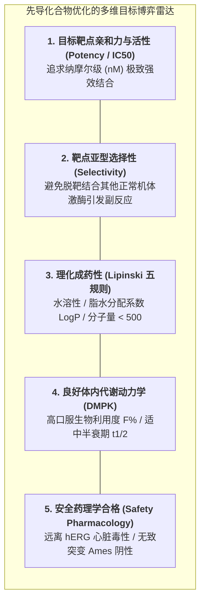

# Lec 4 临床前药物开发：先导化合物优化、体外药效与安全药理学（Preclinical Drug Development: Lead Optimization & Safety Pharmacology）

## TL;DR

- 先导化合物优化（Lead Optimization）：在活性、选择性与成药性（Druggability）之间寻找黄金平衡。
- ADMET 属性微观剖析：吸收（A）、分布（D）、代谢（M）、排泄（E）与毒性（T）。
- 安全药理学核心组合（Core Battery）：hERG 钾通道心脏毒性与中枢神经呼吸安全筛查。

## 一、先导化合物优化（Lead Optimization）的多目标优化困境

当药物化学家通过高通量筛选锁定了一个对靶点具有强效抑制作用的“苗头化合物（Hit）”时，研发长征才刚刚走出第一步。
试管里的强效抑制分子，绝大多数**根本无法直接给活体生物口服使用**：
- 它可能分子量过大、水溶性极差，吃进胃里完全像沙子一样无法被肠道吸收；
- 它可能刚被吸收进入血液，就在肝脏中被细胞色素 P450 酶在几分钟内彻底分解粉碎（生物半衰期只有几分钟）；
- 它可能在抑制目标癌细胞靶点的同时，凶残地阻断心脏细胞的电信号通道，吃下一粒就引发恶性心律失常猝死！

药物化学家的核心使命，是对先导化合物的化学骨架进行精密的手术刀式微调改造（增加一个氟原子、替换一个吡啶环），在多个相互冲突的物理化学与生物学指标之间寻找极其脆弱的**帕累托最优平衡点**。

## 二、成药性基石：ADMET 五维属性解剖

一个候选分子能否成为合格的药物，完全由其在体内的 **ADMET 命运** 所主宰：

::: definition [ADMET 体内转运与代谢全生命周期]
1. **吸收（Absorption）**：
   药物经胃肠道黏膜穿透上皮细胞进入门静脉毛细血管的能力。常用人结肠腺癌细胞（Caco-2 单层细胞模型）评估膜渗透速率；
2. **分布（Distribution）**：
   药物随血流到达各器官组织的扩散程度。血浆蛋白结合率（PPB）与表观分布容积（$V_d$）直接决定游离有效药物浓度；能否穿透血脑屏障（BBB）是中枢神经药物成败的关键；
3. **代谢（Metabolism）**：
   机体（主要在肝脏）通过 I 相代谢酶（CYP450 酶家族：CYP3A4、CYP2D6 等）和 II 相结合酶对药物进行氧化还原和水解解毒转化；必须严密筛查药物是否会抑制或诱导 CYP 酶，防止引发严重的**药物-药物相互作用（DDI）**；
4. **排泄（Excretion）**：
   原形药物及其代谢产物经肾脏（尿液）或胆汁（粪便）排出体外的清除率（Clearance, $CL$）；
5. **毒性（Toxicity）**：
   对机体器官产生的急性损伤、蓄积毒性或不可逆病理损害。
:::

## 三、安全药理学核心组合（Safety Pharmacology Core Battery）

在向药监局递交人体临床试验申请前，根据人用药品注册技术要求国际协调会（ICH S7A/S7B）指导原则，候选药物必须在动物和离体组织上强制通过三大重要生命系统的**安全药理学核心组合审查**：

| 生命系统 | 核心检测靶标 | 临床前毒理学筛查终点与红线 |
| :--- | :--- | :--- |
| **心血管系统 (Cardiovascular)** | **hERG 钾离子通道检测** | 阻断 hERG 通道会导致心电图 **QT 间期延长**，诱发致命的尖端扭转型室性心动过速（TdP）猝死！该项测试具有一票否决权 |
| **中枢神经系统 (CNS)** | **Irwin 神经行为组合测试** | 在啮齿类动物观察运动协调性、体温变化、惊厥抽搐与镇静反射异常 |
| **呼吸系统 (Respiratory)** | **全身体积描记法 (Plethysmography)** | 监测动物在清醒状态下的潮气量（Tidal Volume）、呼吸频率与分钟通气量 |

只有当候选药物在上述三大核心生命系统上展现出足够宽的**安全窗（Safety Margin，即毒性暴露量是有效治疗暴露量的 30 至 100 倍以上）**时，科学家才被允许正式签署文件，批准该分子走向下一步的人体临床试验。

## 我的理解

临床前药物开发是微观化学结构与宏观生物生命之间最精密的缝合线。在电脑屏幕上画出一个分子式是简单的，但在活体复杂的生化熔炉中让它乖乖听话却需要近乎造物的耐心。ADMET 像一道道残酷的筛子，无情地淘汰掉 99% 看似完美的分子。懂得对自然规律保持敬畏、在先导优化的多目标深渊中保持清醒的取舍权衡，是每一位药学科学家最坚实的专业底线。
