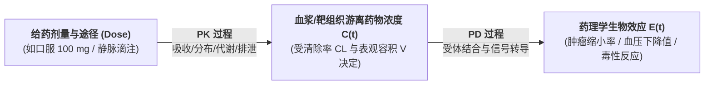

# Lec 5 药物代谢动力学与药效动力学 PK/PD 建模与剂量递增设计（Pharmacokinetics and Pharmacodynamics PK/PD Modeling）

## TL;DR

- 身体对药物做了什么（PK）与药物对身体做了什么（PD）的数理微分方程联立。
- 房室模型（Compartment Models）、清除率（CL）与半衰期（$t_{1/2}$）解析求解。
- 首次人体给药（FIH）安全起始剂量测算与斐波那契（Fibonacci）剂量递增设计。

## 一、PK 与 PD 的核心哲学界定

在临床药理学中，理解药物行为必须牢牢掌握两根支柱的内在关联：
- **药物代谢动力学（Pharmacokinetics, PK）**：研究**“机体对药物做了什么（What the body does to the drug）”**，量化描述药物在体内的血药浓度随时间的动态演变曲线 $C(t)$；
- **药物效应动力学（Pharmacodynamics, PD）**：研究**“药物对机体做了什么（What the drug does to the body）”**，量化描述特定血药浓度如何在受体端转化为生物学疗效或毒性反应 $E(C)$。

**PK/PD 联合建模**通过数学桥梁将两者的微分方程联立，构成了现代精准医疗与临床用药方案设计的量化核心。

## 二、经典房室模型（Compartment Models）数学解析

将复杂的人体器官生理系统简化为由理想储液罐构成的房室网络：

### 一室模型静脉瞬时推注（One-Compartment IV Bolus）
设给药剂量为 $D$。药物瞬间进入容积为 $V$ 的单一均匀房室，随后按一级消除动力学（First-order elimination）以恒定清除率 $CL$ 被肝肾清除：
$$\frac{dC(t)}{dt} = -k_e \cdot C(t)$$
其中消除速率常数 $k_e = \frac{CL}{V}$。
解该一阶常微分方程：
$$C(t) = C_0 \cdot e^{-k_e t} = \frac{D}{V} \cdot e^{-\left(\frac{CL}{V}\right) t}$$
- **生物消除半衰期（Half-life, $t_{1/2}$）**：血药浓度下降一半所需的时间：
  $$t_{1/2} = \frac{\ln 2}{k_e} = \frac{0.693 \cdot V}{CL}$$
- **药时曲线下面积（Area Under the Curve, AUC）**：反映药物全周期总暴露量：
  $$AUC_{0 \to \infty} = \int_0^\infty C(t) dt = \frac{C_0}{k_e} = \frac{D}{CL}$$

### 药效学希尔方程（Hill Equation / $E_{max}$ Model）
血药浓度 $C$ 与生物效应 $E$ 通常服从经典的 S 型饱和曲线：
$$E(C) = E_0 + \frac{E_{max} \cdot C^\gamma}{EC_{50}^\gamma + C^\gamma}$$
其中 $E_{max}$ 为最大理论疗效，$EC_{50}$ 为产生半数最大效应所需的血药浓度，$\gamma$ 为希尔系数（Hill coefficient，反映反应协同性）。

## 三、首次人体给药（FIH）安全起始剂量推演

当新药完成动物实验，准备首次给健康人类受试者注射时，核心伦理难题是：**第一针给多少毫克，既能保证受试者绝对不发生致死毒性，又能具有科研意义？**

::: theorem [FDA 首次人体起始剂量（MRSD）法定推导四步法]
1. **获取动物无可见有害作用水平（NOAEL）**：
   在最敏感的相关动物种属（如食蟹猴或犬）长期毒理实验中，找出未观察到任何有害毒性反应的最大剂量 $NOAEL_{animal}$（mg/kg）；
2. **体表面积归一化换算为人等效剂量（Human Equivalent Dose, HED）**：
   由于哺乳动物的代谢速率正比于体表面积（BSA，异速增长规律 Allometric Scaling），必须利用体表面积转换系数进行折算：
   $$HED = NOAEL_{animal} \times \left( \frac{W_{animal}}{W_{human}} \right)^{0.33}$$
3. **施加安全系数除以 10（Safety Factor）**：
   为了应对人与动物之间的种属差异与极端敏感体质，强制除以 **10 倍安全缓冲底线**：
   $$MRSD = \frac{HED}{10}$$
:::

### 修正斐波那契（Modified Fibonacci）剂量递增阶梯
确定了微小的起始安全剂量后，在 I 期临床中采用递增爬坡队列（Cohort）：
后续队列的剂量递增比例逐渐平缓收敛：$+100\% \to +67\% \to +50\% \to +40\% \to +33\%$，步步为营监测不良反应，直至探索出人类最大耐受剂量（MTD）。

## 我的理解

PK/PD 建模是数学微积分注入人体生命汪洋的最迷人交汇点。它彻底改变了过去医生“凭直觉猜剂量”的野蛮传统。通过将清除率、表观容积与希尔方程联立，药理学家在数字空间为药物分子绘制出了精密的导航轨迹。而 FDA 的四步安全推导法则，则是理性科学与生命伦理最崇高的契约——在探索未知的雄心面前，永远对人类同胞的生命安全保留十倍的谦卑与敬畏。
