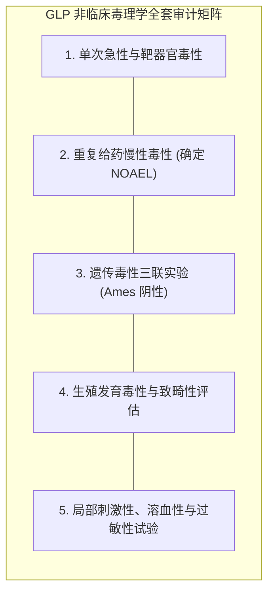
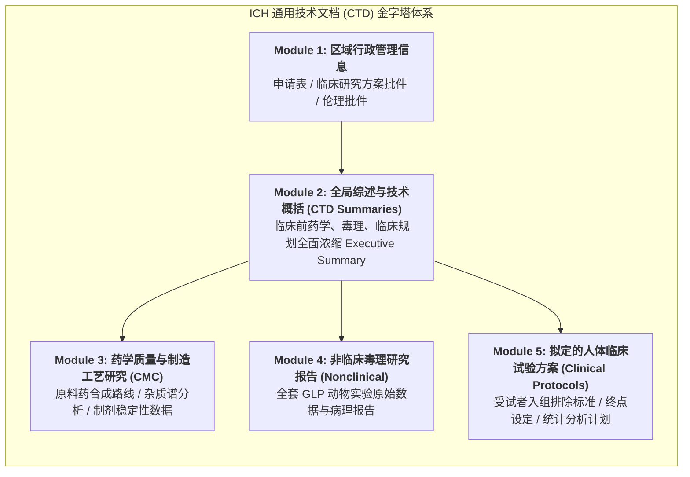

# Lec 6 毒理学评估、新药临床试验申请 IND 申报与首次人体给药试验（Toxicology, IND Filing, and First-in-Human Trials）

## TL;DR

- 良好实验室规范（GLP）与非临床毒理学完整研究图谱（急性、亚慢性、遗传、生殖）。
- 新药研究申请（Investigational New Drug, IND）法定申报资料模块（CTD 架构）。
- 首次人体给药试验（FIH）临床伦理委员会（IRB）审查与受试者知情同意闭环。

## 一、GLP 规范下的非临床毒理学研究全景

在任何化学分子或生物制品注入健康人体静脉之前，必须根据严苛的**良好实验室规范（Good Laboratory Practice, GLP）**，在合规的实验动物（啮齿类小鼠/大鼠，以及非啮齿类兔/犬/非人灵长类猴）体内完成极其详尽的非临床毒理学全套体检。

GLP 规范要求全流程数据不可篡改、所有病理学切片终身留档追溯。标准毒理学评估矩阵包括：

1. **单次给药毒性试验（急性毒性 Acute Toxicity）**：
   测定最大耐受量（MTD）及单次超大剂量暴露下的靶器官毒性表型；
2. **重复给药毒性试验（亚慢性/慢性毒性 Chronic Toxicity）**：
   连续给药 28 天、90 天甚至 6 至 9 个月，密切监测动物血液生化指标、尿常规、心电图及主要实质脏器（心肝脾肺肾脑）的组织病理学坏死、纤维化病变，明确毒性的**可逆性（Reversibility）**；
3. **遗传毒性标准组合试验（Genotoxicity Core Battery）**：
   - 细菌回复突变试验（Ames Test）：评估是否诱发基因突变；
   - 哺乳动物体外染色体畸变试验；
   - 啮齿类动物体内骨髓微核试验（Micronucleus Test）；
4. **生殖与发育毒性试验（DART）**：
   评估对雄雌生育力、胚胎致畸性（Teratogenicity）及围产期母乳毒性的影响；
5. **致癌性试验（Carcinogenicity Studies）**：
   针对长期服用的慢性病药物，需在小鼠体内开展长达 2 年的终身致癌性监测。

## 二、IND 申请与国际通用通用技术文件（CTD）架构

跨国药企向美国 FDA 或中国 NMPA 递交的**新药临床研究申请（Investigational New Drug, IND）**，是一套厚达数万页的庞大技术档案。
国际上统一推行 ICH 颁布的**通用技术文件（Common Technical Document, CTD）五大模块架构**：

在递交 IND 后，FDA 启动著名的**“30 天法定冷静期审查（30-Day Clock）”**：
在这 30 天内，由 FDA 的医学审评员、药理毒理审评员、化学 CMC 审评员和统计学专家组成团队进行交叉攻防。
若未发现重大安全缺陷，30 天到期自动生效获准开展临床；若发现致命隐患，FDA 会当场签发**“临床试验暂停令（Clinical Hold）”**，强制阻断人体试验！

## 三、首次人体给药（FIH）的伦理防线与知情同意（Informed Consent）

新药第一次在人类身上试用，面临极其严苛的伦理考验：
1. **机构伦理审查委员会（Institutional Review Board, IRB）独立审批**：
   必须由包含医学专家、法学专家、社区非医学公众人士组成的独立伦理委员会进行全面伦理权衡，确保潜在风险被降至最低，且受试者的权益高于科学与商业的一切利益；
2. **知情同意书（Informed Consent Form, ICF）的签署闭环**：
   严禁使用充满晦涩学术黑话的文件哄骗受试者；必须用初中生都能理解的大白话，详尽告知试验目的、所有已知潜在副作用、是否有替代疗法，并明确赋予受试者**“无条件、随时、无需任何理由当场退出试验而绝不受任何歧视或惩处”的法定神圣权利**；
3. **哨兵患者设计（Sentinel Dosing Protocol）**：
   在首个剂量队列中，绝不允许多名受试者同时注药；必须先给一名“哨兵受试者（Sentinel Subject）”单人给药，在医学监护病房密切监测生命体征观察满 24 至 48 小时确认绝对无异常后，才允许向队列中的其他受试者陆续注射。

## 我的理解

IND 申报与首次人体试验是药学科学跨越生死之界的最庄严时刻。数万页的 CTD 文件，是数以百计科学家数年日夜心血与严谨理性的物理凝聚。而独立伦理审查与知情同意书，则是在科技狂飙突进的时代，人类为文明守住的最神圣的人道主义底线。只有当制度的铁律将受试者的尊严与安全捍卫得固若金汤时，科学探索的脚步才能走得昂首挺胸、无愧天地。
