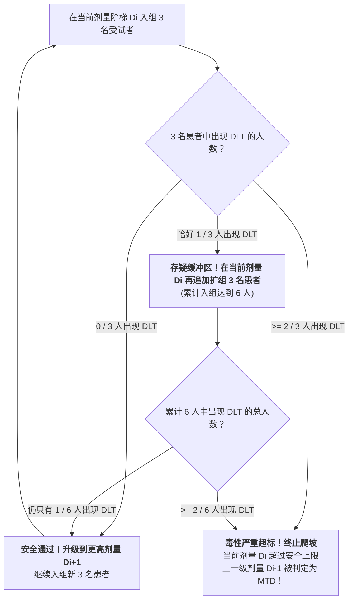

# Lec 7 I 期临床试验运营：安全性、耐受性与最大耐受剂量 MTD 探索（Phase I Clinical Trials: Safety, Tolerability, and Maximum Tolerated Dose）

## TL;DR

- I 期临床核心使命：在健康志愿者或末线肿瘤患者中确证人体安全性与耐受性。
- 剂量限制性毒性（Dose-Limiting Toxicity, DLT）与最大耐受剂量（MTD）操作化定义。
- 经典 $3+3$ 剂量爬坡设计规则树与贝叶斯连续重评估方法（CRM）现代演进。

## 一、I 期临床试验的战略定位与入组人群哲学

在完成 IND 审批后，药物正式迈入人体临床试验的第一阶段——**I 期临床试验（Phase I Clinical Trial）**。
I 期临床通常招募 20 至 80 名受试者，其核心目的**根本不是验证药物能不能治好病（不考察疗效），而是极其纯粹地考察人体能不能承受住这个药（考察安全性、耐受性与人体 PK 代谢规律）！**

在受试者人群选择上，存在深刻的伦理分流：
- **普通非肿瘤慢性病药物（如降压药、抗生素、降糖药）**：
  入组人群必须是**严格筛选的年轻健康成年志愿者（Healthy Volunteers）**，排除一切合并疾病和吸烟酗酒干扰，以纯净的生理背景测定标准人体 PK 数据；
- **细胞毒性抗肿瘤药物（Cytotoxic Oncology Drugs）**：
  由于化疗药和强效靶向药具有天然的杀伤细胞毒性，在伦理上绝对严禁给健康人使用！其 I 期临床直接入组**“已穷尽现有全部标准疗法失败、无药可救的末线癌症晚期患者”**，在承受风险的同时为患者保留一线微弱的生机。

## 二、剂量限制性毒性（DLT）与 MTD 判定

在 I 期剂量爬坡过程中，临床研究者必须制定极其明确的**剂量限制性毒性（Dose-Limiting Toxicity, DLT）**判定清单：

::: definition [剂量限制性毒性（DLT）标准定义]
指在给药后第一个周期（通常为给药后 21 天或 28 天）内发生的、经独立数据安全监察委员会（DSMC）判定为与研究药物肯定或很可能相关的严重不良反应（根据 NCI-CTCAE 常见不良事件评价标准）：
- 4 级中性粒细胞减少伴发热（感染性发热）；
- 4 级血小板减少（自发性内脏出血危险）；
- 持续超过 3 天未缓解的 3 级以上严重肝肾功能损害、顽固性剧烈恶心呕吐或心脏毒性。
:::

::: definition [最大耐受剂量（Maximum Tolerated Dose, MTD）]
**MTD 定义为发生 DLT 的受试者比例严格控制在目标阈值（通常为 $< 33\%$，即 6 名患者中出现 DLT 人数不多于 1 人）时的最高安全剂量阶梯！**
MTD 构成了后续 II 期与 III 期临床试验推荐剂量（Recommended Phase 2 Dose, RP2D）的重要决策上限。
:::

## 三、经典 $3+3$ 剂量递增设计（$3+3$ Escalation Design）

在肿瘤 I 期临床中，统治了行业四十年的经典无模型算法是**“$3+3$ 规则树设计”**：

通过这种极具保守主义色彩的“三人试水、六人复核”机制，临床团队能够以最小的受试者暴露代价，在概率层面将整组发生严重致死毒性的风险严格控制在安全红线之内。

### 现代适应性贝叶斯设计演进（Bayesian CRM）
虽然 $3+3$ 法规则清晰、操作简便，但现代生物统计学家指出了其固有缺陷：
- 过于保守，导致大量处于晚期绝望状态的肿瘤患者被分配在极其微弱、毫无治疗作用的低剂量队列中充当牺牲品；
- 现代临床广泛引入**连续重评估方法（Continual Reassessment Method, CRM）与贝叶斯最优区间设计（BOIN）**：
  利用后验概率分布实时动态更新真实剂量-毒性曲线，在保证受试者安全的同时，大幅加速向具有潜在疗效的靶剂量集中收敛。

## 我的理解

I 期临床试验是医学探险队走向人体禁区的初次试水。在这一阶段，所有实验室和超级计算机的虚拟推演都必须经受血肉之躯的终极检验。$3+3$ 设计的规则树看似冰冷刻板，实则是几代临床药理学家用鲜血凝成的护身符——它在未知风险的雷区中每前进一步都小心翼翼地敲击探针。懂得在对毒性的绝对克制中寻找那一线珍贵的治疗窗，是医学科学对人类生命最深沉的责任担当。
