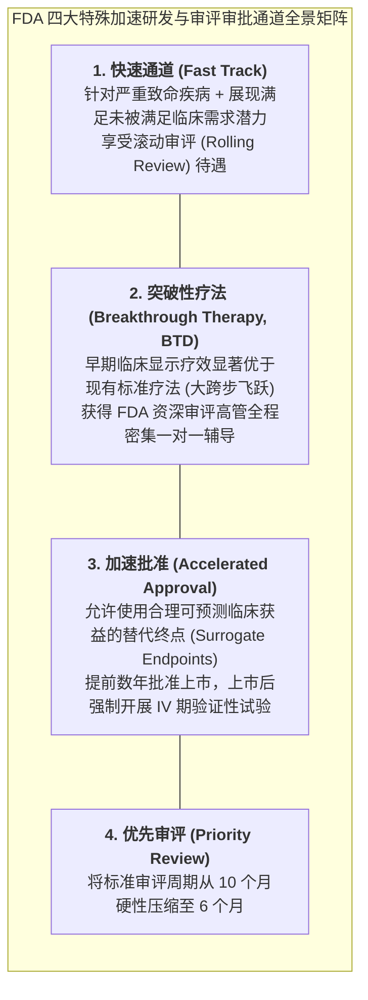

# Lec 8 药品监管法规、相对疗效评价与 FDA 快速通道/突破性疗法认定（Drug Regulation, Comparative Effectiveness & FDA Review Pathways）

## TL;DR

- 全球药品监管审批的政治经济学：患者极速用药渴望与严苛安全证据的永恒张力。
- 相对疗效评价（Comparative Effectiveness Research, CER）与真实世界证据（RWE）。
- FDA 四大加速审评审批通道：快速通道、突破性疗法、优先审评与加速批准全景解析。

## 一、监管机构的两难困境：I 类错误 vs. II 类错误

作为全球药品审评的最高裁判所，美国食品药品监督管理局（FDA）的审评官员每天都坐在极其痛苦的**统计学与伦理学平衡木**上：

$$\text{I 类错误 (Type I Error, 假阳性)} \quad \text{vs.} \quad \text{II 类错误 (Type II Error, 假阴性)}$$

- **若犯下 I 类错误（审核过松）**：批准了一款看似有效、但实际上存在罕见致命心脏毒性或致癌性的新药上市，引发公众健康危机，审评官员将面临国会听证会的严厉公开质询，官声扫地（历史上的反应停、万络事件）；
- **若犯下 II 类错误（审核过严过慢）**：为了追求 100% 毫无争议的铁证，将审批周期拖延数年甚至数十年，导致成千上万原本可以依靠该药救命的渐冻症、晚期癌症患者在无尽等待中痛苦逝去（无声的悲剧，公众看不见的代价）。

在 20 世纪 80 年代艾滋病（HIV/AIDS）大爆发期间，成千上万年轻患者在华盛顿 FDA 门前发起悲壮的静坐示威，彻底打破了监管机构的保守天平，迫使全球药监体系向**加速审批机制**进行系统性重构。

## 二、四大特殊加速审评审批通道深度拆解

为了在控制风险的前提下让真正具有革命性意义的救命新药最快惠及绝望患者，美国国会相继立法确立了四套并行互补的加速工具箱：

| 通道名称 | 核心资格门槛 | 核心赋能政策红利 | 典型获批领域 |
| :--- | :--- | :--- | :--- |
| **快速通道 (Fast Track)** | 治疗严重危及生命的疾病，具备解决临床空白的可能 | 允许**滚动提交资料（Rolling Review）**（写好一个模块审一个模块，无需等全部资料就绪）；与 FDA 沟通频次大幅增加 | 罕见遗传病、耐药超级细菌抗生素 |
| **突破性疗法 (Breakthrough Therapy)** | **拥有明确的早期临床证据**，表明在关键终点上相比现有疗法产生**实质性重大改善（Substantial Improvement）** | **最高级别礼遇！**由 FDA 药物审评中心（CDER）高层领导亲自进驻项目组，跨级压缩审评时限，甚至允许小样本直接豁免部分阶段 | 革命性靶向抗癌药、CAR-T 细胞免疫疗法 |
| **加速批准 (Accelerated Approval)** | 治疗严重疾病，且终点使用经科学验证的**替代终点（Surrogate Endpoint）**（如肿瘤客观缓解率 ORR 或肿瘤缩小直径，而非等待漫长数年的总生存期 OS） | **提前 3 至 5 年抢先获批上市销售**！但法律强制附带条件：药企必须在上市后限期完成确证性临床试验，**若上市后试验证明无法延长寿命，FDA 依法强制撤市注销！** | 晚期恶性实体瘤、阿尔茨海默病抗体 |
| **优先审评 (Priority Review)** | 在疾病治疗、诊断或预防的安全性或有效性上相比市售药物有显著重大提升 | 审评时限由标准 10 个月压缩为 **6 个月**（倒逼审评团队全负荷抢工） | 全球首创新机制药物 |

## 三、相对疗效评价（CER）与卫生经济学准入

获得 FDA 上市批件仅仅意味着拿到了合法销售的“准生证”；然而在现代医疗保险支付方（Medicare、商业保险公司以及欧洲国家医保机构 NICE）眼中，必须面对第二道严苛的生死关卡——**相对疗效评价（Comparative Effectiveness Research, CER）**：

::: definition [安慰剂对照 vs. 阳性金标准对照]
- **药监局准入标准**：新药往往只需在双盲随机试验中证明自己**显著打败了毫无药效的“安慰剂（Placebo）”**，即可合法获批；
- **医保支付方准入标准**：医保官绝不关心你能不能打败安慰剂，医保只追问一个冷酷问题：**你的新药每盒售价 10,000 美元，相比目前已经在市场上普遍销售、每盒仅需 100 美元的老牌阳性药物（Active Comparator），究竟能多活几天？其增量性价比是否合理？**
:::

如果药企无法提供扎实的相对临床获益证据和卫生技术评估（HTA）经济学数据，即便拿到上市批件，也将被医保目录坚决拒之门外，沦为商业化暴跌的“纸面新药”。

## 我的理解

药品审评审批法规是现代政治学、生命伦理学与运筹博弈最激烈的交锋熔炉。加速审批通道的设立，体现了人类文明在极端绝境面前的非凡勇气——打破死板教条，拥抱替代终点，为正在死神边缘挣扎的患者抢出宝贵的生命之光。而相对疗效评价则是一记冷静的现实主义平衡，它提醒资本：任何没有带来实质临床飞跃的所谓“伪创新”，终究无法在全社会卫生经济学的无情天平上蒙混过关。
