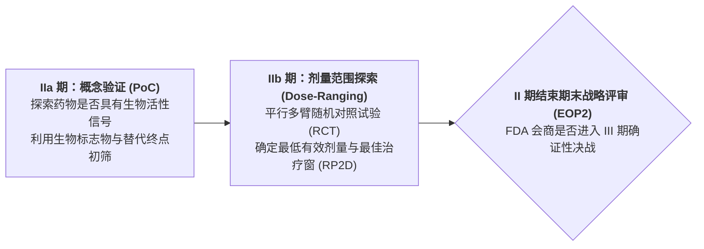
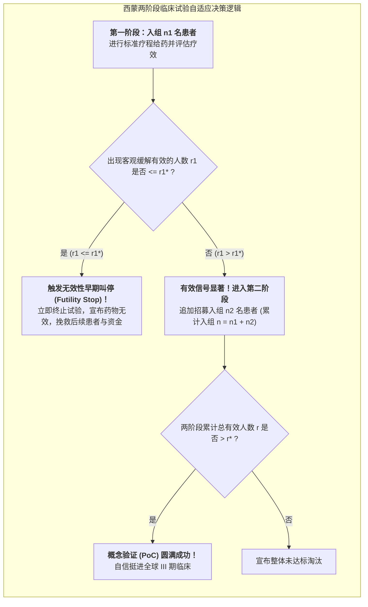

# Lec 9 II 期概念验证研究：生物标志物指导下的剂量范围探索与终点选取（Phase II Proof-of-Concept & Dose-Ranging Studies）

## TL;DR

- II 期临床分水岭：概念验证（PoC）与推荐 II 期给药剂量（RP2D）的锁定。
- 西蒙两阶段设计（Simon's Two-Stage Design）在抗肿瘤无对照单臂试验中的运筹学机制。
- 伴随诊断（Companion Diagnostics, CDx）与精准靶向生物标志物患者富集策略。

## 一、II 期临床试验的战略转折点与高淘杀率

如果说 I 期临床是探明药物的安全底线，那么**II 期临床试验（Phase II Trial）**则是整个新药生命周期中最残酷的**“生死分水岭（Proof of Concept, PoC）”**！
在 II 期临床中：
- 招募规模扩大至 100 至 300 名真实的患病目标适应症患者；
- 核心使命是首次在病人体内严密检验：**该药是否真的能够产生预期的临床疗效？最佳的治疗剂量区间是多少？**
- **全行业最大的夭折陷阱**：超过 **65% 至 70% 的候选药物在 II 期临床中由于疗效不及预期惨遭淘汰终止**。如果不能在 II 期坚决果断地“早失败、快失败（Fail Fast, Fail Cheap）”，将一个无效的平庸分子盲目推向耗资数亿美元的 III 期大样本试验，将直接给药企带来灭顶之灾！

## 二、西蒙两阶段最优设计（Simon's Two-Stage Design）

在肿瘤 II 期单臂试验中，为了避免让大量晚期患者暴露于无效药物的毒副作用中，生物统计学家理查德·西蒙（Richard Simon）提出了著名的**西蒙两阶段自适应设计**：

::: definition [Simon 两阶段检验假设]
设目标客观缓解率（ORR）为 $p$。
- 原假设 $H_0: p \le p_0$（$p_0$ 为历史现有疗法无效基准缓解率，如 10%）；
- 备择假设 $H_1: p \ge p_1$（$p_1$ 为新药具有商业与临床价值的目标缓解率，如 30%）；
- 控制 I 类错误率 $\alpha$（假阳性，如 0.05）与 II 类错误率 $\beta$（假阴性，如 0.10，对应 90% 检验功效）。
:::

通过运筹优化，西蒙给出了使在 $H_0$ 为真时的**期望样本量（Expected Sample Size, EN）最小化的“最优设计（Optimal Design）”**，以及使最大总样本量最小化的“极小化极大设计（Minimax Design）”，成为全球抗癌药 II 期临床的标准设计模版。

## 三、生物标志物（Biomarkers）与伴随诊断富集策略

在精准医疗（Precision Medicine）时代，传统的“不分青红皂白把所有肺癌患者拉进临床”的粗放模式已彻底被淘汰。
现代 II 期临床广泛推行**生物标志物患者富集策略（Biomarker Enrichment Strategy）**：

1. **伴随诊断试剂盒（Companion Diagnostics, CDx）协同开发**：
   - 在患者入组前，强制使用由特定 PCR 或二代测序（NGS）试剂盒对患者肿瘤穿刺样本进行基因突变筛查（如检测是否携带 EGFR 突变、ALK 融合或 HER2 过表达）；
2. **靶向富集入组**：
   - 坚决将阴性无突变患者排除在外，**只将携带特定靶点变异的“超敏感精准人群”纳入临床试验**；
3. **临床成功率倍增奇迹**：
   统计表明：引入经过验证的生物标志物指导后，抗癌药物在 II 期的客观缓解率（ORR）往往能从传统化疗的 15% 飙升至 **60% 至 80%**，临床通过概率整整提升了 3 倍以上！

## 我的理解

II 期临床试验是新药研发中最需要“残酷理性”的科学审判席。它考验的不仅是科学家证明自己正确的聪明才智，更是管理者面对失败时斩断情丝的惊人勇气。西蒙两阶段设计用优雅的概率决策树，在挽救患者生命与保护企业资本之间架起了一道自适应安全阀；而生物标志物富集策略则展现了精准医疗对传统粗放医学的降维打击——在茫茫人海中找到那群真正能被药物挽救的同胞，是现代药学走向成熟的最美里程碑。
