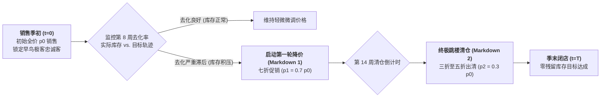

# Lec 10 动态定价策略与季末降价清仓机制（Dynamic Pricing Strategies & Markdown Optimization）

## TL;DR

- 耐用品与快时尚季末库存去化困局：固定库存、有限时间窗口与衰减需求流。
- 动态定价连续哈密顿-雅可比-贝尔曼（HJB）方程推导与离散多阶段降价网格。
- 零售清仓机制（Markdown Management）：何时打折、折扣深度与消费者战略等待防范。

## 一、季末清仓（Markdown Management）的商业紧迫性

在快时尚服装（Zara、H&M）、消费电子以及季节性文创消费品领域，企业在销售季节开始时已经一次性锁定了初始库存量 $I_0$。
随着销售时间窗口 $T$（如秋冬季 16 周）的流逝：
- **如果打折太早太狠**：虽然库存清空了，但企业损失了大量本可以按全价（Full Price）成交的高价值客户，利润被严重践踏；
- **如果打折太晚太轻**：销售季节在寒冬过去后戛然而止，剩余的羽绒服大衣将彻底沦为一文不值的呆滞品，只能以废料价格按斤处理。

如何在有限的剩余时间 $T - t$ 和剩余库存量 $I(t)$ 约束下，设计一条**动态最优降价轨迹 $\{p(t)\}$**，使季末总变现净收益达到数学绝对极大值，是现代零售收益管理的核心命题。

## 二、连续时间动态定价数学推导

设在时刻 $t$，商品定价为 $p(t)$。市场瞬时需求到达率为价格的减函数 $\lambda(p)$。
设剩余库存量为状态变量 $x(t)$，初始条件 $x(0) = I_0$。
状态演化满足随机泊松过程；在确定性流体近似（Fluid Approximation）下：
$$\frac{dx(t)}{dt} = -\lambda(p(t))$$
全期总销售收入最大化目标泛函为：
$$\max_{\{p(t)\}} \int_0^T p(t) \cdot \lambda(p(t)) \, dt$$
$$\text{s.t.} \quad \int_0^T \lambda(p(t)) \, dt \le I_0, \quad p(t) \ge 0$$

### 构造拉格朗日乘子函数
引入库存约束的非负拉格朗日乘子 $\mu$（表示初始库存的边际影子价值）：
$$\mathcal{L}(p(t), \mu) = \int_0^T [p(t) \lambda(p(t)) - \mu \lambda(p(t))] dt + \mu I_0 = \int_0^T [p(t) - \mu] \lambda(p(t)) dt + \mu I_0$$
对每个时刻的价格 $p(t)$ 求点态最优极值条件：
$$\frac{\partial}{\partial p} \left\{ [p - \mu] \lambda(p) \right\} = \lambda(p) + [p - \mu] \lambda'(p) = 0$$
整理可得经典的勒纳加价法则形式：
$$p^*(t) - \frac{\lambda(p^*)}{\left| \lambda'(p^*) \right|} = \mu$$

::: theorem [恒定影子价格下的最优定价单调性]
在流体模型中，只要需求流函数不随时间发生外生性衰减，**全期最优价格 $p^*(t)$ 是恒定不变的常数**！
但在现实中，随着季节推移，消费者的支付意愿函数本身随时间单调衰减（$\lambda(p, t)$ 随 $t$ 下降），求解 HJB 偏微分方程得出的最优价格轨迹必将呈现**严格单调递降的降价阶梯（Monotonically Decreasing Markdown Curve）**。
:::

## 三、防范战略型消费者（Strategic Consumers）逆向等待

在推行动态降价时，企业面临最大的克星是**“战略型消费者（Strategic Customers）”**：
顾客明知道一件大衣两周后会降价到 5 折，哪怕他今天非常喜欢，他也宁愿克制欲望在店外耐心等待两周，等打折后再冲进来抄底。
如果所有顾客都变得高度战略理性，企业的第一轮原价销售将全面崩溃！

为瓦解战略型消费者的等待预期，现代运营管理设计了三大反制机制：
1. **人为制造稀缺感（Rationing & Scarcity Commitment）**：
   - 故意向市场只投放极少量的陈列现货，高调宣布“每种尺码仅有 3 件，卖完绝不补货”；
   - 战略客户面临巨大的**断货风险（Stockout Risk）**：等打折虽然便宜，但极大概率自己合身的尺码早就被别人买光，迫使其在原价期乖乖掏钱买单；
2. **隐藏降价时间表的不可预测性**：
   - 严禁公布固定的降价日程表（如严禁形成“每逢周五必打折”的死板规律），让降价窗口完全呈现随机性；
3. **奥特莱斯与下沉渠道隔离（Off-Price Outlets）**：
   - 将季末滞销品迅速下架打包，运往数十公里外的偏远奥莱小镇或特定线上特卖平台，增加高价值客户跑腿去买打折品的时间与交通摩擦成本。

## 我的理解

动态定价是一场企业与消费者心理心智之间的无声博弈。纯粹的贪婪和机械的打折都无法换来商业成功。最优清仓轨迹的背后，是用微积分精细刻画的需求曲线与存量库存的动态对齐。而面对日益精明的现代消费者，制造适度的断货恐惧与物理渠道隔离，则再次体现了运筹学与博弈论结合的无尽魅力——最高级的商业定价，永远是在欲望与恐惧的刀尖上跳舞。
