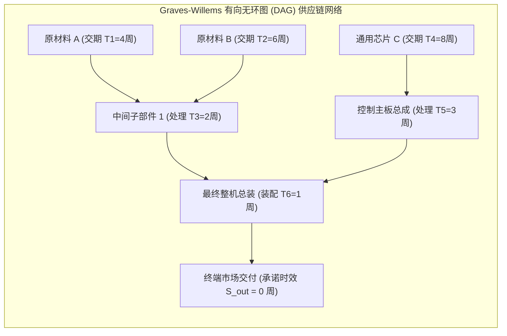

# Lec 11 新产品供应链系统配置：Graves-Willems 保证交付期模型（Supply Chain Design for New Products: Graves-Willems Model）

## TL;DR

- 新产品导入（NPI）阶段的研发与供应链协同：零部件通用化与延迟制造集成。
- Graves-Willems 保证交付服务时间模型（GSM）在一般有向无环图（DAG）网络上的形式化。
- 利用分枝定界算法（Branch-and-Bound）在复杂装配树中求解安全库存最优放置点。

## 一、新产品研发与供应链架构的断层脱节

在高科技与复杂装备制造（如高端医疗设备、航空电子、智能汽车）领域，产品研发团队（R&D）与供应链运营团队（Supply Chain）之间长期存在深不见底的鸿沟：
- 研发工程师在 CAD 工作站前随心所欲地设计出数百个极其特殊的非标异形零部件，却完全不知道这些特殊件的采购交期长达 9 个月；
- 研发工程师为了极致性能，为每一款新机型都定制专属的电源管理芯片，彻底摧毁了跨机型的零部件通用化（Component Commonality）；
- 最终导致新机型量产时，全供应链必须为数百种互不兼容的元器件分别储备天文数字的安全库存，产品尚未上市就已经背负沉重的物料资金利息。

麻省理工学院斯隆管理学院教授史蒂芬·格雷夫斯（Stephen Graves）与肖恩·威廉姆斯（Sean Willems）开创的 **GSM 模型（Graves-Willems Model）**，首次在数学上打通了**新产品 BOM 工程图纸**与**全球供应链安全库存资本开支**的直连纽带！

## 二、Graves-Willems 模型形式化数理构建

将整条多级供应链网络抽象为一个有向无环图（Directed Acyclic Graph, DAG）$G = (V, A)$：
- 节点 $j \in V$：代表一个物料阶段（Stage），涵盖采购、加工、运输或最终装配；
- 有向弧 $(i, j) \in A$：表示阶段 $i$ 是阶段 $j$ 的直接前驱物料来源（即生产 $j$ 必须消耗 $i$）；
- $T_j$：阶段 $j$ 自身的标称生产或运输加工提前期（Processing Lead Time）；
- $h_j$：阶段 $j$ 的单位产品持有成本增加值（Value-added Holding Cost Rate）；
- $S_j$：阶段 $j$ 向其所有直接下游客户节点**承诺保证的服务时间（Service Time）**；
- 阶段 $j$ 的**净补货提前期（Net Lead Time）**定义为：
  $$L_j = \max_{(i, j) \in A} (S_i) + T_j - S_j$$

### 核心物理守恒约束
1. **服务时间非负且不得超过上游最长到达时延**：
   $$0 \le S_j \le \max_{(i, j) \in A} (S_i) + T_j, \quad \forall j \in V$$
2. **终端交付时效刚性约束**：
   对于所有直接面对外部最终客户的终端节点 $k \in V_{retail}$：
   $$S_k \le S_{customer}^{target}$$
   （若要求即时现货满足，则强制约束 $S_k = 0$）；
3. **安全库存投资目标函数**：
   在正态独立需求假设下，阶段 $j$ 所需持有的安全库存为 $k_j \sigma_j \sqrt{L_j}$。全系统总安全库存资本占用为：
   $$\min_{\{S_j\}} \sum_{j \in V} h_j \cdot k_j \cdot \sigma_j \cdot \sqrt{\max_{(i, j) \in A}(S_i) + T_j - S_j}$$

## 三、网络最优性与二值化极端现象（All-or-Nothing Property）

Graves 与 Willems 证明了一个极为震撼的数学定理：

::: theorem [GSM 极值点的二值化性质]
在经典的树状（Tree-structured）装配与分销网络中，最优解向量 $\{S_j^*\}$ 必定具有**全有或全无（Extreme Point Property）**特征：
对于供应链中的任何中间加工阶段 $j$，其最优承诺服务时间 $S_j^*$ 要么为 0（即为下游承担即时现货保障），要么恰好严格等于其上游最长交期加自身处理时间 $\max_i(S_i) + T_j$（即**该阶段净提前期 $L_j = 0$，系统在此处配置 0 额外安全库存！**）。
:::

这一理论给新产品研发设计提供了无与伦比的指导武器：
- **消灭中间冗余节点**：算法证明在流水线中间环节处处设防备货是极其愚蠢的；
- **精准识别解耦锚点**：模型能清晰指出整张 BOM 树状图中，哪几个特定节点是全网方差对冲性价比最高的“战略物料解耦池（Strategic Decoupling Points）”；
- 研发工程师通过优化产品拓扑结构，只需调整两根物料依赖连线，就能通过算法直观看到全网安全库存从 1000 万美元直接暴降至 600 万美元的惊人成效！

## 我的理解

Graves-Willems 模型是产品架构设计与供应链运筹学联姻的巅峰之作。它终结了研发部门与供应链部门长达半个世纪的“盲人摸象”式争吵。通过用有向无环图和净提前期这套严密的数学语言，它把抽象的“可制造性设计（DFM）”和“延迟策略”量化为可以在计算机上运行的极值求解方程。它证明了：最伟大的供应链降本，绝不是在采购端压榨供应商几分钱，而是在研发画下第一张图纸时，就已经在数学上锁死了最优的拓扑结构。
