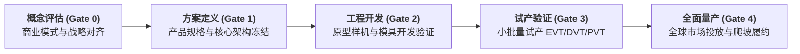

# Lec 12 流程技术演进与 PRTM 高科技供应链集成实战（Process Technology Adoption & PRTM High-Tech Operations）

## TL;DR

- 高科技产业生命周期压缩：摩尔定律驱动下的供应链工艺快速迭代与良率爬坡。",
- PRTM 咨询公司 PACE / 阶段门（Stage-Gate）新产品研发与供应链集成流程体系。
- 全球外协代工制造（EMS / ODM）生态中知识产权保护与产能分配的战略权衡。

## 一、高科技产业的超高速时钟频率（High Clockspeed）

在高科技与半导体领域，查尔斯·芬奇（Charles Fine）提出的“产业钟速理论（Clockspeed）”体现得淋漓尽致：
- 产品生命周期从传统汽车的 5 至 8 年，被急剧压缩至智能手机与消费电子的短短 9 至 12 个月；
- 关键集成电路芯片价格遵循摩尔定律，每 18 个月性能翻倍而价格减半；
- **良率爬坡曲线（Yield Ramp Curve）**决定生死：在量产前 3 个月，由于新封装工艺不成熟，芯片良品率可能仅有 30%；谁能最快将良率推升至 90% 以上，谁就能在窗口期内通吃全行业 80% 的暴利利润。

在此背景下，企业若采用传统串行推进流程（研发做完交试产，试产完交采购，采购完交销售），产品上市必定严重延误。

## 二、PRTM PACE 框架与跨职能集成核心要素

国际知名运营管理咨询公司 PRTM（后被普华永道收购）开创了著名的 **PACE 体系（Product and Cycle-time Excellence）**，成为思科、苹果、惠普等硅谷巨头推行集成产品开发（IPD）的标准化底层框架：

::: definition [PACE 五大核心支撑柱]
1. **阶段门决策评审（Stage-Gate Review）**：在新产品生命周期的关键里程碑设立不可逾越的“质量把关门”，由跨职能高管组成的集成组合管理团队（IPMT）进行“继续（Go）/ 终止（Kill）/ 暂缓（Hold）”硬性表决；
2. **核心团队跨职能运作（Core Team Structure）**：打破部门深井，由研发、制造工艺、全球供应链、市场营销和财务专家组成全权负责的项目核心团队，一人对端到端结果终身负责；
3. **结构化开发流程（Structured Development Process）**：将复杂研发分解为清晰的标准工序阶梯，明确每一阶段的交付物标准；
4. **早期供应链深度介入（Early Supply Chain Involvement, ESI）**：在方案定义（Gate 1）阶段即要求采购和供应商必须进驻项目组，提前锁死长交期芯片与关键模具；
5. **衡量指标体系（Metrics & Scorecard）**：以研发周期缩减率、新产品上市及时率（Time-to-Market）、早期物料报废率作为核心考核指标。
:::

## 三、外协代工生态（EMS / ODM）博弈与 IP 防御

现代高科技硬件企业（如苹果、英伟达）几乎全面走向了**无晶圆厂/轻资产模式（Fabless / Asset-light）**，将制造物理环节外包给专业代工巨头（富士康、立讯精密、台积电）。

在享受代工厂庞大制造规模与柔性红利的同时，品牌货主必须构建严密的防御护城河：
- **核心 IP 黑盒化隔离**：核心底层固件与私有算法芯片由自有自研团队加密烧录，代工厂仅负责外围标准件的贴片总装；
- **双源代工制衡（Dual-Fab Strategy）**：将主力机型按 65% 与 35% 比例动态分配给两家代工厂，挑起健康的竞争博弈，防止单一 EMS 坐大后反向绑架货主；
- **全链条物料透视（Open-Book Costing）**：货主直接越过代工厂，与上游二级（Tier-2）、三级（Tier-3）芯片原材料供应商进行全球集中采购谈价，代工厂仅收取约定的标准加工组装工费（Consignment Model）。

## 我的理解

PRTM 的实战框架告诉我们，高科技供应链的竞争本质上是**“工程确定性”对“时间流逝”的抢夺战**。在每季度产品都在贬值的快钟速世界里，延误上市 1 个月所造成的全生命周期利润损失，远远超过任何车间制造成本的超支。PACE 阶段门体系绝不是官僚主义的繁文缛节，而是企业在惊涛骇浪中保持航向不偏的压舱石。它用跨职能的紧密咬合，把散乱的科技灵感淬炼为无可阻挡的商业洪流。
