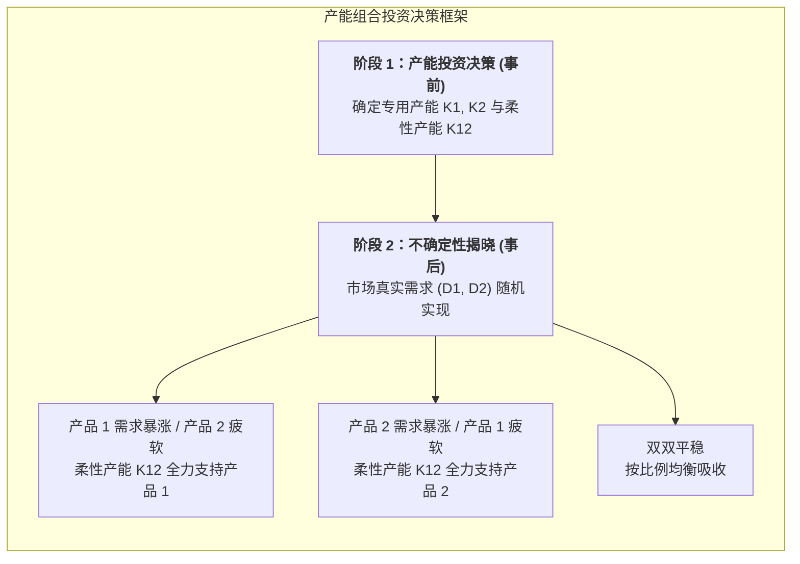

# Lec 13 运营柔性：专用产能与通用柔性产能规划与跨国套期保值（Operational Flexibility: Dedicated vs. Flexible Capacity）

## TL;DR

- 专用产能（Dedicated Capacity）与柔性通用产能（Flexible Capacity）的技术经济权衡。
- 多产品不对称需求分布下的两阶段随机规划产能组合优化数学模型推导。
- 运营柔性在汽车多车型混流生产与跨国生产基地风险对冲中的最佳配置比例。

## 一、产能专用性与柔性溢价的根本矛盾

在制造装备投资决策中，企业始终面临两种截然不同的技术路线选择：
- **专用设备产能（Dedicated Capacity）**：
  为某一特定单一产品量身定制的高速专用刚性自动化专机（如专用于冲压某款固定轴距车门的冲压机）。
  - **优势**：设备造价相对低廉，加工循环节拍极快，运行可靠性高；
  - **致命弱点**：毫无适应性。一旦该款产品市场遇冷夭折，整台设备直接沦为废铁，无法转产任何其他型号。
- **柔性通用产能（Flexible Capacity）**：
  采用多轴工业机器人、通用数控加工中心（CNC）和快速快换夹具组成的柔性制造单元。
  - **优势**：能够自由在产品 A、产品 B 甚至未来新产品之间实现毫秒级程序换模转产；
  - **代价（柔性溢价 Flexible Premium）**：初期资本购置费用通常比同产量的专用设备高出 30% 至 60%，且由于软件复杂度和机械臂活动自由度大，日常维护要求更为严苛。

企业面临的战略核心问题是：**在面对不确定的未来需求时，我们究竟应当投资多少专用产能，又该搭配多少柔性产能？**

## 二、双产品两阶段随机规划数学模型

考虑企业生产两种产品（产品 1 与产品 2），单件销售净利润分别为 $p_1, p_2$。
市场需求为连续随机变量 $(D_1, D_2)$，具有联合概率密度函数 $f(d_1, d_2)$。
- 建设产品 1 专用产能的单位投资成本为 $c_1$；
- 建设产品 2 专用产能的单位投资成本为 $c_2$；
- 建设可同时生产产品 1 和产品 2 的柔性产能单位投资成本为 $c_{12}$；
- 显而易见满足三角不等式：
  $$\max(c_1, c_2) < c_{12} < c_1 + c_2$$
  （柔性设备比任何单一专用设备贵，但比买齐两台专用设备便宜）。

决策变量为：投资决策 $(K_1, K_2, K_{12}) \ge 0$；以及事后生产分配量 $(x_1, x_2, y_1, y_2)$。
其中 $x_i$ 为专用产能生产量，$y_i$ 为柔性产能生产产品 $i$ 的分配量。

全系统期望利润最大化规划模型为：
$$\max_{K_1, K_2, K_{12}} E_{(D_1, D_2)} \left[ \max_{x_1, x_2, y_1, y_2} \left( p_1(x_1 + y_1) + p_2(x_2 + y_2) \right) \right] - c_1 K_1 - c_2 K_2 - c_{12} K_{12}$$
约束条件：
$$x_1 \le K_1, \quad x_2 \le K_2 \quad (\text{专用产能上限})$$
$$y_1 + y_2 \le K_{12} \quad (\text{柔性通用产能上限})$$
$$x_1 + y_1 \le D_1, \quad x_2 + y_2 \le D_2 \quad (\text{需求上限})$$
$$x_i, y_i, K_i, K_{12} \ge 0$$

## 三、最优产能组合边界与几何分划

通过对该两阶段模型进行 Kuhn-Tucker（KKT）一阶条件推导，在二维需求平面 $(D_1, D_2)$ 上可以被精准划分为不同的操作状态区域：

::: theorem [柔性投资成立的经济学临界门槛]
当且仅当柔性溢价满足以下严格条件时，企业投资非零柔性产能（$K_{12}^* > 0$）才是经济合理的：
$$c_{12} < c_1 + c_2 - \text{协方差惩罚项}(\text{Cov}(D_1, D_2))$$
如果两产品需求呈现高度负相关（$\text{Cov} < 0$），柔性产能的投资吸引力将呈几何级数放大；
反之，若两产品高度正相关（同时暴涨同时暴跌），柔性产能完全无法发挥此消彼长的对冲优势，企业应当**完全放弃昂贵的柔性产能，全部采用廉价专用设备进行基线覆盖**！
:::

::: example [汽车整车厂混流柔性焊装线配置]
通用汽车（GM）在传统工厂对每款轿车各投资一条年产 20 万辆的刚性专线，结果轿车畅销时产线被挤爆而 SUV 专线大批闲置。后来通用在兰辛工厂改建为柔性平台：
配置 12 万辆轿车专用产能 + 12 万辆 SUV 专用产能 + **10 万辆柔性混流机器人产能**。
这一“两端专用托底 + 中间柔性调峰”的混合架构，使得全厂总投资仅增加了 8%，但应对市场多变车型的整体产能有效利用率从 68% 跃升至 **94%**！
:::

## 我的理解

运营柔性是供应链面对未知未来时买下的最高明的人身保险。它用严密的数学模型，粉碎了“要么全专用、要么全柔性”的非黑即白思维。优秀的工业架构师深谙投资组合理论（Portfolio Theory）在实体制造中的映射：用低成本的专用资产锁定确定性的基本盘，用高弹性的柔性资产捕捉波动的非线性红利。这不仅是工程装备的配置，更是企业在充满不确定性的市场惊涛中保持敏捷生存的核心进化机制。
