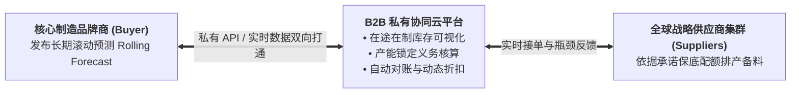

# Lec 14 互联网 B2B 战略采购、协同预测与供应链契约设计（Internet-Based B2B Procurement & Supply Contract Design）

## TL;DR

- 互联网与数字平台重塑采购流程：电子数据交换（EDI）到企业级 B2B 交易集市。
- 非对称信息环境下的逆向选择与道德风险：信号传递（Signaling）与甄别（Screening）契约。
- 柔性数量承诺契约（Quantity-Flexibility Contract）在供应链供需协同中的博弈均衡。

## 一、B2B 电子采购的三个技术演进时代

从 20 世纪末互联网泡沫破裂至今，企业级 B2B 采购经历了三次深刻的技术重构：
1. **传统 EDI 时代（1980s-1990s）**：
   通过昂贵的点对点专线网络传递标准化格式采购单（PO）与发票凭证，仅局限于跨国巨头（沃尔玛、通用电气）与其核心一级供应商，部署成本高昂且扩展极其封闭僵化；
2. **公开公有电子集市时代（Dot-com Boom 2000s）**：
   以 Commerce One、FreeMarkets 为代表的第三方撮合交易平台，试图将所有工业品采购公开化，但在实操中因供应商拒绝公开核心底牌报价、买方担忧商业机密泄露而大面积瓦解；
3. **私有协作云网时代（Private Trading Exchanges, PTX）**：
   以苹果 SAP Ariba、自主研发 SRM 系统为代表，建立高度安全、基于数字身份验证的私有闭环协同网络。重点不再是单纯比价压榨，而是**深度信息穿透、协同计划排程与动态契约清算**。

## 二、数量柔性契约（Quantity-Flexibility Contracts, QF）数学博弈

为了化解销售预测水分过大导致的上下游相互猜忌，现代 B2B 采购广泛采用**数量柔性契约（QF 契约）**：

::: definition [数量柔性契约参数结构]
在销售季开始前 $T$ 个月，买方向供应商提报初步承诺订购量预测 $Q$。
在销售季临近、真实需求进一步明朗时，契约赋予买方在如下闭区间内**自由调整最终实物采购量 $q$ 的法定权利**：
$$(1 - \alpha) Q \le q \le (1 + \beta) Q$$
其中：
- $\alpha \in [0, 1)$ 为下行柔性比例（Downside Flexibility）：买方承诺最少提货数量为 $(1 - \alpha)Q$，为供应商兜底基础产能利用率；
- $\beta \ge 0$ 为上行柔性比例（Upside Flexibility）：供应商承诺必须预留出 $(1 + \beta)Q$ 的充足产能，随时准备无条件交付买方的超额激增订单。
:::

### 风险分担机制推导
通过引入柔性系数 $(\alpha, \beta)$，过估滞销风险与欠估缺货风险在双方之间进行了平滑重塑：
- 供应商承担的需求波动范围被严格限制在上下浮动边界内，不再面对完全失控的牛鞭效应；
- 买方获得了部分需求对冲保护，自愿向供应商披露更真实、不掺水分的预测基准 $Q$。
在最优参数设计下，全供应链整体期望利润能够逼近一体化完美协同状态。

## 三、信息共享与信息泄露（Information Leakage）的博弈防御

在 B2B 协同网络中，买方往往希望供应商提供透明的**公开账目成本核算（Open-Book Costing）**。
然而，供应商存在强烈的警惕与防备：
- 供应商担忧：一旦我把直接材料、机器折旧和人工工时一清二楚地披露给买方，买方的采购谈判团队第二年就会依葫芦画瓢强行压榨我的利润空间；
- 供应商更担忧**横向信息泄露**：买方可能会把我的关键工艺数据和成本底牌悄悄透露给我的竞争对手，用于逼迫竞品降价！

解决这一博弈困局必须依靠严密的契约治理机制：

| 机制维度 | 传统粗放采购 | 现代可信协同采购契约 |
| :--- | :--- | :--- |
| **降本分享机制** | 强制每年单边硬性降本 5%（压榨模式） | **联合价值工程（Gain-Sharing）**：双方联合改善节约的成本五五对半分成 |
| **技术泄密防范** | 泛泛而谈的免责保密条款（NDA） | 设立第三方独立审计中介，仅输出匿名化指数，违约直接附带巨额违约金罚则 |
| **长期订单承诺** | 仅按单签单，随时转单踢出供应商 | **长周期产能保底协议（Capacity Reservation）**：确保合格供应商最低年收益率 |

## 我的理解

互联网和数字化没有消灭商业世界的博弈，而是将博弈推向了更高维度的契约机制设计。B2B 采购从来不是简单地把线下订单搬到网页上点几下鼠标。真正的数字供应链变革，是用精妙的数学契约（如 QF 柔性承诺与收益分享）重构人性的自私与恐惧。当系统能够用机制保证诚实的人获得最大的回报、投机的人承担确定的惩罚时，冰冷的信息流动才能真正沉淀为休戚与共的战略信任。
