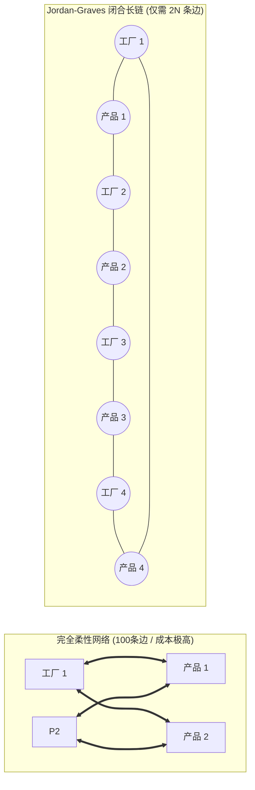

# Lec 15 多阶段柔性设计：Jordan-Graves 链式网络拓扑理论（Multi-Stage Flexibility & Chaining Theory）

## TL;DR

- 完全柔性（Full Flexibility）的成本陷阱：为什么连接一切的万能网络是极其愚蠢的浪费。
- 威廉·乔丹与史蒂芬·格雷夫斯（Jordan & Graves）链式理论（Chaining Theory）核心定理推导。
- 闭合大环链（Long Chains）如何仅用 1% 的微小柔性投资捕获完全柔性 96% 以上的对冲效益。

## 一、完全柔性（Full Flexibility）的狂妄与破灭

在面对多工厂、多产品线的复杂制造网络时，直觉上最完美的设计是**完全柔性网络（Fully Flexible Network）**：
让每一座工厂都能生产全集团所有的产品（在二分图拓扑上表现为一个完全全连接二分图 $K_{m, n}$）。

然而，在工业现实中，完全柔性是一场吞噬资本的噩梦：
- 如果集团有 10 座工厂、需要生产 10 种汽车底盘，完全柔性意味着全网必须铺设 $10 \times 10 = 100$ 条柔性连接弧；
- 每座工厂都必须购置全套极度复杂的工装夹具、昂贵的通用机器人，并对工人进行 10 种完全不同车型的繁琐培训；
- 维护和软件更新成本呈二次方指数级爆炸，最终导致企业在沉重的折旧中走向破产。

通用汽车研发中心研究员威廉·乔丹（William C. Jordan）与麻省理工学院教授史蒂芬·格雷夫斯（Stephen C. Graves）于 1995 年发表了运营管理学史上最具震撼力的经典论文：《制造柔性的原则》（Principles of Manufacturing Flexibility）。他们提出了划时代的**链式理论（Chaining Theory）**！

## 二、Jordan-Graves 链式理论（Chaining Theory）的数学证明

考虑 $N$ 座同质制造工厂与 $N$ 种同质产品。每座工厂的产能为 $C$，每种产品的随机需求期望值为 $\mu$（满足 $N \cdot C = N \cdot \mu$）。
定义图结构 $G = (P, M, E)$，其中边 $(i, j) \in E$ 表示工厂 $i$ 具备生产产品 $j$ 的能力。

### 1. 独立孤岛网络（Dedicated / 0 柔性）
每座工厂仅对应生产 1 种固定产品：$|E| = N$。
系统期望总销售量受限于各产品各自的上限截断：
$$E[\text{Sales}]_{dedicated} = \sum_{j=1}^N E[\min(C, D_j)]$$
由于无法对冲，期望销售量最低，产能浪费严重。

### 2. 闭合单一长链网络（Single Long Chain）
在每座工厂仅增加**极其微弱的 1 个额外连接度（即每座工厂仅能生产 2 种产品）**的严格限制下，构建一个首尾相连贯穿所有节点的**闭合大环链（Hamiltonian Cycle）**：
- 工厂 1 生产：产品 1、产品 2；
- 工厂 2 生产：产品 2、产品 3；
- 工厂 3 生产：产品 3、产品 4；
- ……
- 工厂 $N$ 生产：产品 $N$、产品 1（闭合闭环！）。
此时全网总连接边数仅为微不足道的 $|E| = 2N$！

::: theorem [Jordan-Graves 链式大一统定理]
构建的单一闭合大环链（Long Chain），在面对广泛的随机需求波动时：
**仅凭借 $|E| = 2N$ 条连接边（相比于完全柔性的 $N^2$ 条边，仅花费了极微小的柔性工程改造成本），就能捕获完全柔性网络（Full Flexibility, $|E| = N^2$）所能带来的期望销售增长与产能利用率提升效益的 96% 至 98% 以上！**
:::

### 3. 短链断裂的严重危害（Short Chains vs. Long Chains）
如果企业虽然也增加了相同数量的边，但由于规划失误，形成了两个互不连通的独立短环链（如工厂 1-2 环链，与工厂 3-4 环链）：
一旦工厂 1-2 所对应的产品需求暴涨，而工厂 3-4 所对应的产品严重疲软，**由于短链之间存在无法跨越的绝缘断层，闲置产能无法向激增需求跨区传递**，整体系统的期望销售量将发生严重滑坡！

## 三、链式动力学在工业界的普适性映射

链式理论不仅适用于汽车总装工厂，其哲学在整个供应链工程中无处不在：

1. **跨学科客服坐席技能培训（Call Center Cross-Training）**：
   - 不需要把每个客服培养成精通全险种、全业务的“超级全能王”；
   - 只需让每位客服精通自己的主业务，并额外掌握一门相邻业务（形成链式技能轮转环），就能以极低培训成本平滑应对突发话务洪峰；
2. **跨国空运集装箱与航线调度**：
   - 建立闭环循环航线（三角链式），彻底消除单向空载飞行；
3. **软件多核处理器并发任务调度（Processor Chaining）**。

## 我的理解

Jordan-Graves 链式理论是整个现代管理科学中最优美、最震撼心灵的数学定理之一。它用无懈可击的拓扑图论，粉碎了人类对“越多越好、全连接万能”的原始幼稚崇拜。它告诉我们：**连接的真正力量，不在于无节制的堆砌，而在于闭环拓扑的精密设计**。仅仅多给一个微小的自由度，只要首尾相咬形成一个闭合的生命环，波动的能量就能像水波一样在全网顺畅传递消弭。这是用极简结构战胜无序混沌的最高艺术境界。
