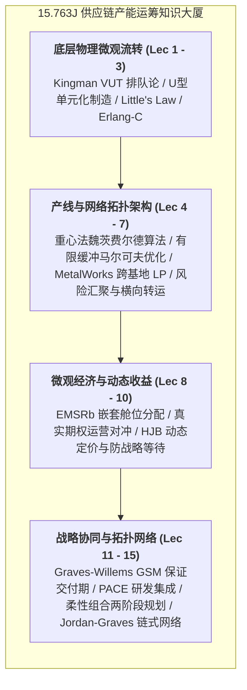

# Lec 16 课程全面总结：数字化双胞胎与端到端智能供应链未来（Course Summary & The Future of Supply Chain Analytics）

## TL;DR

- 全课程系统大复盘：从排队底层物理到全球网络长链拓扑的运筹架构演进路线图。
- 数字化双胞胎（Digital Twin）与大语言模型 Agent 在未来自主供应链决策中的跃迁。
- 在不确定性、复杂性与可持续发展约束交织的时代成为卓越运营系统架构师。

## 一、全课程知识体系大一统复盘

在麻省理工学院 15.763J 供应链产能分析与系统设计的全景航程中，我们系统推演了现代工业帝国赖以平稳运转的量化运筹矩阵。整个课程架构由微观物理流转、中观产线平衡、宏观网络设计与动态商业博弈交织而成。

这一体系深刻表明，现代供应链工程不是经验主义的拼图，而是一门具有高度自洽性的严谨量化科学。无论是车间内的一张工单流转，还是跨大洋的千万级产能投资，所有决策均受到排队等待、有限缓冲、网络流和博弈均衡等基础运筹定律的支配：

从排队论中微小的在制品积压，到跨国巨头面对数十亿汇率风暴时的战略对冲；从高节拍自动化流水线上几毫秒的托盘阻断，到全球闭合长链以极微小的连接捕获 96% 的超额红利——这门课程向我们展现了量化思维在驾驭工业复杂性时的无尽力量。通过将多级物理约束转化为数学规划模型，管理层得以超越直觉与经验的盲区，建立起兼具高韧性与低总拥有成本的端到端系统竞争优势。

## 二、新一代前沿范式：数字孪生与 AI 自主供应链

站在当下技术变革的潮头，传统的静态离散事件仿真（DES）与周期性批量计划正加速向**下一代自主智能供应链体系（Autonomous Supply Chain）**进化：

1. **工业级数字孪生（Supply Chain Digital Twin, SCDT）**：
   - 将企业物理世界的每一台机床、每一个托盘、每一艘货轮在云端构建 1:1 的实时数字化镜像；
   - 传统模型需要几小时甚至几天才能完成一次 LP 求解，数字孪生结合 GPU 高性能并行运筹计算，能够在数秒内完成百万变量级的实时重排产；
2. **生成式 AI 与大语言模型 Agent 调度中枢**：
   - 告别传统复杂的 ERP 报表与繁琐表单录入，LLM Agent 能够理解人类自然语言的复杂模糊指令（如“华东遭遇台风，请在不增加总预算的前提下将受阻订单动态重定向到华南”）；
   - Agent 自动调用底层 MILP 求解器与 GSM 拓扑模型，生成多套经过严格数学证明的可行方案，并在虚拟沙盘中推演财务影响供决策者拍板；
3. **闭环端到端自我修复（Self-Healing Supply Networks）**：
   - 遭遇微小的交期延误或质量异常时，系统无需人类介入，直接通过预先约定的智能合约自动完成横向调拨与加急补货。

## 三、致未来的运营系统架构师

成为一名顶尖的供应链系统架构师，不仅需要精通复杂的偏微分方程、随机规划与图论算法，更需要深刻洞察算法背后的真实人性与生态伦理：

::: insight
数据永远无法代替常识，模型永远无法穷尽现实。任何优雅的运筹公式在车间地面的泥泞与跨国港口的拥堵面前都会遭遇现实摩擦。真正卓越的管理者，绝不盲目做算法的奴隶，而是懂得在**算法的冷峻数学理性**与**商业战略的敏锐直觉**之间找到那个充满温度的黄金平衡点。
:::

未来的全球供应链还将背负更崇高的历史使命：不仅要追求更低成本与更快时效，更必须在全球脱碳减排（Scope 3 碳足迹审计）、循环经济逆向物流与人道主义救援保障中承担起时代赋予的沉甸甸责任。

## 我的理解

15.763J 的旅程结束了，但系统运筹的思维方式将伴随我们一生。这门课程教会我们最宝贵的洞见，是**透过混乱的表象洞悉系统的底层动力学结构**。当别人在抱怨随机波动的痛苦时，我们看到了金曼公式中可以被标准化的变异系数；当别人在争吵工厂到底该自建还是外包时，我们看到了真实期权在跨国长链中的优雅对冲。在这个瞬息万变的时代，掌握了系统运筹这柄利剑，我们就拥有了在不确定性迷雾中披荆斩棘、重塑世界秩序的无畏勇气。
