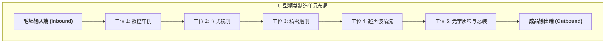

# Lec 2 制造系统设计：装配配置、节拍平衡与单元化制造（Manufacturing System Design: Assembly, Sizing & Cellular Layout）

## TL;DR

- 传统机群式布局（Job Shop）与现代流水线/单元化制造（Cellular Layout）范式对决。
- 生产线平衡（Line Balancing）启发式算法：节拍时间（Takt Time）与平滑系数优化。
- 基于成组技术（Group Technology）的秩顺序聚类法（Rank Order Clustering）推导。

## 一、传统车间布局的流动阻滞与单元化革命

在传统离散机械加工厂中，工厂通常按**工艺机群式布局（Process Layout / Job Shop）**：所有的车床集中在一个车间，所有的铣床在另一个车间，所有的冲压机在第三个车间。
这种布局导致零件在加工过程中呈现极其混乱的“意大利面条式”迂回游走：
- 零件在车间之间长距离往返搬运，物流动线极其低效；
- 95% 的制造周期时间（Lead Time）被浪费在工序间的托盘等待与排队上；
- 责任主体割裂，任何质量缺陷需要经历数周才能被最终质检发现，引发大批量批次报废。

**单元化制造（Cellular Manufacturing）**依据成组技术（Group Technology）原理，将加工相似零件族（Part Families）所需的不同类型设备集中布置成紧凑的 U 型单元（U-shaped Cell）：
- 一个零件在一个流（One-Piece Flow）状态下依次经过车、铣、磨各道工序；
- 工件在几分钟内完成全套工序，在制品 WIP 暴降 80% 以上，质量问题实现即时暴露。

## 二、生产线节拍时间与平衡优化算法

在连续装配线设计中，核心任务是将总作业任务集合 $\{1, 2, \dots, n\}$ 分配到若干个工作站中，使各工作站的加工负荷尽可能均匀。

::: definition [节拍时间（Takt Time）与理论最少工作站数]
- **节拍时间（Takt Time, $T_{takt}$）**：制造一件合格成品所允许的最大时间间隔，完全由终端市场需求拉动：
  $$T_{takt} = \frac{\text{每日有效工作净时间}}{\text{每日客户需求总量}}$$
- **理论最少工作站数（Theoretical Minimum Workstations, $N_{min}$）**：
  $$N_{min} = \left\lceil \frac{\sum_{i=1}^n t_i}{T_{takt}} \right\rceil$$
  （其中 $t_i$ 为作业要素 $i$ 的标称操作工时）
:::

### 生产线平衡率与平滑系数
- **平衡率（Line Balancing Efficiency, $E$）**：
  $$E = \frac{\sum_{i=1}^n t_i}{N \cdot T_{cycle}} \times 100\%$$
- **平衡损失率（Balance Delay）**：$d = 1 - E$；
- **平滑指数（Smoothness Index, $SI$）**：衡量各工作站空闲时间分配的均衡度：
  $$SI = \sqrt{\sum_{k=1}^N (T_{max} - T_k)^2}$$

在优先图（Precedence Diagram）拓扑约束下，工业界通常采用**后继任务最多优先启发式（Ranked Positional Weight, RPW）**进行贪心分配，确保不违反工艺装配先后顺序的同时，使总站数 $N$ 逼近 $N_{min}$。

## 三、成组技术与秩顺序聚类法（Rank Order Clustering, ROC）

将成百上千种零件与其对应的机床设备解耦划分为互不重叠的独立制造单元，是单元化制造的技术基石。金·劳拉（J. R. King）提出的**秩顺序聚类法（ROC）**通过矩阵变换优雅地求解该问题：

1. **构建机床-零件关联矩阵（Machine-Part Incidence Matrix）**：
   行代表机床 $M_i$，列代表零件 $P_j$。若机床 $i$ 加工零件 $j$，则交叉项为 1，否则为 0。
2. **计算行与列的二进制权重并重排**：
   - 将每一行视为一个二进制数，计算其十进制分值，按分值从大到小对所有行进行降序重新排列；
   - 随后将每一列视为一个二进制数，重新计算列的十进制分值，按分值从大到小对所有列降序重排；
3. **收敛检查**：
   重复上述行排与列排交替迭代，直到矩阵行列顺序不再发生任何变化。

收敛后的矩阵将呈现极其清晰的**对角块状拓扑（Block Diagonal Form）**：每一个独立的对角块直接对应一个物理上完全闭环的 U 型制造单元！

## 我的理解

制造系统设计是工业工程皇冠上的宝石。从机群式布局向 U 型精益单元的跨越，本质上是一场“以时间消除空间”的伟大范式革命。ROC 聚类算法展示了离散矩阵数学如何将原本一团乱麻的车间工艺动线，梳理为井井有条的自给自足单元。这不仅消灭了数以吨计的呆滞在制品，更让一线工人从螺丝钉式的局部看管者，蜕变为掌控全流程流动的复合多能工。
