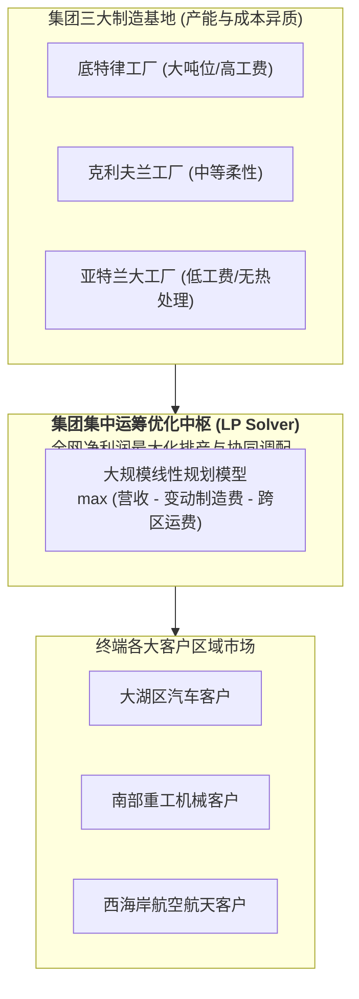

# Lec 6 供应链网络协同决策：MetalWorks 案例与跨基地产能调配（Supply Chain Design II: MetalWorks Multi-Site Allocation）

## TL;DR

- 重工业与金属加工企业典型痛点：多生产基地、多产品线与跨区客户需求的产能冲突。
- MetalWorks 案例大规模线性规划（LP）模型构建：边际贡献最大化与固定换线开销权衡。
- 影子价格（Shadow Price）在指导工厂战略扩产、外协代工与跨基地动态转单中的深度剖析。

## 一、跨基地制造协同的现实复杂度

在大型制造集团（如金属锻造、特种钢材、精密注塑龙头企业）中，企业往往在全国或全球布局多个生产基地（Plants）。
以 MIT 经典商业案例 **MetalWorks 公司** 为例：
- 公司在底特律、克利夫兰和亚特兰大拥有 3 座大型重力冲压工厂；
- 需向遍布全美五大区域的上百家主机厂客户供应数十种规格的高强度合金钢部件；
- **各基地的工艺能力非同质化**：底特律工厂拥有大吨位冲压机，适合生产重型卡车底盘件，但人工工时费高昂；亚特兰大工厂电费与劳动力低廉，但缺乏热处理特种产线；
- **各区域的运输物流费率差异巨大**：若为了填满亚特兰大产能而向底特律周边客户长途供货，沉重的运费将完全吞噬生产成本优势。

在此场景下，单凭各工厂厂长的独立排产，集团必然陷入局部争抢高毛利订单、推诿难加工部件的内耗局面。必须建立全集团层面的**集中式跨基地产能协同分配优化模型**。

## 二、MetalWorks 协同决策的线性规划（LP）数学构建

### 1. 指标与集合定义
- $I$：制造工厂集合，$i \in \{1, 2, \dots, M\}$；
- $J$：产品型号集合，$j \in \{1, 2, \dots, N\}$；
- $K$：目标客户区域集合，$k \in \{1, 2, \dots, P\}$；
- $T$：关键设备工艺类别集合（如冷轧、冲压、淬火热处理），$t \in \{1, \dots, H\}$。

### 2. 参数定义
- $p_{jk}$：在区域 $k$ 销售产品 $j$ 的单价；
- $d_{jk}$：区域 $k$ 对产品 $j$ 的市场最大需求量上限；
- $c_{ij}$：在工厂 $i$ 生产单位产品 $j$ 的直接变动制造成本；
- $t_{ijk}$：将单位产品 $j$ 从工厂 $i$ 运输至客户区域 $k$ 的单位综合物流费用；
- $a_{itj}$：在工厂 $i$ 上生产单位产品 $j$ 所消耗的工序 $t$ 的机时工时；
- $Cap_{it}$：工厂 $i$ 在工序 $t$ 上的额定可用总工时上限。

### 3. 决策变量
- $X_{ijk} \ge 0$：工厂 $i$ 生产并运往区域 $k$ 交付客户的产品 $j$ 的实物数量。

### 4. 优化目标函数与约束体系
全网目标函数：最大化全集团总边际贡献净利润：
$$\max \sum_{i \in I} \sum_{j \in J} \sum_{k \in K} \left( p_{jk} - c_{ij} - t_{ijk} \right) X_{ijk}$$
约束条件：
1. **工厂设备产能刚性工时约束**：
   $$\sum_{j \in J} a_{itj} \left( \sum_{k \in K} X_{ijk} \right) \le Cap_{it}, \quad \forall i \in I, \forall t \in T$$
2. **区域市场最大需求上限约束**：
   $$\sum_{i \in I} X_{ijk} \le d_{jk}, \quad \forall j \in J, \forall k \in K$$
3. **变量非负约束**：
   $$X_{ijk} \ge 0, \quad \forall i, j, k$$

## 三、对偶解与影子价格（Shadow Price）的战略推演

在商用求解器输出最优生产调配矩阵 $X_{ijk}^*$ 之后，高级运筹总监最关注的实际上是约束条件的**对偶变量（Dual Variables / Shadow Prices）**：

::: definition [产能影子价格（Shadow Price of Capacity）]
对应工厂 $i$ 工艺 $t$ 产能约束的对偶变量值 $y_{it}^*$。其严格经济学物理含义为：**在当前最优运营基准下，若该工厂的该项设备产能能够微幅增加 1 个机器工时，全集团总净利润所能获得的瞬时边际增量！**
:::

通过分析影子价格表，管理层能够做出震撼性的战略抉择：
- **精准加班决策**：若某冲压机的影子价格为每小时 450 美元，而支付给一线工人的双倍加班费仅为每小时 80 美元，系统清晰表明：**组织工人周六加班具有极高的正向投资回报**；
- **战略资本技改（CapEx）投向**：若亚特兰大热处理工序的影子价格连续数月为 0，表明该工序常年富余，继续投资更新该设备毫无意义；而底特律大冲压机的影子价格长年居高不下，下年度集团数千万元的技改技措预算必须全部倾斜砸向底特律！

## 我的理解

MetalWorks 案例展示了运筹学如何彻底重构集团型企业的经营决策范式。在复杂的多基地分工体系中，人类的大脑往往被海量的运费表、工时定额和报价单搞得晕头转向，最终退缩为“就近供货、自负盈亏”的平庸妥协。线性规划模型像一台超大功率的算力涡轮，在全网复杂的利益交错中精准捕捉每一分钱的边际套利空间；而对偶影子价格则如同商业 X 光机，穿透嘈杂的表象，为千亿级资本开支指明了最锋利的投掷靶心。
