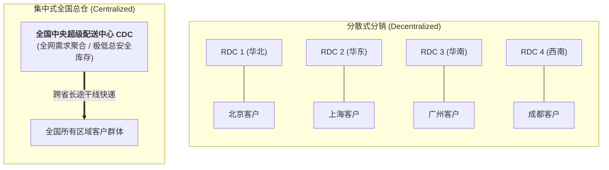

# Lec 7 分散式分销系统：多级仓网架构与库存风险汇聚效应（Decentralized Distribution Systems & Risk Pooling）

## TL;DR

- 分销网络拓扑选型：多层级分散区域分仓（RDC）vs. 单一全国中央大仓（CDC）。
- 风险汇聚效应的深层定量条件：跨区域市场需求相关系数 $\rho$ 对总库存的非线性影响。
- 引入中转虚拟调拨（Transshipment）与动态共享机制下的全网弹性库存再平衡。

## 一、分销仓网的经典两极化对决

在消费品、零售电商与工业品分销领域，网络架构师始终面临结构性的终极取舍：
- **方案 A：极端分散式网络（Highly Decentralized）**：
  在全国各大主要省份设立 20 个区域分销配送仓（RDC）。
  - **优势**：离终端客户物理距离极短，能轻松实现“当日达”或“次晨达”；末端短途配送运费低廉；
  - **劣势**：全网安全库存被分割在 20 个蓄水池中，总库存资金占用巨大；频繁出现“A 仓缺货断档而 B 仓积压如山”的窘境。
- **方案 B：高度集中式网络（Highly Centralized）**：
  仅在国家地理中心（如武汉或郑州）设立 1 个巨型中央分发中心（CDC）。
  - **优势**：全网需求汇聚，方差高度相互抵消，安全库存大幅缩减 60% 以上；建仓固定资产投资与管理团队极度精炼；
  - **劣势**：向偏远省份交付需要跨越数千公里干线，平均物流时效拉长至 3 到 5 天，干线运输运费成本高昂。

## 二、相关系数 $\rho$ 对风险汇聚收益的制约机制

我们在前面的基础课程中曾证明，在各区域需求相互独立（$\rho = 0$）的假定下，集中化能够带来经典的平方根定律节约。
然而，在真实分销网络中，**各区域之间的需求往往存在正向或负向的空间相关性（Spatial Correlation）**：

::: theorem [跨区域相关需求下的全网方差合成通式]
设网络服务 $n$ 个区域市场，每个区域的需求均值为 $\mu_i$、方差为 $\sigma_i^2$。任意两区域 $i, j$ 之间的需求相关系数为 $\rho_{ij}$。
集中合并后的全网总需求方差为：
$$\sigma_{total}^2 = \sum_{i=1}^n \sigma_i^2 + 2 \sum_{i < j} \rho_{ij} \sigma_i \sigma_j$$
若假定各区域具有相同方差 $\sigma^2$，且两两之间的平均相关系数为 $\bar{\rho}$，则全网总标准差为：
$$\sigma_{total} = \sigma \sqrt{n + n(n-1)\bar{\rho}}$$
:::

### 风险汇聚收益率与相关系数的极端边界分析
1. **完全正相关极端（$\bar{\rho} = 1$）**：
   $$\sigma_{total} = \sigma \sqrt{n + n(n-1)} = \sigma \sqrt{n^2} = n \cdot \sigma$$
   此时，集中化后的总标准差恰好等于各分散区域标准差的简单代数相加！
   **结论**：当全国市场同频共振（如遭遇全国性宏观周期下行或全国统一大降价大促）时，**地理集中化无法带来任何一分钱的安全库存节省！**
2. **完全独立基准（$\bar{\rho} = 0$）**：
   $$\sigma_{total} = \sqrt{n} \cdot \sigma \implies \frac{\sigma_{total}}{\sum \sigma_i} = \frac{1}{\sqrt{n}}$$
   标准平方根节约完美成立。
3. **负相关极端（$\bar{\rho} < 0$）**：
   不同区域呈现“此消彼长”的对冲互补特征（如夏季雨带推移导致南方雨具暴涨时北方大旱，而后期雨带北移又反转）。
   此时全网总方差发生激烈的相互湮灭，**风险汇聚能够爆发甚至超越理论平方根的惊人节约奇迹**！

## 三、网络中间形态：横向转运（Transshipment）与虚拟集中化

为了兼顾“分散式 RDC 的极速履约时效”与“集中式 CDC 的低库存风险”，现代智慧供应链广泛部署**横向应急转运（Lateral Transshipment）**：

::: definition [横向转运运作机制]
各区域 RDC 仍旧独立就近为本地客户履约发货。但打通全国全网库存透明数据库：
当某 RDC 突发局部爆单面临缺货危机时，系统并不盲目向上游工厂下达加急生产单，而是自动检索相邻地理 RDC 的实时富余库存，以极低的区域间短途陆运费进行**横向同级库存调拨支援**。
:::

这种策略被称为**“物理分散、逻辑集中（Physically Decentralized, Virtually Centralized）”**。企业在维持客户就近发货体验的同时，通过灵活的横向转运算法，实质上享受到了几乎等同于全国中央大仓的风险汇聚对冲红利。

## 我的理解

分销系统的拓扑演进，是供应链对抗时空熵增的宏伟画卷。它告诉我们，切忌用静止割裂的眼光看待一张仓网。相关系数 $\rho$ 的推导如同一剂清醒剂，戳破了“盲目建大仓就一定能省库存”的教条主义幻象。而现代物联网与数字孪生驱动的横向转运机制，则优雅地跨越了“时效”与“成本”看似不可调和的二元对立，让静态沉睡的物理库房，蜕变为全网呼吸共振的有机生命体。
