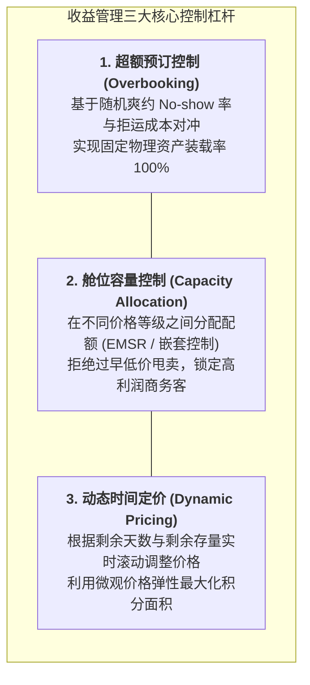

# Lec 8 收益管理：超额预订、动态定价与多等级舱位产能分配（Revenue Management & Dynamic Capacity Allocation）

## TL;DR

- 从成本定价向价值定价跃迁：易腐产能资产的收益最大化基本公理体系。
- 单资源多等级控制：期望边际收益启发式（EMSR）与连续动态规划打分方程。
- 网络级收益管理（Network Revenue Management）的随机起讫点（OD）联合规划模型。

## 一、收益管理（Revenue Management）的核心商业逻辑

收益管理由美国航空（American Airlines）在 20 世纪 80 年代率先开创，被《福布斯》誉为现代商业史上最具盈利杀伤力的战术武器。
其核心宗旨可以总结为著名的**“5R 原则”**：
在正确的时间（Right Time）、将正确的资源产品（Right Product）、以正确的价格（Right Price）、通过正确的渠道（Right Channel）、销售给正确的细分客户（Right Customer）。

收益管理适用的商业土壤具有极其苛刻的共性条件：
1. **易腐烂的固定产能（Perishable Fixed Capacity）**：酒店今晚空置的客房、货运航班起飞后多余的吨位，价值瞬间归零；
2. **高固定成本与极低边际变动成本**：多接待一位客人几乎不需要增加额外支出；
3. **市场客户支付意愿差异巨大**：休闲度假游客对价格极度敏感，而临时出差的高管对价格极度不敏感；
4. **能够实现市场区隔（Market Segmentation）**：防止高支付意愿客户投机倒把购买廉价折扣产品。

## 二、多等级舱位分配与 EMSR 算法推导

设某资源拥有固定物理容量 $C$。市场存在 $m$ 个票价等级：
$$p_1 > p_2 > \dots > p_m$$
各等级客户按时间顺序顺次到达（低价客户早早到来，高价客户在最后时刻到来）。

### 1. 嵌套容量控制（Nested Capacity Allocation）
在管理中切忌采用各自独立的“硬配额（Partitioned Allocation）”——如果低价票卖光了而高价票有空闲，应该随时允许高价客户抢占低价配额！
因此必须推行**嵌套控制（Nesting）**：
允许销售给等级 $j$ 及其更低等级的总累计预订量上限为 $BL_j$（Booking Limit），且满足：
$$BL_m = C \ge BL_{m-1} \ge \dots \ge BL_1$$

### 2. EMSRb 启发式算法推导
由 Peter Belobaba 提出的 **EMSRb 算法**是全球航空业 GDS 系统运行事实标准：
当决定是否向价格等级 $k$ 开放销售时，我们将所有比它更高的等级 $\{1, 2, \dots, k-1\}$ 聚合成一个虚拟的高等级需求：
- 该联合高等级的期望平均票价为加权均值：
  $$\bar{p}_k = \frac{\sum_{j=1}^{k-1} p_j \mu_j}{\sum_{j=1}^{k-1} \mu_j}$$
- 联合需求的期望值与方差（假定各等级相互独立）：
  $$S_k = \sum_{j=1}^{k-1} D_j \sim N\left( \sum_{j=1}^{k-1} \mu_j, \sum_{j=1}^{k-1} \sigma_j^2 \right)$$

::: theorem [EMSRb 保护水平方程]
向等级 $k$ 拒绝销售、留给更高等级客户的保护容量（Protection Level, $y_k^*$）必须满足：
$$P\left( S_k > y_k^* \right) = \frac{p_k}{\bar{p}_k} \implies F_k(y_k^*) = 1 - \frac{p_k}{\bar{p}_k}$$
利用标准正态逆累积分布求解：
$$y_k^* = \sum_{j=1}^{k-1} \mu_j + \Phi^{-1}\left( 1 - \frac{p_k}{\bar{p}_k} \right) \sqrt{\sum_{j=1}^{k-1} \sigma_j^2}$$
等级 $k$ 允许接受的最大预订额上限为：
$$BL_k = C - y_k^*$$
:::

## 三、网络级收益管理与影子竞价价格（Bid Price Controls）

单航段单资源的容量控制存在局限性。在复杂的轴辐式航线或高铁网络中：
- 某旅客希望购买“波士顿 $\to$ 芝加哥 $\to$ 洛杉矶”的联程票（消耗两段航段的运力）；
- 此时究竟该收多少钱？

**网络收益管理（Network RM）**将全网抽象为大规模线性规划对偶模型：
通过每日凌晨运行全网确定性等价规划（DLP）：
$$\max \sum_{j} R_j x_j \quad \text{s.t.} \quad \mathbf{A} \mathbf{x} \le \mathbf{C}, \quad 0 \le \mathbf{x} \le \mathbf{D}$$
每个航段资源对应一个对偶影子价格 $\pi_i$（被称作该航段的**门槛竞价价格，Bid Price**）。

::: definition [动态门槛竞价准则（Bid-Price Rule）]
当一个联程产品申请预订时，系统计算其所经过的所有航段的影子价格之和：
$$\text{最低门槛价格} = \sum_{i \in Route} \pi_i$$
**唯有当该旅客支付的票价 $R$ 严格大于其所消耗的所有底层资源的影子价格总和时，系统才允许出票确认；否则断然予以拒单！**
:::

## 我的理解

收益管理是运筹学在资本主义微观市场中的无情掠夺者，也是效率优化的最高艺术。它用优雅的概率对冲与影子定价，彻底颠覆了“一手交钱一手交货”的僵化传统买卖观念。通过将同一架飞机的座位在时间长河中进行动态切片，它既让囊中羞涩的学生买到了白菜价机票，又让一掷千金的企业主在危急关头总能买到最后一张加急票。这不仅是利润的最大化，更是在微观资源配置层面实现了全社会总福利的极致释放。
