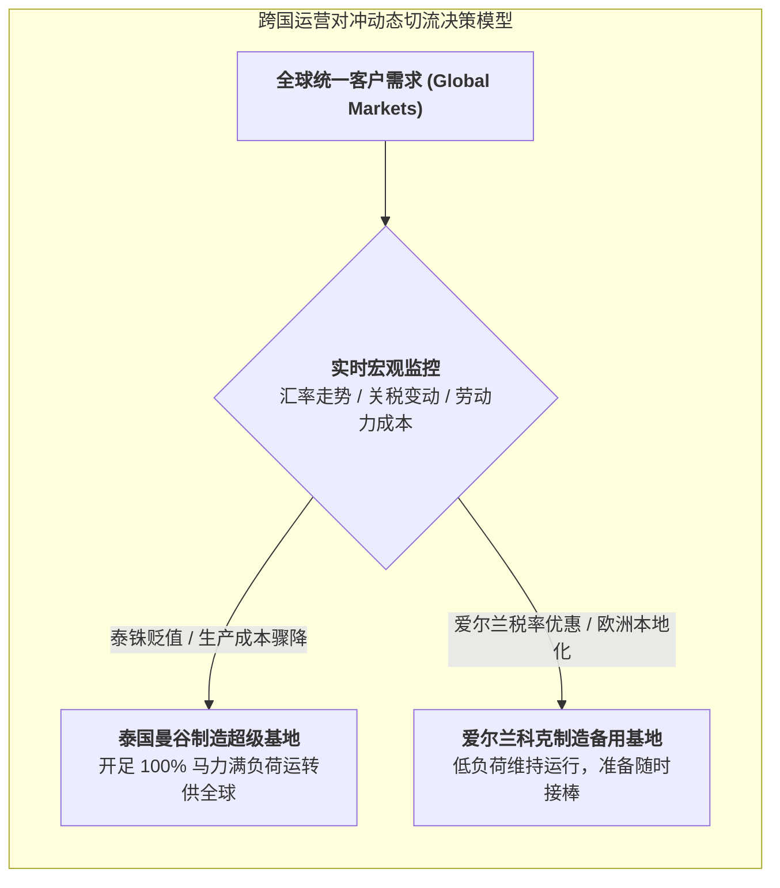

# Lec 9 不确定性下的运营对冲：产能超额投资与弹性期权（Operational Hedging: Capacity Investment Under Uncertainty）

## TL;DR

- 应对外汇波动与地缘动荡的终极防线：金融对冲（Financial Hedging）与运营对冲区别。
- 双市场跨国制造基地的真实期权（Real Options）价值：在不同生产基地间动态切换产出。
- 希捷科技（Seagate）硬盘全球制造网络布局与汇率巨幅波动对冲实战。

## 一、金融对冲的局限与运营对冲的战略价值

在跨国制造与供应链运营中，企业无时无刻不在直面两大宏观系统性冲击：
- **全球货币汇率剧烈波动（Currency Volatility）**：生产基地所在国货币突然大幅升值 20%，导致以美元计价的出口制造成本急剧恶化；
- **地缘政治与关税贸易摩擦（Trade Barriers）**：某国突然对进口元器件征收惩罚性关税。

传统财务总监通常倾向于通过华尔街金融衍生品（如货币远期合约 Currency Forwards、外汇期权）进行**金融对冲（Financial Hedging）**。
然而，金融对冲存在三大致命短板：
1. **期限极其短暂**：市场上高流动性的外汇远期通常只有 3 到 6 个月，很难买到 5 至 10 年期的长期外汇保险；
2. **仅对冲现金流会计数字**：无法改变企业在当地真实的物理制造劣势；
3. **衍生品交易成本高昂且容易爆仓**。

**运营对冲（Operational Hedging）**通过在全球多国进行**战略性产能冗余投资（Strategic Over-Capacity）**，赋予企业在物理世界中随汇率和政策变动而在不同基地之间动态“转单切流”的真实期权！

## 二、真实期权（Real Options）数学建模

扬·范米格姆（Jan Van Mieghem）教授推导了运营对冲的双基地产能投资模型。
考虑一家跨国企业在两个国家（国家 1 与国家 2）建设制造基地，单位产能建设成本分别为 $c_1, c_2$。
未来时期，两国的本地单位生产成本分别为随机变量 $W_1, W_2$（以基准货币折算，反映了随机汇率与通胀走势）。
全球客户总需求为 $D$。

### 两阶段决策博弈架构
1. **阶段 1（事前投资决策）**：在汇率未知的前提下，确定在两地投资建设的产能规模 $K_1, K_2$；
2. **阶段 2（事后动态调度决策）**：汇率随机变量 $W_1, W_2$ 实现后，确定各地的实际生产量 $q_1, q_2$：
   $$\max_{q_1, q_2} \left[ P(q_1 + q_2) - W_1 q_1 - W_2 q_2 \right]$$
   $$\text{s.t.} \quad 0 \le q_1 \le K_1, \quad 0 \le q_2 \le K_2, \quad q_1 + q_2 \le D$$

::: theorem [跨国运营对冲价值方程]
如果 $W_1 < W_2$，最优调度策略是**优先用满低成本基地 1 的全部产能 $K_1$**；若仍有未满足需求，再由次优基地 2 补充生产：
$$q_1^* = \min(K_1, D), \quad q_2^* = \min(K_2, D - q_1^*)$$
由于可以在事后根据 $\min(W_1, W_2)$ 动态选择最优流向，生产成本函数呈现出严格的凸函数形态：
$$E[\min(W_1, W_2)] < \min(E[W_1], E[W_2])$$
**两地汇率波动的方差越大（波动越剧烈），这种运营期权所能榨取的超额套利价值就越高！**
:::

## 三、希捷科技（Seagate）运营对冲实操教训

作为全球机械硬盘（HDD）制造龙头，希捷科技在其历史发展中将运营对冲运用到了极致：
- 在 20 世纪 90 年代，希捷在新加坡、泰国、马来西亚和中国无锡同时建立了大规模高度同质化的磁头与盘片组装线；
- 希捷在各地的总额定产能之和达到了其全球平均需求量的 **140%（即常年保持 40% 的名义闲置产能冗余）**！
- 当 1997 年亚洲金融风暴爆发、泰铢与马来西亚林吉特暴贬 50% 时，希捷仅用了不到两周时间，通过内部全球 ERP 调度，将 60% 的总装订单从新加坡瞬间切换转移至泰国与马来西亚工厂，直接将单机组装成本砍掉近三分之一，在当年彻底击垮了几乎全产线重仓新加坡的竞争对手 Conner Peripherals。

::: insight
运营对冲不是免费的午餐，它的代价是常年维持多地厂房与产线的固定资产折旧。企业必须严谨测算：**期权套利带来的期望运营现金流节省，是否足以覆盖多建 40% 产能所产生的固定资本沉没成本**。只有在汇率波动剧烈、产品生命周期较长且换线成本低的行业，运营对冲才能发挥最耀眼的光彩。
:::

## 我的理解

运营对冲是战略供应链在资本层面的最高级别博弈。它展现了一种深刻的辩证法：表面上的“闲置浪费”（多建备用工厂），在充满不确定性的宏观风暴面前，反而构成了最坚不可摧的战略护城河。华尔街的金融合同可能因对手方破产而瞬间变成废纸，但耸立在不同大陆上的实体工厂和熟练工人，是企业永远可以在关键时刻打出的物理底牌。这是重资产工业智慧对虚拟金融投机的降维打击。
