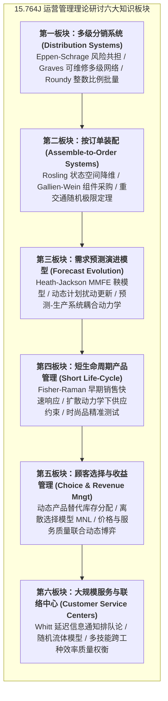

# Lec 1 研讨导引与顾客导向运营理论范式（Introduction & Customer-Driven Operations）

## TL;DR

- 本博士研讨课立足于随机运筹学与应用概率论，聚焦顾客导向运营（Customer-Driven Operations）的数学建模范式。
- 课程横跨多级分销系统、按单装配（ATO）、需求预测演进（MMFE）、短生命周期产品及服务中心随机排队五大理论前沿。
- 研讨核心在于攻克随机动态规划维数灾难，提炼出结构优雅、且具备渐进最优保证的闭式决策启发式规则。

## 一、运营管理理论范式的演进与博士研讨课定位

麻省理工学院 15.764J（与土木工程系 1.271J 联合开设）是面向运筹学与运营管理博士生的高阶理论研讨课。传统的运营管理研究长期建立在以产出为中心的静态或准静态模型之上（如确定性经济订货批量 EOQ、线性规划 MRP 排程）。

然而，随着现代商业环境从“卖方市场”向“买方市场”的不可逆跃迁，顶尖企业的运营核心已全面转向以终端顾客真实体验与异质性需求为中心的**顾客导向运营（Customer-Driven Operations）**。

::: definition [顾客导向运营（Customer-Driven Operations）]
指将终端顾客的微观行为机理（包括交期敏感性、动态品牌/品类替代、等待心理成本与异质性估值）深度内生化，构建以最小化系统总缺货惩罚、最大化服务可用性为目标的随机控制与优化理论体系。
:::

本课程的理论研究主线旨在解决经典运营学面临的核心数学矛盾：
- **随机性（Stochasticity）**：客户到达的泊松波动、服务时间的相型分布、生产提前期的随机扰动。
- **动态性（Dynamism）**：长周期的预测随着新信息的注入呈现鞅演进（Martingale Evolution），过去决策作为状态向量约束当前决策。
- **高维耦合性（Dimensionality & Coupling）**：多级分销网络中跨节点的在途在制品依赖，按单装配中多组件与多产品的双向匹配约束。

## 二、理论研讨的六大核心板块全景透视

全学期的理论研讨围绕六个经过深思熟虑的子领域展开。每一个子领域均代表了现代随机运作理论在特定业务场景下的纵深探索，由该方向上最具突破性的里程碑学术论文奠定基石。从多级网络的空间库存流动，到按订单装配的时间敏感性装配；从信息演进的时间序列鞅模型，到快消时尚品的扩散动力学；再到最终由人类主观选择模型驱动的收益管理与服务呼叫中心排队系统，六大板块构成了自成一体的理论闭环。

在多级分销系统中，我们重点剖析集中化订货与多梯队库存控制的风险共担效应；在按订单装配领域，我们将深入挖掘组件通用性与订单级惩罚函数的非线性耦合难题；在预测演进模型中，我们将学习如何用鞅论刻画信息到达的时序动态；在短生命周期管理中，我们将见证快速响应机制如何用两阶段规划平抑时尚品需求方差；在顾客选择模型中，我们将建立包含效用离散选择的动态库存定价联动；在服务中心排队论中，我们将探索大系统重交通流体极限下的最优排班与路由规则。

每一板块的学术目标不仅在于推导特定公式，更在于领悟顶尖运筹学者如何通过**凸分析（Convex Analysis）**、**弱收敛（Weak Convergence）**与**布朗控制问题（Brownian Control Problems）**化繁为简，将难以求解的 NP-hard 维度死锁转化为优美且工程可落地的极限定理。研讨课程特别强调推导过程中的结构性性质证明，例如次模性、多模性与超模性在证明单调最优控制策略中的关键应用。学生需要独立复现核心引理的代数推演，并结合当前云计算架构、自动化履约网络与数字化实时平台开展跨学科联想与反思。

## 三、数学建模中的维数灾难与近似最优性哲学

在随机动态规划（Stochastic Dynamic Programming）中，贝尔曼方程（Bellman Equation）在理论上完美刻画了最优策略：

$$V_t(S_t) = \min_{a_t \in \mathcal{A}(S_t)} \left\{ C(S_t, a_t) + \mathbb{E} \left[ V_{t+1}(f(S_t, a_t, W_{t+1})) \mid S_t, a_t \right] \right\}$$

然而，在复杂运营网络中，状态向量 $S_t$ 的维度往往随着节点数、在途提前期与产品种类呈指数级膨胀，导致精确数值求解遭遇不可逾越的**维数灾难（Curse of Dimensionality）**。

本研讨课展现了理论运筹学的一致哲学美感：
- **寻找策略空间的充分统计量**：例如在树状网络中证明次序一致性，将多维状态折叠为一维标量（如基准库存 Base-stock）。
- **证明最坏情况界限（Worst-case Bounds）**：如 Robin Roundy 证明的“98% 有效性”——设计极度简便的 2 的幂次方批量规则，其总成本距离不可知的全局绝对最优解的偏差上限不超过 2%！
- **渐近最优性（Asymptotic Optimality）**：在系统吞吐量 $N \to \infty$ 的重交通极限下，离散跳跃过程弱收敛为连续漂移布朗运动，从而推导出闭式解析解。

::: pitfall [脱离物理直觉的数学形式主义陷阱]
博士生在做运筹学研究时，容易陷入为了推导而推导的形式主义泥潭，构造出极其晦涩的超维状态转移矩阵，最终算法在实践中无法计算且无法解释。优秀的理论研究必须像 Eppen-Schrage 或 Roundy 一样，用极其精妙的数学工具支撑出极其朴素、符合运营现场直觉的管理洞见。
:::

## 我的理解

作为运筹学与复杂系统研究者，研读 15.764J 的经典理论带来的是思维视角的根本升华。

1. **从确定性规划迈向随机控制直觉**：工业界许多工程师在做排产时习惯于线性规划（LP）或整数规划（MIP），将输入均值作为确定参数。然而现实充满随机扰动，平均值掩盖了致命的方差惩罚。真正成熟的架构师必须养成在方差、排队重交通与概率分布尾部思考系统的本能。
2. **渐近分析的优雅力量**：当一个组合优化问题在离散微观层面不可解时，退后一步观察系统在大规模极限（Heavy Traffic / Fluid Scaling）下的宏观流动，往往能发现流体动力学般的平滑对称性。现代云计算大规模数据中心容器调度、外卖即时物流派单算法，其底层均流淌着这些经典重交通控制理论的血液。
3. **策略的可解释性高于黑盒微调**：在运营决策中，一线调度员绝不会执行一个由上万个不可见神经网络权重吐出的黑盒工单。理论研究的核心贡献，恰恰是证明诸如 $(s, S)$ 或按比例订货这类极其简单优雅的规则在数学上的高保真度，为工程实现注入灵魂。
