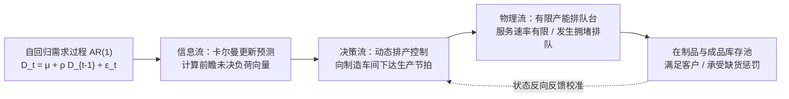

# Lec 12 平稳需求下的预测-生产-库存耦合系统动力学（Analysis of a Forecasting-Production-Inventory System）

## TL;DR

- 托克泰与温（Beryl Toktay & Lawrence Wein, 2001）构建了预测、有限生产能力与库存控制闭环耦合的动力学分析框架。
- 在平稳自回归 AR(1) 需求环境下，严密分析了有限加工速率排队系统（$M/M/1$ 型产能约束）对信息预测更新的非线性响应。
- 证明了动态最优基础库存不仅取决于当前实物在库，更取决于由预测新息（Innovations）加权计算的未决前瞻工作量。

## 一、预测、有限产能与库存的闭环三体纠缠

在过去的经典学术文献中，三类核心运营要素往往被割裂在不同的子学科中孤立研究：
1. **预测学（Forecasting）**：统计学家专注于时间序列模型（ARIMA、状态空间滤波），假设预测结果被下游无条件完美执行；
2. **排队论与生产能力（Queueing & Capacity）**：运筹学者研究有限服务速率 $C$ 的排队延迟，但通常假设需求到达是无外生预测的纯泊松流；
3. **库存论（Inventory Theory）**：假设提前期外生且无限产能，忽视工厂车间排队拥堵对交付时间的内生动态拉长。

欧洲工商管理学院贝尔·托克泰（Beryl Toktay）与斯坦福大学劳伦斯·温（Lawrence Wein）在 2001 年发表于《Management Science》的名篇《平稳需求下预测-生产-库存系统的分析》，首次将这三者拉入同一个**闭环反馈动力学系统（Closed-loop Coupled Dynamic System）**中进行统一解析。

系统核心矛盾在于：**当工厂车间具备有限的刚性产能上限（Capacity Limits）时，预测信息的提前揭露是否依然有用？企业该如何防止车间在需求低谷时设备闲置、而在需求高峰时排队雪崩？**

## 二、自回归 AR(1) 需求与前瞻工作量指数推导

托克泰与温设定系统的真实客户需求服从均值回复的平稳一阶自回归过程 $\text{AR}(1)$：

$$D_{t+1} = \mu + \rho (D_t - \mu) + \epsilon_{t+1}, \quad \text{其中 } |\rho| < 1, \quad \epsilon_t \sim \text{i.i.d. } \mathcal{N}(0, \sigma^2)$$

参数 $\rho$ 刻画了需求的自相关持续性：
- 当 $\rho > 0$ 时，需求展现出正向粘性与动量效应（今天卖得好，预示着下周大概率继续畅销）；
- 当 $\rho < 0$ 时，需求展现出负向振荡均值回复特性。

### 前瞻未决工作量（Forward-Looking Workload Index）
由于生产车间是一个具有有限最大加工速率 $\mu_{\text{Cap}}$ 的排队系统，在时刻 $t$，系统不仅需要掌握当前物理仓库中的在制品量 $x_t$，还必须对未来无限时域内的**累积折现预测需求冲量**进行全息投影。

通过对几何级数 $\sum_{k=1}^{\infty} \beta^k \mathbb{E}[D_{t+k} \mid D_t]$ 求闭式和，作者推导出系统的充分统计量标量指标——**前瞻调整工作量（Adjusted Workload Status, $W_t$）**：

$$W_t = I_t - B_t + \frac{\rho}{1 - \rho} (D_t - \mu)$$

其中：
- $I_t - B_t$ 为当前物理净库存（在库减去积压）；
- 核心增益项 $\frac{\rho}{1 - \rho} (D_t - \mu)$ 是对由于需求自相关性引发的未来累积涌入量的精确数学折现！

## 三、状态依赖动态最优策略与产能利用率边界

通过结合扩散近似与半马尔可夫决策过程（SMDP），托克泰与温严格证明了该耦合系统的最优控制结构：

::: theorem [Toktay-Wein 状态依赖基准库存定理 (2001)]
在有限产能与自回归需求耦合的连续时间系统中，全系统的长期平均成本最优控制策略具有**动态状态依赖基准库存形式（State-Dependent Modified Base-Stock Policy）**：

生产车间应当时刻保持以最大能力全速加工，当且仅当前瞻调整工作量指标低于静态门槛值：
$$W_t < S^*$$
一旦 $W_t \ge S^*$，工厂车间立即刹车降速或转为停工待料，以防止过多无意义的成品在仓库发生折旧积压。
:::

### 关键理论洞察：产能松紧度与信息价值的非单调关系
论文通过大规模正交试验揭示了一个惊人的反直觉发现：
- **当产能极其充裕时（$\mu_{\text{Cap}} \gg D$）**：系统几乎不发生排队拥堵，预测信息的边际价值极小，因为工厂随时可以在最后一刻瞬间开机补齐缺口；
- **当产能极度匮乏、利用率逼近 100% 时（$\mu_{\text{Cap}} \approx D$）**：预测信息的边际价值同样趋近于零！因为工厂无论何时都在以 100% 负荷极限运转，即便提前一年知道了未来有大订单，受制于刚性产能天花板，工厂也根本没有多余机器去提前排产；
- **仅在产能处于中等中度利用率区间（$\rho_{\text{Cap}} \in [0.75, 0.92]$）时**：预测演进信息的价值达到最高峰！此时系统拥有适度的空闲缓冲时间，能够从容地根据前瞻信号提前拉平波峰波谷，收获巨大的平滑红利。

::: example [高技术陶瓷烧结炉排产的闭环动力学调优]
某高科技半导体陶瓷基板制造厂，核心工序为高能耗高温高温烧结炉（启停一次需升温保温 3 天，单炉产能上限固定）。原先车间调度与销售预测完全脱节，当销售报表出现暴涨信号时，烧结炉已排单至两个月后，导致客户撤单率高达 35%。引入 Toktay-Wein 耦合模型后，算法实时抓取行业订单自相关系数 $\rho = 0.68$，在前瞻调整工作量 $W_t$ 刚出现抬升萌芽时，便提前指示烧结炉利用低谷平稳备件，使整厂在不增加任何额外加热炉重资产的前提下，将有效交付准时率从 65% 跃升至 **92%**。
:::

## 我的理解

Toktay 与 Wein 的三体耦合模型，直击现代工业系统中最深刻的系统动力学本质。

1. **走出局部信息孤岛的全局直觉**：在许多企业中，预测团队坐在写字楼里研究 ARIMA 参数，车间厂长在油污车间里计算设备 OEE，仓库主管在物流园里数托盘。三者老死不相往来，各自指责对方。Toktay-Wein 模型用数学严格证明了：脱离了车间排队加工速率的预测纯属纸上谈兵，而脱离了预测自相关前瞻项的库存管理必定处处被动挨打。
2. **警惕“盲目把产能打满”的财务毒药**：如定理所示，当利用率逼近 100% 时，预测信息彻底贬值，系统的排队等待时间走向发散。那些追求“全厂设备 24 小时连轴转、一分钟都不许闲着”的管理者，实际上亲手掐死了系统根据前瞻信号主动削峰填谷的全部战略柔性。预留 10%-15% 的空闲产能作为系统调度的战略缓冲，是维持系统敏捷响应的前提。
3. **前瞻指标对日常运营看板的设计指导**：现代企业的 BI 仪表板往往只显示昨天的在库实物件数。根据 Toktay-Wein 定理，这个数字是严重失真的滞后指标。优秀的数字中台必须在看板上展示 $W_t = I_t - B_t + \frac{\rho}{1-\rho}(D_t - \mu)$ 这一“前瞻有效负荷指数”，让管理者提前数周看清冰山下正在涌来的真实排队压力。
