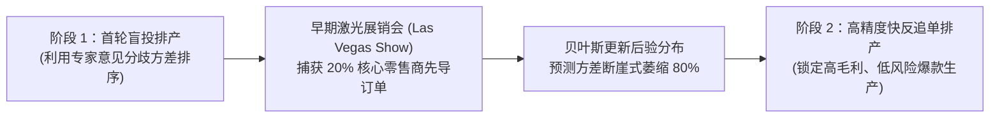

# Lec 13 早期销售快速响应与需求不确定性缩减（Reducing Demand Uncertainty Through Accurate Response）

## TL;DR

- 马歇尔·费雪与阿南特·拉曼（Marshall Fisher & Anant Raman, 1996）开创了快反制造的经典“精准响应”（Accurate Response）理论。
- 将短生命周期时尚品的生产周期解耦为早期盲订预测与基于真实早期销售数据修正的两阶段混合整数随机规划。
- 在世界顶级滑雪服装巨头 Sport Obermeyer 成功落地，在总产能受限下将缺货损失与季末大甩卖折价同时削减三分之一。

## 一、短生命周期时尚品的残酷商业环境与 Obermeyer 困境

在快时尚、高端滑雪服、节日礼品与先锋消费电子行业，产品生命周期极其短暂（通常仅有一个长约 3-4 个月的销售季节），且一旦季节结束，过季商品将彻底贬值报废。

沃顿商学院马歇尔·费雪（Marshall Fisher）与哈佛商学院阿南特·拉曼（Anant Raman）在 1996 年发表于《Operations Research》的开创性论文，深入解剖了滑雪服巨头 **Sport Obermeyer** 面临的生死抉择：
- **前置时间漫长且极度不可预测**：Obermeyer 每年设计数百款全新样式的滑雪夹克。由于面料织造与高精度刺绣需要远距离跨洋采购（中国与香港代工厂），从发出采购订单到成衣运抵丹佛仓库需要长达 6-8 个月的前置时间；
- **极端分散的专家主观预测**：在新装发布会前，让公司 6 位顶尖设计师与销售高管各自预估同一款衣服的全国销量，结果极其惊人——有些专家预测某款衣服能卖 4000 件，而另一些专家则断言只能卖 200 件！
- **残酷的两头挨打惩罚**：如果押注过多，季末只能以低于 BOM 成本的 3 折骨折价向奥特莱斯抛售（Overage Cost）；如果押注过少，滑雪季中期全美专柜断货，白白错失巨大的正价毛利（Underage Cost）。

费雪与拉曼提出的**精准响应（Accurate Response）**理论，彻底重塑了供应链对于“时间价值”与“信息价值”的认知。

## 二、准确响应（Accurate Response）两阶段数学优化模型

精准响应的核心工程思想在于：**在销售季节正式爆发前，创造一个微小的信息感知窗口（例如在拉斯维加斯举办面向核心分销商的预展会）**。当捕获到全美仅 20% 的早期订货数据后，全季度的最终总需求不确定性将发生断崖式萎缩。

企业将总生产产能划分为两个严格的阶段：

### 1. 第一阶段决策变量 $x_{1i}$（早期销售数据揭晓前）
在完全缺乏市场客观数据、仅有专家主观估计时，企业必须决定首批投产的保守基准量。

### 2. 贝叶斯后验预测更新
设某款服装在第一阶段的初始主观先验分布为 $D_i \sim \mathcal{N}(\mu_{0i}, \sigma_{0i}^2)$。
在展销会上观察到前 2 周由先导客户下达的早期销售量为 $s_i$。根据历史贝叶斯更新回归模型：

$$\mu_{1i} = \mathbb{E}[D_i \mid s_i] = \alpha_i \cdot s_i + \beta_i$$

$$\sigma_{1i}^2 = \text{Var}(D_i \mid s_i) \approx (0.15 \sim 0.25) \cdot \sigma_{0i}^2$$

仅仅两周的真实买手下注行为，便能将未来总需求的不确定性标准差（$\sigma$）**瞬间削减 75% 以上**！

### 3. 第二阶段决策变量 $x_{2i}$（高精度快反追单）
在后验分布极其收敛的前提下，企业利用第二批灵活产能进行精准追补。

全系统形式化为一个大规模**两阶段随机混合整数规划（Two-Stage Stochastic MIP）**：

$$\min \sum_{i=1}^N \left( c_{1i} x_{1i} + \mathbb{E}_{s} \left[ \min_{x_{2i} \ge 0} \left\{ c_{2i} x_{2i} + \mathbb{E}_{D_i \mid s_i} [h(x_{1i} + x_{2i} - D_i)^+ + p(D_i - x_{1i} - x_{2i})^+] \right\} \right] \right)$$

$$\text{s.t.} \quad \sum_{i=1}^N a_i x_{1i} \le K_1 (\text{第一阶段受限总工时}), \quad \sum_{i=1}^N a_i x_{2i} \le K_2 (\text{第二阶段受限总工时})$$

## 三、专家意见分歧方差法与生产优先级启发式排序

除了两阶段运筹模型，Fisher 与 Raman 最著名的管理落地贡献在于发明了极度简单易行的**专家意见方差启发式规则（Expert Variance Heuristic）**。

企业在第一阶段根本不需要运行庞大的超级计算机，只需做一张简单的 Excel 表格：
1. **计算各款式专家估计的标准差与变异系数**：
$$CV_i = \frac{\sigma_{0i}}{\mu_{0i}}$$
2. **两极分化策略分类**：
   - **低风险安全款（Low $CV$）**：所有 6 位专家无论审美差异，均一致认同该款必将大卖（如经典纯黑保暖基础款）。此类款式的需求确定性极高，**应当在第一阶段全部打满排产，直接用足廉价但慢速的海外工厂基础产能**！
   - **高风险争议款（High $CV$）**：专家之间发生激烈争吵，有人狂热喜爱、有人强烈看衰（如前卫荧光拼色设计款）。此类款式具有极高的期权价值，**在第一阶段一件都不生产（零排产），坚决将宝贵的第二阶段敏捷快反产能全额预留给它们**！

::: example [Sport Obermeyer 商业落地的惊人斩获]
通过实施 Accurate Response 体系，Obermeyer 彻底终结了全凭创始人直觉盲拍的时代。在全美滑雪服市场整体滑坡的残酷竞争年份中：
- 热门款式的缺货率从原本的 16% 断崖式下降至 **1.8%**；
- 季末被迫甩卖清仓的尾货滞销率从 25% 压缩至 **8.5%**；
- 全公司当期净利润直接翻倍，该案例成为哈佛商学院历史上引用率最高的经典供应链标杆案例。
:::

## 我的理解

Fisher 与 Raman 的精准响应理论，是每一个涉足消费品与科技硬件领域管理者的必修心法。

1. **信息具有清晰的财务净现值**：许多企业习惯于对“购买一台更快的缝纫机或注塑机”大笔批复预算，却吝于为“提前两周获取终端真实订单”投入资源。Accurate Response 从数学上严格证明了：两周的先导市场信息能够将方差削减 80%，其所释放的流动资金与挽回的毛利损失，足以抵消十座工厂的利润。时间就是金钱，信息就是资本。
2. **专家意见分歧本身就是最宝贵的数据资产**：许多管理层在开会时追求表面的一团和气，试图通过“民主表决取平均值”来消除不同总监之间的预测分歧。Fisher 告诉我们：分歧方差 $\sigma$ 恰恰是系统对冲风险的最强量尺！承认人性的不可知，把确定性的任务交给批量流水线，把争议性的探索留给敏捷快反线，才是真正高明的决策艺术。
3. **产能分级是快反落地的物理底座**：没有“两阶段异质产能”的支撑，任何快反理论都只是水中捞月。如果你的所有工厂都是需要提前半年订料的刚性大产线，即便你通过大数据秒级预测出爆款，你也根本无法在物理世界上追补一件成衣。构建能够随时插单、快速换模的中试敏捷特种产线，是数字化快反战略落地的终极依托。
