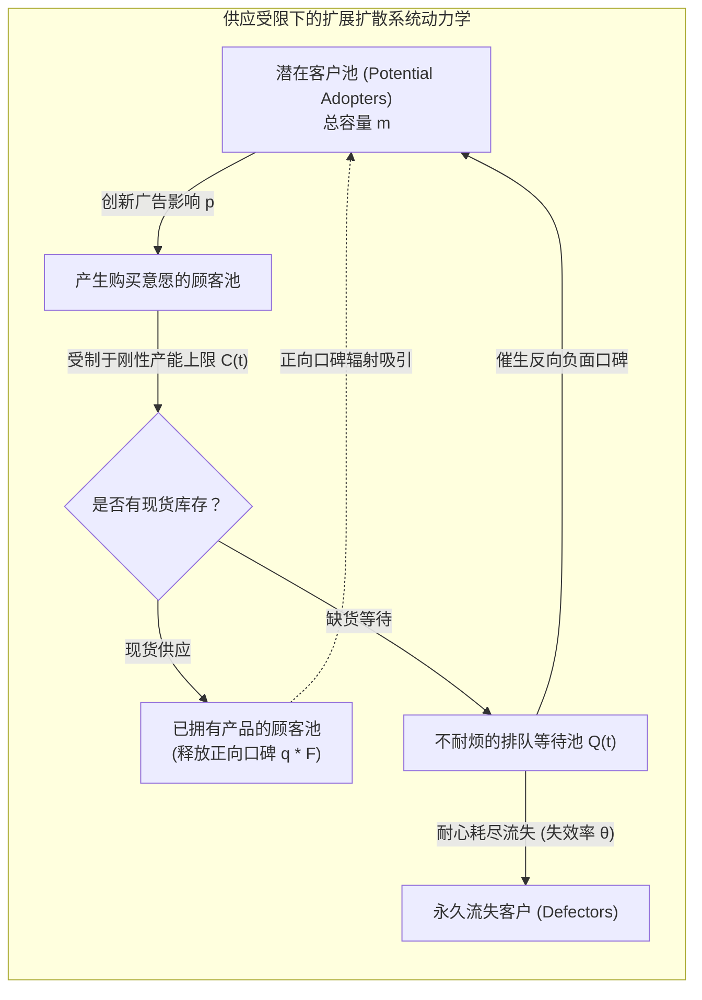

# Lec 15 供应受限下新产品扩散与销售动力学控制（Managing Demand and Sales Dynamics Under Supply Constraint）

## TL;DR

- 何德华、萨温与泰维施（Teck-Hua Ho, Sergei Savin & Christian Terwiesch, 2002）攻克了供应受限下的扩散动力学控制难题。
- 打破了传统 Bass 模型“所有潜在顾客均能立即买到产品”的乌托邦假设，严密量化了缺货等待导致的口碑衰减与客户流失效应。
- 推导建立了受限产能下的最优动态爬坡（Capacity Ramp-Up）与分阶段定价策略，证明过度饥饿营销可能永久扼杀市场潜在规模。

## 一、经典扩散理论的盲区：当好产品遭遇严重缺货

在科技行业中，我们屡见不鲜这样的戏剧性场景：一款具有划时代意义的颠覆性硬件发布（如索尼 PS5 游戏机、特斯拉 Cybertruck 或最新代旗舰智能手机），市场口碑瞬间引爆，狂热的消费者手持现金在官网排队抢购。然而，由于上游芯片良率不稳或自动化产线爬坡滞后，企业深陷长达数月乃至两年的严重产能瓶颈（Supply Constraints）。

在第 14 讲中我们研讨的经典 Bass 扩散模型隐含了一个不切实际的假设：**市场上每一个被口碑“传染”激发出购买欲望的潜在顾客，都能在当下瞬间完成购买并立即成为新的口碑传播源**。

沃顿商学院何德华（Teck-Hua Ho）、谢尔盖·萨温（Sergei Savin）与克里斯蒂安·泰维施（Christian Terwiesch）在 2002 年发表于《Management Science》的经典论文，尖锐地指出了这一假设的致命漏洞：
- **未满足需求的等待摩擦（Backlog Friction）**：当客户想买却买不到时，客户陷入不耐烦的排队等待，其口碑转化率发生严重衰减；
- **客户永久流失与替代（Customer Defection）**：部分客户的耐心被耗尽，愤而取消订单并转投竞对怀抱；
- **负面口碑反噬（Negative Word-of-Mouth）**：无法按期提车的用户在社交网络上大肆抱怨饥饿营销，原本处于摇摆状态的潜在潜在群体被吓退，导致整个产业的潜在市场上限 $m$ 发生永久性不可逆缩水！

## 二、受限动力学非线性微分方程系统形式化

作者构建了一个将市场状态细分为四维连续流的状态空间动力学微分系统：
- $P(t)$：尚未产生购买意愿的潜在客户池比例；
- $Q(t)$：已经下单但由于产能不足正在排队等待的客户比例；
- $A(t)$：已经实际提货并拥抱产品的客户比例；
- $L(t)$：由于等待过长愤而退订永久流失的客户比例。

### 耦合非线性微分方程组
1. **潜在客户转化率（包含正向口碑激励与负面排队阻尼）**：
$$\frac{d P(t)}{d t} = - \left[ p + q A(t) - \delta Q(t) \right] P(t)$$
其中 $\delta$ 为排队阻尼系数，反映了市场上蔓延的“缺货抱怨”对潜在客户转化意愿的抑制。

2. **排队等待池动力学**：
$$\frac{d Q(t)}{d t} = \left[ p + q A(t) - \delta Q(t) \right] P(t) - S(t) - \theta Q(t)$$
其中 $S(t) = \min(Q(t), C(t))$ 为当前受制于工厂产能 $C(t)$ 的实际发货速率，$\theta$ 为客户因等待绝望而放弃退订的泊松流失率。

3. **实际拥有者池扩充**：
$$\frac{d A(t)}{d t} = S(t)$$

4. **永久流失池累积**：
$$\frac{d L(t)}{d t} = \theta Q(t)$$

## 三、产能爬坡（Capacity Ramp-Up）与分阶段动态定价策略

基于该非线性微分系统的全局最优控制分析，Ho、Savin 与 Terwiesch 推导提出了高科技硬件在供应链受限时期的两大核心战略杠杆：

### 1. 产能爬坡速度的非线性收益门槛
传统财务分析往往认为：如果市场总容量是 1000 万台，慢慢生产卖完就行，早产晚产总销量不变。
本模型从数学上彻底击碎了这一荒谬神话：
- 存在一个**临界产能爬坡速率 $C_{\text{crit}}$**。若企业在导入期产能释放速率低于该阈值，排队池 $Q(t)$ 的负面反噬将彻底压倒正向扩散网络效应，最终实际累积销量将比理论市场潜力**永久蒸发 30% 至 50% 以上**！
- 极速爬坡（Aggressive Ramp-up）不仅是为了多接订单，更是为了以最快速度壮大已拥有客户基数 $A(t)$，让正向口碑飞轮在竞争对手反应过来之前完成对全市场的统治。

### 2. 抑制需求的动态撇脂定价（Dynamic Skimming）
当产能无法在短期内突击扩充时，盲目保持低廉售价引发数百万人的无望排队是极其愚蠢的运营策略。
理性的价格控制算法应当推行**动态价格调节阀**：
- 在发售初期由于产能极度短缺，主动定位于高溢价撇脂价格，将初期极度不耐烦的长尾大众需求挡在门外，优先筛选满足那些对价格极不敏感的高净值狂热粉丝；
- 随着工厂良率突破、产能全面释放，再按季度逐步平滑阶梯降价，引导主流大众客户进场。

::: example [索尼 PlayStation 3 供货短缺与微软 Xbox 360 绝地逆袭]
在第七世代游戏机大战中，索尼 PS3 因蓝光光驱激光二极管产能严重卡死，在发售初期的半年内全球大面积缺货。数百万苦等 PS3 无果的核心玩家失去耐心，转而采购了率先实现量产现货供应的微软 Xbox 360。这一早期的供应链断链直接打破了索尼在 PS2 时代高达 70% 的绝对霸主地位，使 Xbox 360 在北美市场与 PS3 形成了长达十年的平分秋色格局。
:::

## 我的理解

Ho、Savin 与 Terwiesch 的研究是运筹学与微观市场营销学结合的绝顶之作。

1. **饥饿营销是极其危险的走钢丝**：许多半瓶醋的市场营销人员常常迷恋所谓的“饥饿营销”，故意限制产能排单以制造虚幻的抢购热度。Ho 等人的模型冷酷地证明：当客户等待时长超越心理容忍阈值，排队的负面口碑反噬效应呈现超线性爆炸。除了极少数具备极致宗教信仰壁垒的顶级奢侈品，大众科技产品玩饥饿营销无异于慢性自杀。
2. **NPI 阶段的产能爬坡是最高战略级**：在新产品导入（NPI）阶段，千万不要为了节省几百万美元的试模与模具复制费用而放缓爬坡节奏。在窗口期内每提前一个月把产能拉满，就能多锁死数十万高粘性早期种子用户，进而通过正向口碑传染几何级放大后期的自然转化率。在这个阶段，运营速度就是最锋利的战略武器。
3. **软硬件协同排队的心理疏导**：如果物理产能由于外部不可抗力（如全球芯片代工瘫痪）确实无法突破，运营系统绝不能对排队用户展示冷冰冰的“缺货”。通过在软件端提供实时透明的排队进度条、赠送数字权益积分、提供高管亲笔签名的社区独家更新，降低不耐烦流失率 $\theta$，是用软件运营对冲物理产能短板的高明实践。
