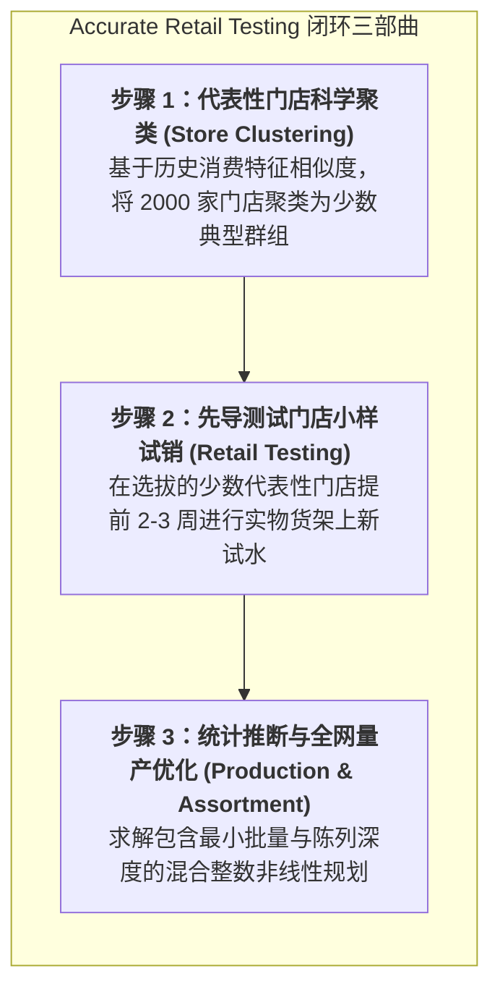

# Lec 16 时尚商品的精准零售测试与量产组合优化（Accurate Retail Testing of Fashion Merchandise）

## TL;DR

- 马歇尔·费雪与库马尔·拉贾拉姆（Marshall Fisher & Kumar Rajaram, 2000）开创了时尚零售精准试销与聚类优化理论。
- 通过构建科学的代表性试点门店聚类（Store Clustering）算法，仅用 2-3 周的先导销售精准预测全网数千家门店需求分布。
- 推导建立了包含款式深度与广度权衡的混合整数非线性量产排产规划，在全球顶级服装零售商实现数千万美元级利润释放。

## 一、时尚零售的终极痛点：品类海量与门店异质性

在大型跨国零售连锁巨头（如耐克、阿迪达斯、优衣库或高端百货连锁）的日常运作中，商品企划（Merchandising）团队面临着极其庞大的组合爆炸困境：
- **数以万计的 SKU**：每个季度设计团队推出数千款不同剪裁、面料、印花与配色的样衣；
- **数以千计的异质门店网络**：全美拥有 2000 家线下门店，各门店所处的地理气候（迈阿密 vs. 明尼苏达）、人口种族构成、消费购买力与时尚敏感度截然不同；
- **不可逆的开模与量产定单**：服装生产具有极高的最小起订量（MOQ）约束。企业不可能为每家门店专属定制生产，必须在整季度出货前，精确敲定每一款衣服究竟应当生产多少件、以及如何精准配发给全国各异质门店。

沃顿商学院马歇尔·费雪（Marshall Fisher）与拉贾拉姆（Kumar Rajaram）在 2000 年发表于《Marketing Science》的里程碑论文《时尚商品的精准零售测试：方法论与工业实践》，系统解决了这一长期依靠采购买手拍脑袋的经验主义难题。

## 二、代表性测试门店的科学聚类与贝叶斯预测放大

如果企业盲目在任意几家门店进行试销，试销结果往往充满严重的局部幸存者偏差。Fisher 与 Rajaram 创立了严谨的两阶段统计学习框架：

### 1. 基于消费行为特征向量的非监督门店聚类（Clustering）
不按简单的地理省份划分，而是为每家门店构建多维属性向量：
$$V_j = (\text{气候冷热指数}, \text{人均客单价}, \text{前卫款式历史占比}, \text{折扣敏感度}, \dots)$$

运用加权 $k$-means 算法将全国 $J$ 家门店聚类为 $K$ 个具有高度内部同质性、外部异质性的**门店集群（Clusters: $C_1, \dots, C_K$）**。

### 2. 精选代表性测试试点门店（Test Stores Selection）
在每个集群内部，精选 2-3 家与该集群历史重心欧氏距离最近的“典型门店”。全网仅需动用 20-30 家测试门店，即可在统计学上以 95% 的置信度代表全网数千家门店的潜在购买偏好。

### 3. 统计推断与放大模型（Extrapolation Model）
当新款试样在测试门店铺设上架 2-3 周后，收集真实收银台 POS 流水。令某款式 $i$ 在集群 $k$ 的测试门店日均实测销量为 $\tau_{ik}$。
通过构建**固定效应协方差分析模型（ANCOVA）**，剥离工作日、天气突变与陈列位置等局部扰动，推导全网未测试同类门店的无偏预期需求估计值：

$$\hat{D}_{ij} = \hat{\alpha}_j \cdot \tau_{ik(j)} + \hat{\gamma}_i \cdot \text{CategoryBaseline}$$

## 三、量产与品类配置优化数学规划（Assortment Optimization）

在获得精确的全网需求预测分布后，商品企划总监必须做出终极决策：在设计出的 1000 款样衣中，究竟**挑选哪 300 款投入大批量生产**？每款衣服应当分配给哪些特定门店？

Fisher 与 Rajaram 构建了如下高维**混合整数非线性规划（MINLP）**：

### 决策变量
- $z_i \in \{0, 1\}$：款式 $i$ 是否被选中投入大批量量产；
- $y_{ij} \in \{0, 1\}$：被选中的款式 $i$ 是否被配发至门店 $j$ 铺货；
- $x_{ij} \ge 0$：款式 $i$ 配发给门店 $j$ 的具体初始入库铺货深度（件数）。

### 目标函数（最大化全网总预期净利润）
$$\max \sum_{i=1}^I \sum_{j=1}^J \mathbb{E} \left[ P_i \min(x_{ij}, D_{ij}) + S_i (x_{ij} - D_{ij})^+ - c_i x_{ij} \right] - \sum_{i=1}^I F_i z_i$$

### 工业级核心约束条件
1. **起订量与开模门槛（MOQ Constraints）**：
   若款式 $i$ 被选中量产（$z_i = 1$），则全网总订货量必须跨越工厂最小起订门槛 $M_i$：
   $$M_i z_i \le \sum_{j=1}^J x_{ij} \le \text{Capacity}_i z_i, \quad \forall i$$
2. **视觉陈列视觉冲击力约束（Visual Merchandising Rules）**：
   若某款式被配发给某家门店（$y_{ij} = 1$），其在货架上的陈列深度必须达到饱满展示阈值 $d_{\text{min}}$（例如同一排衣架至少挂 5 件不同尺码，避免货架稀稀拉拉影响高端感）：
   $$d_{\text{min}} y_{ij} \le x_{ij} \le d_{\text{max}} y_{ij}, \quad \forall i, j$$
3. **门店物理总展示空间上限**：
   $$\sum_{i=1}^I y_{ij} \le \text{StoreCapacity}_j, \quad \forall j$$

::: example [全球知名时尚零售巨头的百万级利润释放]
该优化系统首先在全美顶尖女装零售连锁进行为期两年的全面实盘对标。由算法自动推荐的测试款式与订货组合，与资深企划买手的人工主观选品开展 A/B 测试：
- 算法组的滞销打折库存占比由 31% 骤降至 **19%**；
- 畅销款由于量产配额充足，全价售罄率提升了 **14%**；
- 仅单品牌单财季为该跨国零售巨头净增毛利超过 **4500 万美元**！
:::

## 我的理解

Fisher 与 Rajaram 的零售测试模型，代表了现代零售分析与运筹优化结合的最高境界。

1. **摆脱买手个人品味的局限性**：在传统时尚行业，企划总监常常像独裁者一样凭借个人美学偏好决定几千万美元的采购下注。然而，当代消费者的审美极其去中心化与小众碎片化。用小范围实境测试与聚类算法替代个人的虚妄直觉，让成千上万消费者的真实扫码动作去定义什么是爆款，是商业民主化与科学化的必由之路。
2. **视觉陈列规则在数学上的严谨映射**：许多运筹学者做库存优化时，把门店当成纯粹的数字吸收池，算出某家店分配 1 件、另一家店分配 2 件。但在真实的线下零售世界中，一件衣服挂在冷清的货架上会让顾客觉得是被人挑剩下的瑕疵品。将陈列深度 $x_{ij} \ge d_{\text{min}}$ 作为硬约束编入整数规划，深刻展现了应用数学对物理零售心理学的敬畏。
3. **数字孪生驱动的敏捷快反闭环**：在当前 Shein 与 Zara 等数字原生快时尚体系中，这一套逻辑已被进一步极速化：线下测试门店被线上 App 的“虚拟小流量测款”所取代。根据几千名用户在应用内的点击率与加购率，算法在两小时内自动向柔性供应链集群派发首批 100 件订单，这正是 Fisher 与 Rajaram 思想在数字时代的极致绽放。
