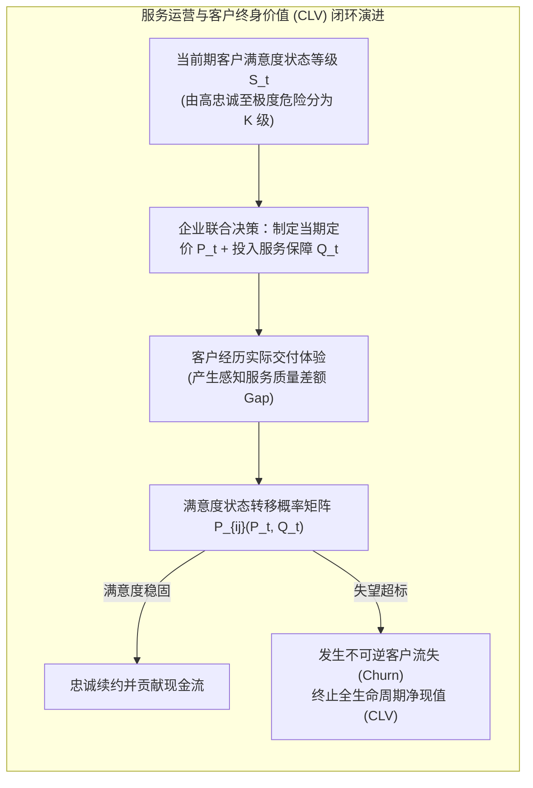

# Lec 18 基于价格与服务质量的顾客关系与流失管理（Customer Relationships via Price and Service Quality）

## TL;DR

- 比特兰、奥利维拉与希尔克鲁特（Gabriel Bitran, Paulo Rocha e Oliveira & Alexis Schilkrut, 2003）开创了客户动态关系管理模型。
- 将宏观服务运营与微观客户终身价值（CLV）打通，形式化刻画了服务等待延迟与定价水平对顾客满意度衰减与流失概率的马尔可夫演进。
- 推导建立了多阶段动态联合定价与服务质量控制策略，证明追求短期暴利而牺牲服务等级将对长期顾客资产造成不可逆的毁灭性侵蚀。

## 一、从交易型运营（Transactional）向关系型运营（Relational）的范式跃迁

在过去的运筹学教科书中，客户通常被抽象为一个个互不相识、独立到达的无记忆泊松点（Poisson Arrivals）。当客户完成一次购买或遭遇一次服务排队延误后，系统假定其“记忆瞬间清零”，下一次到达依旧遵循相同的静态外生概率。

麻省理工学院斯隆管理学院著名讲席教授加百列·比特兰（Gabriel Bitran）与合作者在 2003 年发表于《MIT Sloan Working Paper Series》的经典论文，尖锐地指出了这一工程视角的狭隘性：
- **客户拥有深刻的累积历史记忆**：在电信宽带、企业 SaaS 软件、私人银行与民航常旅客等长周期服务行业中，客户与企业的每一次交互都在重塑其内在的信任与满意度水位；
- **服务质量（Service Quality）是隐性价格**：漫长糟糕的排队等待、客服坐席的冷漠推诿，在本质上等同于向顾客强加了极高的心理沉没成本；
- **客户流失（Customer Churn）的非线性不可逆性**：一旦客户的累积失望情绪击穿临界阈值，客户将果断注销账户并流失至竞争对手（Defection）。重新挽回一名流失客户的获客营销成本（CAC），通常是维系老客户成本的 5 至 10 倍！

## 二、客户满意度与流失动力学的马尔可夫决策过程（MDP）

比特兰团队构建了一个严密的离散时间无限时域马尔可夫决策过程：

- **状态空间（State Space）**：设 $s_t \in \{1, 2, \dots, K, \Delta\}$ 代表客户在时期 $t$ 的内在忠诚度与满意度状态。其中状态 $1$ 代表极度满意的忠诚拥趸，状态 $K$ 代表濒临退订的危险边缘客户，$\Delta$ 为不可逆的吸收终止状态（已流失 Absorbing Churn State）。
- **行动空间（Action Space）**：在每个周期初，企业需要针对特定客户细分群体联合决定两项核心控制杠杆：
  1. 订阅/服务价格 $p_t \in [\underline{p}, \bar{p}]$；
  2. 服务质量保障投入水平 $q_t \in [\underline{q}, \bar{q}]$（如增配资深专席客服、缩短网络报修响应 SLA、提升硬件算力可用度）。

### 状态转移概率矩阵的微观机理
从状态 $i$ 转移至状态 $j$ 的转移概率 $P_{ij}(p, q)$ 严格由价格感知与服务质量共同内生驱动：

$$\mathbb{P}(s_{t+1} = \Delta \mid s_t = i, p, q) = \sigma_i \cdot \Phi(\alpha p - \beta q + \gamma_i)$$

其中：
- $\Phi(\cdot)$ 为标准单调递增累积分布函数（如 Sigmoid 或标准正态）；
- 价格 $p$ 的上涨直接推升流失风险系数 $\alpha > 0$；
- 质量投入 $q$ 的增加产生反向保护阻尼 $\beta > 0$；
- 客户当前所处的历史满意度状态 $i$ 决定了其对负面冲击的基础抵抗阈值 $\gamma_i$。

## 三、联合定价与服务质量控制的最优结构定理

企业的长期目标是最大化客户全生命周期的折现净现值（Customer Lifetime Value, CLV）：

$$V(s) = \max_{p, q} \left\{ p - c(q) + \delta \sum_{j=1}^K P_{sj}(p, q) V(j) \right\}$$

其中 $c(q)$ 为维持服务质量 $q$ 所需承担的单期边际运营成本，$\delta \in (0, 1)$ 为时间折现因子。

::: theorem [Bitran-Oliveira-Schilkrut 结构单调性定理 (2003)]
在利润函数的超模性（Supermodularity）假设下，全生命周期最优运营策略展现出高度一致的单调性结构：

1. **满意度溢价法则**：最优定价函数 $p^*(s)$ 关于客户满意度状态保持严格单调递减（即客户越忠诚、满意度越高，企业越能收取稳固的长期溢价）；
2. **危机干预服务杠杆**：当客户处于中间过渡危险状态（$s \to K$）时，最优服务保障投入 $q^*(s)$ 呈现激进的**非凸凸起（Proactive Surge）**！系统必须不惜代价调配顶级资源实施主动关怀与质量补偿，以将客户拉离流失悬崖边界。
:::

::: example [全球顶级企业级 SaaS 平台的客户成功（Customer Success）重构]
某千亿美元企业级协同办公云平台，以往服务运营仅考核电话客服的“平均接听时长（AHT）”，客服人员为了压低工时草草挂断客户电话，导致年费高达数十万美元的企业客户续费率（Net Retention Rate）跌破 80%。
引入 Bitran 动态关系模型后，平台将后台遥测数据（API 报错率、管理员登录频次）与客户流失概率算法联动。一旦系统检测到某大客户的健康度下滑至临界状态 $K$，算法自动豁免工时考核，秒级派出资深架构师进行一对一上门驻场调优，并赠送专属算力配额。半年内，大客户流失率骤降 **62%**，客户资产总现值净增数亿美元。
:::

## 我的理解

Bitran 等人的研究将运营管理从冷冰冰的“成本控制”升华为了“经营客户心智资产”。

1. **别用短期账面利润去透支长期的信任资本**：在许多服务企业中，管理层常常通过裁撤一半客服人员或悄然下调网络带宽来换取当季财务报表上的微弱利润增长。这种短视行为在 Bitran 的状态转移矩阵中，实际上是以惊人的速度将数以万计的客户推向流失边缘状态 $\Delta$。你今天省下的几毛钱运营成本，未来必须花费百倍的营销广告去弥补客户流失的滔天大罪。
2. **区分“前瞻主动关怀”与“事后被动挽留”**：绝大多数企业在客户正式提交退订注销申请时，才安排专员打电话询问“能不能给您打个八折”。此时客户的心智早已彻底死亡，挽留成功率通常低于 5%。真正的卓越运营必须在满意度状态从状态 2 刚刚滑落至状态 3 的微小征兆时刻（例如首次遇到系统延迟告警），就在底层发起算法级的主动服务干预，在客户还未产生愤怒前抚平创伤。
3. **服务运营与定价必须统一作战**：在很多公司，产品定价由市场部制定，而服务支持由运营部负责，两部门之间缺乏协同。Bitran 模型告诉我们，价格与服务质量是一对紧密咬合的双生子。脱离了底层高可用 SLA 的高价是自欺欺人，而缺乏合理溢价支撑的过度服务注定无法持续。构建统一的客户体验度量与控制闭环，是现代服务巨头立于不败之地的基石。
