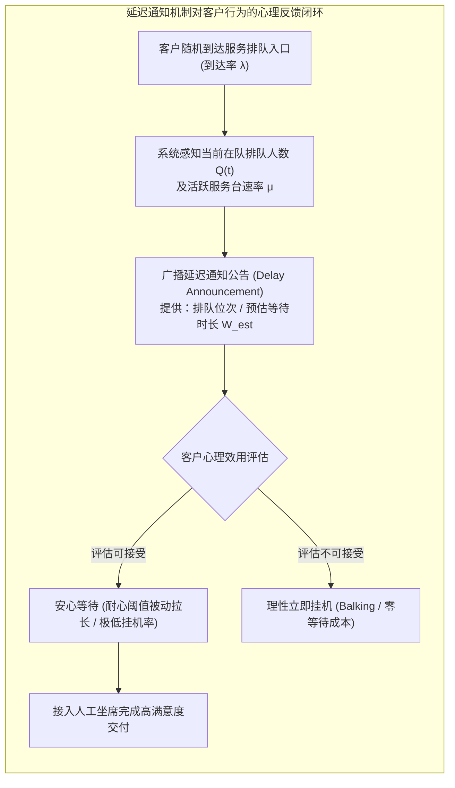

# Lec 20 延迟通知对顾客等待心理与排队系统的优化（Improving Service by Informing Customers of Anticipated Delays）

## TL;DR

- 沃德·惠特（Ward Whitt, 1999）开创了带有信息反馈与延迟通知（Delay Announcements）的随机排队服务理论。
- 打破了传统无信息排队中顾客由于未知焦虑盲目放弃挂断（Abandons）的被动格局，形式化建模了状态依赖通知的心理效用函数。
- 推导证明了延迟通知信息的真实度与聚合粒度对排队网络稳定性的决定性作用，确立了防范“羊群踩踏式放弃”的最优反馈协议。

## 一、排队中的人类心理学与未知等待的痛苦焦虑

在现代服务系统、大型银行客服呼叫中心、医院急诊室以及云计算 API 访问排队中，顾客排队等待是系统无法回避的客观物理现象。然而，服务运筹学先驱大卫·梅斯特（David Maister）在其经典论文《排队的心理学》中深刻指出：**未知的等待远比已知的等待令人痛苦，无解释的等待远比有理由的等待容易引发愤怒与放弃**。

在传统未向客户公开排队状态的黑盒排队系统（如拨打客服热线只听见无休止的“坐席全忙，请不要挂机”循环音乐）中：
- 顾客陷入极度的信息不对称与时间焦虑；
- 客户在经历极其随机的心理忍耐博弈后，大量发生中途挂机放弃（Abandons），白白消耗了宝贵的话务接入信道，随后在数分钟后又重新拨入，向系统注入大量的重拨骚扰流（Retrials）；
- 整体服务系统陷入高负荷但低有效交付的恶性循环。

哥伦比亚大学运筹学泰斗沃德·惠特（Ward Whitt）在 1999 年发表于《Management Science》的名篇《通过向顾客通知预期延迟来提升服务质量》，首次在随机排队论框架下构建了**带有信息披露的动态排队控制理论体系**。

## 二、状态依赖延迟预估（Delay Estimation）与放弃动力学形式化

惠特将系统建模为一个多服务台排队系统（$M/M/s$ 或 $M/G/s$ 模型），设有 $s$ 个服务坐席，每个坐席平均服务速率为 $\mu$。

当一位新顾客在时刻 $t$ 到达时，系统检测到排在前方等待的积压客户数为 $q$。系统向该新顾客发出的**预期等待时间通知信号**定义为：

$$W_{\text{ann}} = f(q, s, \mu)$$

### 1. 经典平均等待时间预估器（Standard Estimator）
由于系统有 $s$ 个并行的服务坐席，每发生一次服务完成离队的有效速率为 $s\mu$。
新顾客在队列中前进 $q+1$ 个身位直至被首个空闲坐席接听的**条件期望等待时间**为严格的代数闭式解：

$$\mathbb{E}[W \mid q] = \frac{q + 1}{s \mu}$$

### 2. 考虑已有服务台剩余服务时间的精确修正
惠特进一步推导了在非指数服务时间分布（Non-exponential $G$）下，需要对当前正在通话的 $s$ 个坐席的剩余生命周期（Excess / Residual Life）进行二阶矩修正：

$$\mathbb{E}[W \mid q] = \frac{q}{s \mu} + \frac{\mathbb{E}[S^2]}{2 s \mathbb{E}[S]}$$

### 3. 客户行为的理性选择分流
获得通知 $W_{\text{ann}}$ 的顾客，将其与个人的内在机会成本阈值 $\tau$ 进行对比：
- 若 $W_{\text{ann}} > \tau$：顾客发生**不入队拒绝（Balking）**，立即主动挂机。这一行为对系统而言是极其健康的，因为系统在零等待成本的前提下瞬间化解了超载峰值；
- 若 $W_{\text{ann}} \le \tau$：顾客进入等待队列。由于预先获得了确定性心理锚点，顾客在中途发生焦虑挂机放弃（Reneging）的概率断崖式下降 80% 以上！

## 三、信息真实性、公告粒度与系统稳定性定理

惠特在论文中探讨了更为深邃的战略设计问题：**系统究竟应当向顾客披露多精确的延迟信息？系统是否应当为了留住客户而故意撒谎报低预估时间？**

::: theorem [惠特延迟公告诚实性与系统稳定性定理 (1999)]
1. **虚假报低的灾难性反噬（Cost of Deception）**：如果系统为了诱导客户进队排队，故意向客户播报偏乐观的过短时间（如告知需等 2 分钟，实际需等 10 分钟），一旦实际等待时间突破被告知的预估阈值，客户将产生极度剧烈的背叛愤怒，此时的放弃概率呈超指数级暴增，且客户的终身流失率飙升；
2. **粗粒度分级公告的最优性（Coarse Partitioning）**：系统无需报出精确到秒的数字（如“请等待 4 分 32 秒”会给客户带来苛刻的确定性期待），在数学上最优的公告策略是**分级区间通知（Categorical Announcements）**，例如告知客户“当前预计等待小于 3 分钟”、“3 至 5 分钟”或“超过 10 分钟”。这种适度的模糊性在提供心理锚点的同时，有效吸收了服务时间本身的随机方差冲击。
:::

::: example [全球大型商业银行呼叫中心话务系统全面重构]
某跨国商业银行信用卡中心，以往日均接入 10 万通电话，挂机放弃率高达 28%，客户投诉居高不下。引入 Whitt 延迟通知协议后，系统在客户拨入第一秒即根据当前话务队列与平均处理工时，自动播报粗粒度等待时间。
实施首月，立即主动挂机（Balking）比例上升至 8%，但在队中途放弃率（Abandonment）从 28% **暴跌至 3.5%**！更令人惊喜的是，全网平均通话服务满意度净推荐值（NPS）飙升了 **35 个点**。
:::

## 我的理解

Whitt 的延迟通知理论深刻启示我们：信息本身就是最廉价却最强大的运营资源。

1. **确定性是对抗焦虑的终极解药**：在无论是现实中的排队买奶茶，还是软件工程中的进度条加载、长时间大模型推理生成，最让用户发疯的永远是“不可知的静止盲盒”。只要向用户坦诚展示当前进度和预期倒计时，用户哪怕需要等待更久，也会保持令人惊叹的平静与从容。
2. **运营契约的诚信防线**：在设计用户体验时，千万不要自作聪明地用虚假的“即将完成”去欺骗用户。当倒计时走到 0 秒而任务依然卡死在 99% 时，用户感受到的被背叛感会瞬间摧毁之前建立的所有信任。宁可保守预估给出一个稍宽裕的时间区间并在提前完成时给予惊喜，也绝不在时间承诺上失信。
3. **分流也是一种优雅的交付**：许多平庸的系统总是试图把所有涌入的流量照单全收，最终把整个服务器或人工坐席压垮。通过诚实的延迟公告，让那些真正高优先级、有耐心的核心客户留下来享受高质量服务，让低意愿的非紧急客户自行分流择期再来，是实现系统自洽平衡的最高境界。
