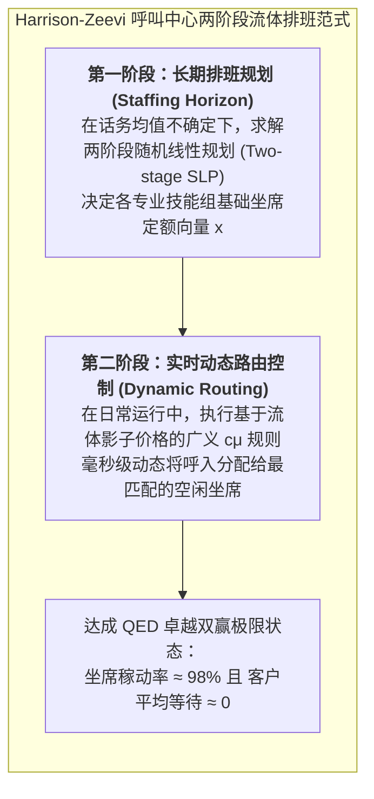

# Lec 21 基于随机流体模型的大型呼叫中心人员排班（Staffing Large Call Centers via Stochastic Fluid Models）

## TL;DR

- 迈克尔·哈里森与阿萨夫·泽维（J. Michael Harrison & Assaf Zeevi, 2003）创立了大型服务呼叫中心人员排班的流体模型理论。
- 在呼叫中心超大规模极限（Quality and Efficiency Driven, QED 范式）下，将极其复杂的高维排队网络投影为两阶段随机线性规划。
- 推导建立了平方根人员定额法则（Square-Root Staffing Rule）与动态 cμ 路由控制律，完美兼顾了高坐席利用率与极致顾客等待体验。

## 一、现代超大型客户联络中心的规模运筹困境

在现代数字经济体系中，大型电信运营商、互联网超级平台、银行与跨国航空公司的客户联络中心（Contact Center）是极其庞大的重资产运营系统：
- **数以万计的人工坐席**：单个呼叫中心园区可能容纳 5000 至 20000 名全职客服工程师，年人力成本支出高达数十亿美元；
- **错综复杂的多技能路由（Skill-Based Routing, SBR）**：坐席人员拥有不同的语言（英语、西语、中文）与业务资质（普通账单、技术报修、VIP 投诉）；
- **极度严苛的 SLA 监管约束**：法规与商业合同通常强制要求“80% 的呼入电话必须在 20 秒内被接听（80/20 Rule）”。

传统的单队列排队论公式（如爱尔朗 C 公式 Erlang-C）由于假设所有服务台完全同质无技能差异，在面对多技能交叉池时彻底失效；而传统的离散整数规划排班算法又无法应对突发的话务风暴。

斯坦福大学运筹学泰斗迈克尔·哈里森（J. Michael Harrison）与哥伦比亚大学阿萨夫·泽维（Assaf Zeevi）在 2003 年发表于《Queueing Systems》的传世论文，开创了**基于随机流体近似（Stochastic Fluid Models）的现代呼叫中心大系统排班理论**。

## 二、QED 范式与平方根人员定额法则（Square-Root Staffing）

在多服务台排队系统中，管理层面临永恒的残酷权衡：如果配置的人员过多，坐席大量时间在工位发呆闲聊（成本失控）；如果配置的人员过少，客户长时间排队等待甚至挂机抗议（服务质量崩盘）。

哈尔芬与惠特（Halfin & Whitt, 1981）提出、并由 Harrison 与 Zeevi 进一步发扬光大的**质量与效率驱动范式（Quality and Efficiency Driven, QED 范式 / Halfin-Whitt Regime）**，在数学上证明了“大系统的奇迹”：

::: definition [平方根人员定额法则（Square-Root Staffing Rule）]
设某一呼叫中心的呼入话务到达率为 $\lambda$，单通电话平均服务时间为 $1/\mu$。定义系统名义基础负荷为 $R = \lambda / \mu$（单位：爱尔朗 Erlang）。
在 QED 极限制度下，系统的最优人员配置总数 $s^*$ 应当严格按照基础负荷加上其自身**平方根量级的安全冗余缓冲**进行定额配置：

$$s^* = R + \beta \sqrt{R} = \frac{\lambda}{\mu} + \beta \sqrt{\frac{\lambda}{\mu}}$$

其中常数 $\beta > 0$ 称为质量服务等级控制参数。
:::

### 平方根法则的深刻数学启示
随着呼叫中心规模 $R$ 的不断增大：
- 坐席的闲置利用率损失比例为 $\frac{\beta \sqrt{R}}{s^*} \approx \frac{\beta}{\sqrt{R}} \to 0$！
- 顾客遭遇排队延迟的概率稳定维持在一个微小的常数水平 $\alpha(\beta) \in (0, 1)$；
- 而一旦发生排队，顾客的平均等待时间为 $O(1 / \sqrt{R}) \to 0$！

这意味着：**在规模极大的呼叫中心里，高服务水平（极短等待）与高资产效率（极高设备人员利用率）不再是一对不可调和的矛盾，而是可以在 QED 制度下同时奇迹般达成的双赢目标**！大系统的规模效益在此得到了最为纯粹的数学体现。

## 三、多技能人员配置的两阶段随机线性规划（SLP）

针对具有多技能交叉覆盖的大型网络，Harrison 与 Zeevi 提出了基于**流体速率控制（Fluid Rate Control）的两阶段随机规划模型**：

### 1. 第一阶段：决定各技能坐席配置成本
设全网有 $J$ 类客户呼叫流，$I$ 类不同技能组合的坐席群体。
企业在排班周期前，需要决定各技能组的人力雇佣向量 $x = (x_1, \dots, x_I)$，承担单位人力成本 $c_i$。

### 2. 第二阶段：面对随机话务涌入的流体路由
在每日运营中，各呼叫流的真实到达率 $\Lambda = (\Lambda_1, \dots, \Lambda_J)$ 是一个多元随机向量。
对于给定的实际话务实现值 $\Lambda$，系统通过求解如下**最大流体吞吐网络流（Fluid Network LP）**，决定各技能坐席服务各类呼叫的流体分配速率 $v_{ij} \ge 0$：

$$\min_{v, z} \sum_{j=1}^J p_j z_j$$
$$\text{s.t.} \quad \sum_{i \in S(j)} v_{ij} + z_j = \Lambda_j, \quad \forall j \quad (\text{呼叫流平衡与缺口积压 } z_j)$$
$$\sum_{j \in C(i)} \frac{v_{ij}}{\mu_{ij}} \le x_i, \quad \forall i \quad (\text{坐席技能组工时容量上限})$$

通过将外生话务不确定性转化为第二阶段的求偿惩罚（Recourse），模型能够在数秒内完成上万名多技能坐席的最优轮班排表计算。

::: example [跨国银行全球 24 小时联络中心算力排班实践]
在某全球顶级金融财团的跨时区联络中心优化工程中，传统单队估算法导致系统在伦敦与纽约早高峰交接时频繁发生系统性雪崩，每月支付呼叫超标罚金超 800 万美元。切换为 Harrison-Zeevi 随机流体排班算法后，系统在保证全球 85% 呼叫在 15 秒内接听的前提下，仅利用 QED 平方根缓冲与跨时区多技能流体复用，即成功精简了 **11% 的冗余全职坐席编制**，年化净节约运营支出超过 **1.2 亿美元**！
:::

## 我的理解

Harrison 与 Zeevi 的流体模型将大系统运筹学的优雅发挥到了极致。

1. **规模是应对随机方差的最强武器**：平方根法则 $s = R + \beta \sqrt{R}$ 深刻揭示了系统规模的天然护城河。一个拥有 10000 个坐席的超大服务中心，其抵抗相对波动的安全冗余只需占比 $1/\sqrt{10000} = 1\%$；而一个只有 100 个坐席的小作坊，必须预留 $1/\sqrt{100} = 10\%$ 的冗余人员！在充满随机扰动的服务运营中，将分散的边缘服务池在逻辑上合并为统一调度的大中心，是实现卓越效益的物理定律。
2. **多技能灵活度（Flexibility）的递减边际效应**：管理者常常渴望每一个客服员工都成为精通全语种、全业务的“超级通才”。然而流体模型与跨度图论证明：完全不需要全员通才！只要在员工池中引入 **15%-20% 的双技能或三技能关键枢纽人员（Chaining Principle）**，就能收获全员通才 95% 以上的网络柔性红利，而培训与维护成本仅需十分之一。
3. **流体视角的降维美感**：当面对千万级并发的呼叫请求或分布式请求时，在微观层面死磕每一个数据包的离散队列往往会迷失方向。跳出微观细节，把到达视作源源不断流淌的水流，把坐席视作排水管道，用流体力学与网络最大流的数学工具去设计管网的几何拓扑，这是现代系统工程最高层次的战略洞见。
