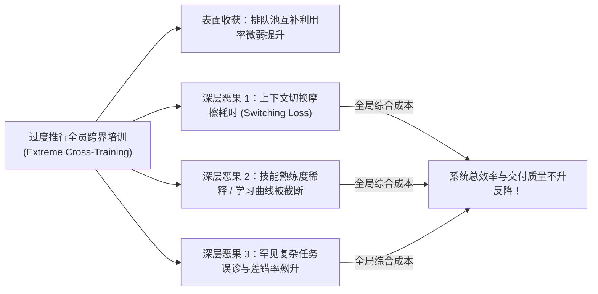

# Lec 22 跨职能多技能员工的效率与质量权衡分析（Efficiency-Quality Trade-Off of Cross-Trained Workers）

## TL;DR

- 平克与舒姆斯基（Edieal Pinker & Robert Shumsky, 2000）开创了多技能跨职能员工效率与质量权衡理论。
- 打破了“多技能必然带来系统绝对收益”的直觉盲区，首次引入认知学习衰减与任务切换注意力耗散的微观惩罚机制。
- 推导建立了多级专业化与柔性交叉培训的最优人员配置结构定理，证明过度跨界会导致工时膨胀与服务错误率双重飙升。

## 一、多技能交叉培训（Cross-Training）的迷思与隐性摩擦

在现代敏捷组织管理、医院急诊分诊、软件工程全栈开发以及高阶技术支持中心中，“培养跨职能、多技能人才（Cross-Trained Workforce）”被普遍奉为组织敏捷性的金科玉律。

传统运筹学教科书在论证交叉培训的价值时，往往基于纯粹的排队路由视角：
- 如果工人 A 既会焊接又会质检，当焊接工位闲置而质检工位大排长龙时，工人 A 能够瞬间切流支援质检；
- 这种资源柔性极大地提高了劳动力的资产综合利用率，消除各工位的局部拥堵。

然而，罗切斯特大学西蒙商学院的平克（Edieal Pinker）与罗伯特·舒姆斯基（Robert Shumsky）在 2000 年发表于《Manufacturing & Service Operations Management》的经典名篇《跨职能培训员工的效率与质量权衡》，向工业界发出了振聋发聩的理性警示：
- **认知负荷与技能稀释（Cognitive Load & Skill Dilution）**：人类的认知深度与记忆强化服从严格的生理神经心理学规律。如果一名员工同时承担 5 种不同业务，其在单项技能上的专业精进速度（Learning Curve）将发生严重衰退；
- **任务切换的上下文摩擦（Context-Switching Penalty）**：每一次跨界切换工种，工人都需要重新调动心理工作记忆、重置工装仪器，产生显著的隐性工时浪费；
- **错误率与服务质量坍塌**：多技能通才在面对复杂特异性罕见故障时，由于缺乏深厚的单一领域案例肌肉记忆，其出错率与误诊率远高于深耕十年的单一领域专才！

## 二、考虑学习曲线衰减与差错率的排队运营模型

平克与舒姆斯基构建了一个将认知学习效应内生化的排队服务系统：

- **任务异质性**：系统处理两类不同的专业任务（Task 1 与 Task 2），到达率分别为 $\lambda_1, \lambda_2$。
- **劳动力结构分层**：
  - **专职专才（Specialists）**：仅长期专精于 Task 1 或 Task 2；
  - **跨界通才（Generalists / Cross-Trained）**：在系统调度下跨界承接两类任务。

### 1. 经验积累与熟练度学习函数
员工完成任务的平均处理时间 $1/\mu$ 严格是其历史从事该项具体任务的**时间分配比例 $\alpha \in [0, 1]$** 的单调递减函数（经典的赖特学习曲线 Wright's Learning Curve）：

$$\mu_{\text{Specialist}} = \mu_0 \cdot (1)^{\gamma} = \mu_0$$
$$\mu_{\text{Generalist}}(\alpha) = \mu_0 \cdot (\alpha)^{\gamma}, \quad \text{其中学习指数 } \gamma \in (0, 1)$$

由于通才必须在两类任务之间瓜分精力（$\alpha_1 + \alpha_2 = 1$），凸函数的詹森不等式直接导致：
$$\mu_{\text{Generalist}}(\alpha_1) + \mu_{\text{Generalist}}(\alpha_2) < \mu_{\text{Specialist}}$$
即通才在两类任务上的平均加工速率，均**在生理上严格落后于专精专才**！

### 2. 差错概率与返工成本惩罚
设完成单项任务发生重大质量失误的概率为 $p_{\text{Error}}(\alpha)$，失误后必须移交资深工程师执行昂贵的二次拆解返工（Rework Cost $C_R$）：

$$p_{\text{Error}}(\alpha) = p_0 \cdot \alpha^{-\theta}, \quad \theta > 0$$

当通才处理其仅分配了 10% 工时的冷门任务时，差错率将呈几何级数爆炸。

## 三、最优劳动力架构配比定理与工业实践启示

作者推导建立了全系统长期平均运营成本（包括劳动力薪酬、排队等待成本与质量差错返工损失）的全局凸优化方程：

$$\min_{N_1, N_2, N_G} C_{\text{Labor}}(N_1, N_2, N_G) + C_{\text{Wait}}(N_1, N_2, N_G) + C_{\text{Error}}(N_1, N_2, N_G)$$

::: theorem [Pinker-Shumsky 最优劳动力结构定理 (2000)]
最优的人力资源配置结构绝非“全盘通才”，亦非“全盘专才”，而是严格呈现**阶梯式核心-外围混合架构（Core-Periphery Hybrid Structure）**：

1. **基准负荷必须由专才捍卫**：系统针对常年稳定出现的基准核心话务量，必须配置充足的纯专精专才（Specialists），以最大化释放学习曲线红利，维持零差错与最高加工效率；
2. **通才仅作为弹性减震器**：仅配置比例适度的少数跨界通才（比例通常为 15%-25%），专门用于对冲两类任务之间的瞬态随机波动高峰；
3. **任务路由单向倾斜**：在调度时，必须执行“专才优先”策略，唯有当专才队列被击穿时，任务才被溢流至通才，从而最大化保护通才的单项专注度。
:::

::: example [全球顶级云计算售后技术支持体系改革]
某全球排名前三的公有云巨头，曾激进推行“全栈技术支持工程师”改革，要求每一位 L2 工程师必须能同时排查数据库内核、K8s 容器网络与底层存储硬件故障。改革后，虽然客服等待时间表面下降了 8%，但大客户投诉的“误诊率”与“二次排查延误率”暴增了 45%，数个重要客户因生产系统误操作瘫痪发起数百万美元索赔。
引入 Pinker-Shumsky 权衡模型后，管理层果断刹车，重构了“75% 纵向专家组（只深耕存储或只深耕数据库）+ 25% 横向敏捷架构师”的混合梯队。最终系统在维持同等等待 SLA 的前提下，技术支持**一次性解决率（FCR）提升至 91%**，彻底终结了严重的技能稀释危机。
:::

## 我的理解

Pinker 与 Shumsky 的研究是对当代管理学中浮躁“全能崇拜”的一记深沉警钟。

1. **敬畏专业主义的生理极限**：在现代分工越来越高精尖的社会中，“通晓一切”往往意味着“样样稀松”。一个人不可能在拥有超声波心脏介入手术极致手感的同时，还能熟练精通神经外科开颅手术。在关乎生死的重大硬核场景中，深耕单一领域的肌肉记忆是抵御系统灾难的最终底线。
2. **上下文切换是组织效率的隐形杀手**：在软件工程团队中，如果让一个核心工程师周一写前端 CSS、周二调 Go 后端、周三修运维网络驱动，他在工具链切换与心智重载上的精力损耗将摧毁他 80% 的生产力。敏捷组织切忌把“多技能”变成管理层随意滥用、随意打断核心研发人员深度专注的借口。
3. **架构师的混搭设计智慧**：优秀的系统设计者就像拼装一支精锐特种部队：你必须拥有专门负责百步穿杨的专精狙击手，专门负责爆破的工程专家，辅以少数几位能够协同呼叫空中支援的战术协调员。将专才的极致深度与通才的动态粘滞力有机编织在一起，才是兼顾效率与质量的终极组织艺术。
