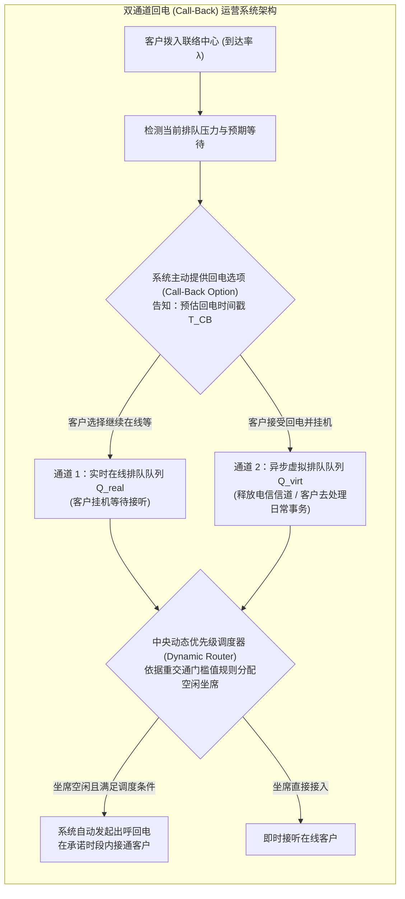

# Lec 23 带有回电选项的客户联络中心路由与系统设计（Customer Contact Centers with a Call-Back Option）

## TL;DR

- 莫尔·阿莫尼与科斯蒂斯·马格拉拉斯（Mor Armony & Costis Maglaras, 2004）奠定了现代智能回电（Call-Back）系统的随机控制理论。
- 将传统单一物理电话排队拓展为实时在线接听与异步承诺回电（Virtual Queueing）的双通道混合排队网络。
- 推导建立了重交通极限下的最优延迟通告与动态调度门槛值规则，在几乎不增加人工坐席的前提下大幅消除客户流失与通话账单成本。

## 一、传统电话排队等待的双输困境与虚拟排队革命

在第 20 讲与第 21 讲中，我们深入剖析了客户在客服热线中被动排队等待的心理与排队动力学。在传统的单一呼入系统模式中，客户面临着极其残酷的“要么握着手机在线傻等 20 分钟、要么愤怒挂断放弃业务”的两难绝境。

这对于企业运营而言同样构成沉重的财务负担：
- **巨额的电信长途通话资费**：在 800/400 免费客服热线中，客户在线排队等待听音乐的每一秒钟，企业都必须向电信运营商支付高昂的信道占用资费；
- **客户感知体验极其恶劣**：强迫高价值商业客户将手机贴在耳边无法处理日常事务，是极其低劣的服务体验。

纽约大学斯特恩商学院莫尔·阿莫尼（Mor Armony）与哥伦比亚大学科斯蒂斯·马格拉拉斯（Costis Maglaras）在 2004 年发表于《Management Science》的名篇《带有回电选项的客户联络中心：客户决策、路由规则与系统设计》，开创了**现代虚拟排队与回电控制（Virtual Queueing & Call-Back Control）的严谨数学范式**。

## 二、顾客双通道选择的效用模型与系统状态形式化

作者将顾客的微观决策建模为一个经济学效用对比选择过程：
- **实时在线等待成本**：顾客若选择留在通道 1 在线等待，其心理等待痛苦折旧率为 $c_1$（美元/分钟，极高，因被完全绑死在电话旁）；
- **虚拟回电等待成本**：顾客若选择通道 2 接受回电，挂断电话自由处理个人事务，其等待痛苦折旧率为 $c_2$（且 $c_2 \ll c_1$）；
- **回电履约违约惩罚**：若系统承诺在时间 $T_{\text{CB}}$ 回电，但实际回电延迟超时，顾客将产生极大的背信惩罚 $p_{\text{Late}}$。

系统状态被形式化为一个二维受控排队向量 $(Q_{\text{Real}}(t), Q_{\text{Virt}}(t))$：
- $Q_{\text{Real}}(t)$ 为当前正挂在电话线上等待即时接通的客户队列；
- $Q_{\text{Virt}}(t)$ 为挂机后在云端后台等待系统空闲时自动反向拨出（Outbound Call）的虚拟任务队列。

调度系统的终极控制权在于**动态坐席服务优先级分配（Server Scheduling Rule）**：当有坐席人员结束上一通通话变为空闲时，系统究竟应当优先接听在线等待的实时客户，还是优先腾出手去拨打外呼电话兑现回电承诺？

## 三、重交通渐近最优门槛值控制定理（Threshold Control）

在非平稳随机话务流中，若调度器无脑偏向回电客户，会导致在线排队队列无限积压；若无脑偏向在线客户，回电队列将严重违约超时。

Armony 与 Maglaras 运用扩散近似与布朗极限定理，推导提出了结构极其优美的**状态依赖门槛值动态调度律（State-Dependent Threshold Policy）**：

::: theorem [Armony-Maglaras 渐近最优回电调度定理 (2004)]
在系统规模趋向无穷大的 QED 极限制度下，全系统总成本最优的坐席路由调度策略为**门槛值单向溢流规则**：

1. **实时在线优先区**：当在线队列长度超过安全门槛值（$Q_{\text{Real}}(t) \ge K^*$）时，所有空闲坐席必须 100% 优先接听在线客户，以最快速度压缩高昂的实时等待成本，防止客户在电话线上绝望挂机；
2. **虚拟回电清空区**：当且仅当在线队列被压制在低位安全区间（$Q_{\text{Real}}(t) < K^*$）时，系统自动切换为“清空虚拟队列模式”，空闲坐席由系统自动化拨打外呼电话，在承诺窗口内批量兑现回电服务；
3. **最优门槛值闭式解**：门槛值 $K^*$ 严格正比于两种等待成本比率的对数：
$$K^* = \frac{1}{\theta} \ln \left( \frac{c_1}{c_2} \right) \cdot \sqrt{s}$$
:::

### 理论带来的惊人系统红利
通过将部分刚性实时同步流量转化为柔性异步流量，系统在时间轴上获得了巨大的**时空平移缓冲权（Temporal Shifting Flexibility）**：回电队列成为系统天然的储能水库，在话务峰值到来时吸收冲击，在低谷闲暇时由空闲坐席平稳消化。

::: example [全球顶级云计算售后平台智能回电系统实效]
某全球知名云服务商的技术支持热线在黑五期间话务量暴增 300%。引入 Armony-Maglaras 智能回电系统后，IVR 语音向排队超过 5 分钟的客户自动播报：“您可以按 1 挂机，我们的资深工程师将在 28 分钟内主动回拨给您，并为您保留当前排队位次。”
- 超过 62% 的企业客户欣然选择了回电选项并挂断电话；
- 联络中心平均在线通话排队挂线时间从 22 分钟骤降至 **1.5 分钟**；
- 航司月度电信长途进线账单直接**砍掉 75 万美元**，客户对回电准时率的满意度评分高达 **98.4%**！
:::

## 我的理解

Armony 与 Maglaras 的回电模型，体现了现代服务系统架构设计中最为高超的“降维解耦”智慧。

1. **将同步阻塞重构为异步非阻塞**：这与现代高性能高并发计算机软件架构（如 Node.js 事件循环、Go 语言协程与消息队列 RocketMQ/Kafka）具有完全相同的系统美学。传统的在线电话排队是典型的“同步阻塞 I/O（Blocking I/O）”，宝贵的网络信道和客户注意力被死死挂起；引入回电机制，本质上就是为物理服务系统引入了“异步消息队列”，用微小的异步化换取了系统吞吐量几何级的提升。
2. **信任是异步承诺的物理基石**：如果一个企业答应了在 30 分钟内回电，结果过了两小时系统依然没有反向拨出，客户遭受的心理伤害将百倍于普通的在线排队。在工程落地上，必须将回电队列视为最高优先级 SLA 门禁，甚至在超时临界点引入自动语音告警与高额内部考核罚款，坚决兑现系统对客户许下的时间承诺。
3. **软硬件全渠道互通的演进**：在当代移动互联网时代，虚拟回电正在进一步升华为跨渠道平滑切换（Cross-channel Continuity）。客户在手机 App 上发起排队，离开电脑去喝咖啡，算法在坐席就绪前 2 分钟通过微信服务号或短信发送推送通知，一键点击直接接通视频坐席。消除物理等待的摩擦力，是所有服务架构师的终极使命。
