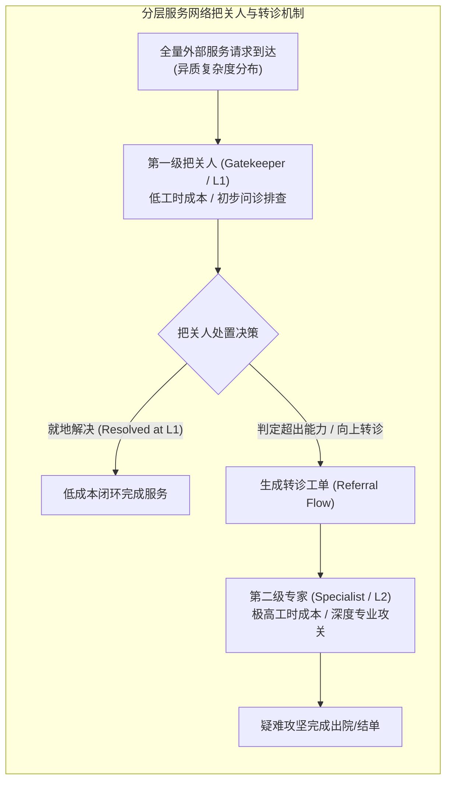

# Lec 24 服务系统中的把关人与转诊机制优化（Gatekeepers and Referrals in Service Systems）

## TL;DR

- 罗伯特·舒姆斯基与埃迪尔·平克（Robert Shumsky & Edieal Pinker, 2003）创立了分层服务网络中把关人与转诊（Gatekeeper-Referral）优化理论。
- 在包含全科初诊把关人（Gatekeeper）与专科专家的两级服务架构中，形式化建模了首诊解决率与误诊误转的经济学权衡。
- 推导建立了包含道德风险与激励对齐的最优转诊阈值控制方程，为医疗分级诊疗、多级技术支持与反欺诈风控提供了严谨理论基准。

## 一、分层服务架构的普遍性与把关人（Gatekeeper）制度

在现代大型复杂服务网络中，专业顶级专家资源（如医院主任医师、资深软件架构师、反洗钱高级调查官）是极其稀缺且极其昂贵的战略资产。如果允许所有微观外部请求无门槛直接访问顶级专家，专家将瞬间被海量琐碎平庸的低端任务所淹没，导致系统性崩溃。

工业界广泛采用经典的**两级分层服务把关人架构（Gatekeeper-Referral Hierarchy）**：
- **第一级：全科把关人（Gatekeeper / Triage / L1 工程师 / 社区全科医生）**：作为系统所有流量的统一入口。把关人薪酬成本较低，负责处理常规基础问题，并对疑难复杂病例执行过滤与分诊；
- **第二级：专精专家（Specialist / Referral Target / L2-L3 专家 / 三甲专科主任）**：仅接收由第一级把关人转诊（Referral）上送的高难度复杂请求，提供深度专业解决方案。

罗切斯特大学罗伯特·舒姆斯基（Robert Shumsky）与埃迪尔·平克（Edieal Pinker）在 2003 年发表于《Management Science》的名篇《服务系统中的把关人与转诊机制》，首次构建了这一经典制度的深层应用概率与微观经济学博弈模型。

## 二、把关人转诊的双重失误代价与微观模型

把关人在执行分诊与转诊决策时，面临严峻的信息不完全对称与两难困境：

### 1. 两类致命的分类决策失误
- **过度转诊（Over-referral / 甩锅怠工）**：把关人为了逃避个人责任或图省事，将原本在基层完全可以轻松处理的普通问题，轻易打包转诊给二线专家。这导致二线专家工位大面积排队拥堵，系统产生巨额昂贵的专家工时浪费！
- **不当截留与误诊（Under-referral / 盲目自信）**：把关人由于水平有限却强行尝试自行就地解决，结果不仅未能根除问题，反而延误了最佳排查时机，导致客户病情恶化或系统故障升级，最终引发更灾难性的重症急救抢修成本！

### 2. 数学模型形式化设定
设到达把关人的服务请求其潜在内在真实复杂度为连续随机变量 $X \sim F(x)$。
把关人耗费时间 $t_1$ 对任务进行初步接触排查，获得关于真实复杂度的噪声观测信号 $Y = X + \epsilon$。
把关人必须确立一个**转诊门槛值（Referral Threshold $K$）**：
- 若感知信号 $Y \le K$：在 L1 本地自行解决，消耗处理时间 $T_1(X)$，但承担因能力不足导致处理失败而产生的期望返工惩罚 $C_F(X)$；
- 若感知信号 $Y > K$：触发转诊，请求移交 L2 专家，消耗专家宝贵时间 $T_2(X)$ 并产生专科专家工时账单 $C_2$。

全系统的长期期望平均成本函数为：

$$\min_{K} \int_{-\infty}^K \left[ c_1 T_1(x) + C_F(x) \right] dF(x) + \int_K^{\infty} \left[ c_1 t_1 + c_2 T_2(x) + \text{DelayCost}(W_2) \right] dF(x)$$

其中 $W_2$ 为第二级专科专家队列的平均排队等待时间（由转诊流量的到达率 $\lambda_{\text{Ref}} = \lambda \mathbb{P}(Y > K)$ 内生决定）。

## 三、纳什均衡、道德风险与激励机制设计定理

在现实商业与医疗体系中，把关人与系统管理层的利益往往是不一致的（委托-代理问题 Principal-Agent Problem）：
- 若管理层对把关人考核“转诊率指标（限制转诊，超标罚款）”，把关人倾向于硬着头皮强行截留，导致严重医疗事故或客户重大投诉率飙升；
- 若管理层对把关人免责、允许自由转诊，把关人倾向于一键秒转，把二线专家当成免费碎纸机。

::: theorem [Shumsky-Pinker 最优转诊契约与激励机制定理 (2003)]
1. **全局系统级最优门槛值（System-Optimal Threshold $K^*$）**：系统的全局最优转诊门槛值严格将二线专家当前的**边际排队拥堵影子成本（Congestion Externality）**内生化。当二线专家队列严重积压时，门槛值 $K^*$ 应当动态上调，迫使基层把关人承担更多就地吸收任务；
2. **反向双向考核奖惩契约**：为了消除把关人的道德风险，管理层必须设计精密的复合线积分激励方案：
$$\text{Reward} = R_0 - \alpha \cdot \text{转诊工单数量} - \beta \cdot \text{本地截留返工事故率}$$
当且仅当权重比率 $\frac{\alpha}{\beta}$ 严格等于专家边际机会成本与事故修复成本的代数比率时，把关人的自利自私选择才能与全系统的全局最优化达成完美的**纳什激励对齐（Incentive Compatibility）**！
:::

::: example [全球顶级科技巨头 IT 运维服务台分层重构实证实录]
某跨国软件巨头的企业内部 IT 服务台，全球拥有 20 万员工。原先 L1 外包客服为了满足“2 分钟处理完毕”的表面 KPI，将高达 68% 的网络和软件工单不加排查直接转诊给年薪数十万美元的核心 L3 系统架构师，导致高管与核心开发人员的日常故障排查排期长达两周。
引入 Shumsky-Pinker 分层把关人机制后，管理层重构了 L1 的诊断知识库与激励契约，并引入把关人技能分级认证与质量逆向抽检。半年内：
- 规范合理的转诊率从 68% 断崖式下降至 **22%**；
- L1 本地一次性解决率（FCR）提升至 **78%**；
- 核心 L3 架构师工单排队等待时间从 14 天极致压缩至 **35 分钟**，全集团研发人员因此释放的有效工时创造了数亿美元的潜在生产力。
:::

## 我的理解

Shumsky 与 Pinker 的把关人理论直击人类复杂科层制组织运作的灵魂内核。

1. **组织分层的本质是稀缺注意力的防火墙**：一个健康的组织绝不能是扁平到所有人都可以随时随地打扰核心技术带头人的结构。将组织划分为 L1、L2 与 L3，设立清晰的把关人过滤网，不是官僚主义的倒退，而是保护企业最核心专家能够拥有大块不被打扰的时间去解决高价值战略难题的唯一屏障。
2. **考核单一指标必然引发系统性作恶**：在设计把关人机制时，切忌使用单一片面的考核口径。如果你只考核“转诊率低”，员工就会拼命掩盖故障；如果你只考核“解决速度快”，员工就会疯狂甩锅推诿。必须像 Shumsky-Pinker 定理一样，构建“解决效率”与“返工质量差错”相互制衡的对抗性指标体系。
3. **人工智能正在重塑第一级把关人**：在今天大语言模型（LLM Agent）蓬勃发展的时代，传统的 L1 把关人正在全面经历智能化重构。由具备语义理解、自动检索知识库的 AI Agent 充当 7x24 小时零等待的第一级把关人，在秒级内过滤解决 80% 的高频日常问题，仅将真正具有高认知不确定性的疑难长尾工单转诊给人类工程师，这正是 Shumsky-Pinker 理论在数字智能时代的终极工程兑现。
