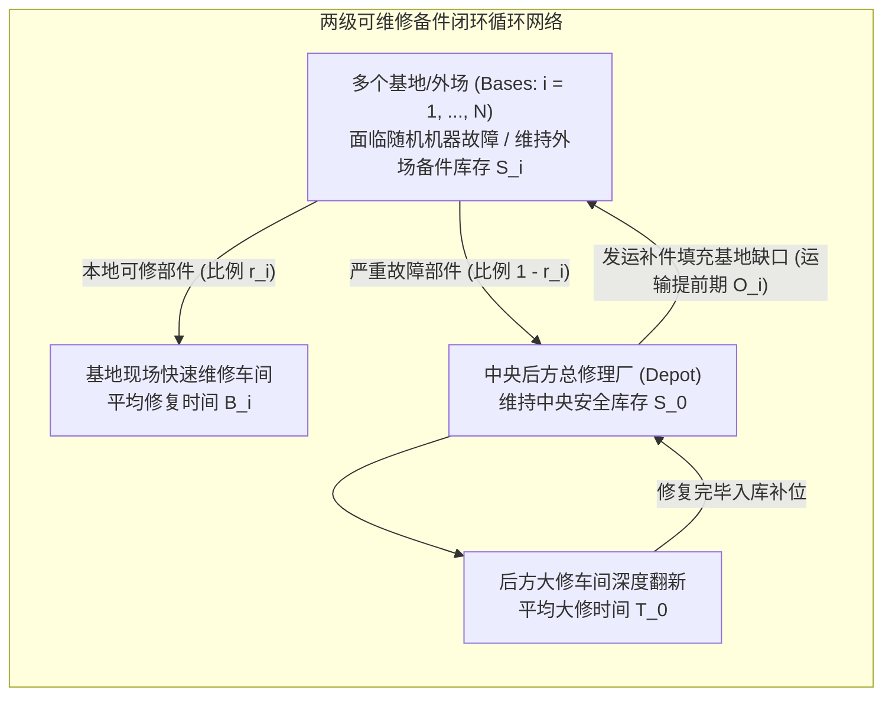

# Lec 3 可维修备件的多级库存系统与 (S-1, S) 策略（Multi-Echelon Repairable Inventory & METRIC Model）

## TL;DR

- 史蒂芬·格雷夫斯（Stephen Graves, 1985）拓展了经典 METRIC 模型，奠定了高价值可维修备件多级库存控制的严密理论基石。
- 针对昂贵周转件普遍适用的 $(S-1, S)$ 一对一补充策略，依托帕姆定理（Palm's Theorem）刻画在修备件数的泊松边缘分布。
- 格雷夫斯提出负二项分布近似法（Negative Binomial），精确修正了传统 Sherbrooke 模型对基地缺货方差的低估偏差。

## 一、高价值可维修件（Repairable Items）与两级系统设定

在航空航天、国防军工、半导体光刻机与高端医疗设备等重资产领域，备件库存管理面临着与一般消费品截然不同的物理规律：
- **备件单价极度昂贵**：一台飞机航空发动机、光刻机激光发生器或医院核磁共振超导磁体，单价高达数百万乃至数千万美元。
- **不可随意丢弃**：部件发生故障时绝不报废，而是运往专业维修站进行检测、换件并循环翻新（Repairable Items）。
- **极低需求率与极其严苛的停机惩罚**：日常故障率极低（属于典型稀疏泊松流），但一旦备件缺货导致客机停飞（Aircraft on Ground, AOG）或半导体产线停摆，每小时的停机损失以数万美元计。

麻省理工学院斯隆管理学院教授史蒂芬·格雷夫斯（Stephen Graves）在 1985 年发表了划时代论文《一对一补货下可维修备件的多级库存模型》，对美国空军兰德公司谢尔布鲁克（Craig Sherbrooke）经典的 METRIC 模型做出了革命性的理论修正。

在系统各节点，高价值备件的库存控制普遍采用极度简洁的**$(S-1, S)$ 连续盘点策略**（又称一出一进策略）：外场每拆卸下一个故障件送修，系统立即触发下达一件新备件的补充请购单，使得在库（On-hand）加在途在修（On-order/In-repair）始终恒等于基础库存水准 $S$。

## 二、帕姆定理（Palm's Theorem）与后方在修数分布

分析 $(S-1, S)$ 系统的理论数学基石是排队论中著名的**帕姆定理（Palm's Theorem, 1938）**：

::: theorem [帕姆定理（Palm's Theorem / $M/G/\infty$ 排队）]
如果顾客到达流服从参数为 $\lambda$ 的非齐次或齐次泊松过程，服务系统拥有无限个服务台（即不发生服务排队排队延迟），且服务时间 $T$ 服从任意一般独立分布 $G$（期望平均服务时间为 $\mathbb{E}[T]$）。
则在系统达到统计平衡的稳态下，**当前系统内正在接受服务的顾客总数 $X$ 严格服从期望参数为 $\lambda \mathbb{E}[T]$ 的泊松分布**，与服务时间分布的更高阶矩完全无关！
:::

在中央后方大修厂（Depot），来自全部基地的严重故障件到达流合并为一个参数为 $\lambda_0 = \sum \lambda_i (1 - r_i)$ 的大泊松流。由于总厂具备充足工位，当前后方大修车间内正在翻新的备件总数 $X_0$ 严格服从泊松分布：

$$X_0 \sim \text{Poisson}(\lambda_0 T_0)$$

若后方大修厂配置了 $S_0$ 件基础周转备件，则当且仅当在修总数 $X_0 > S_0$ 时，中央工厂发生缺货。后方工厂向外场基地的**延期发货积压量（Backorders at Depot, $B_0$）**为：

$$B_0(S_0) = \mathbb{E}[\max(0, X_0 - S_0)] = \sum_{x = S_0 + 1}^{\infty} (x - S_0) \frac{(\lambda_0 T_0)^x e^{-\lambda_0 T_0}}{x!}$$

## 三、格雷夫斯（Graves）理论突破：负二项分布近似法

谢尔布鲁克早期的 METRIC 模型在将后方大修延误传递至外场基地时，做出了一个过于简化的假设：认为基地层级面临的补货流依然是泊松分布（均值等于方差）。

格雷夫斯（1985）敏锐地指出这一假设存在严重的系统性低估：
- 中央大修厂的缺货延误具有**成团聚集性（Clustering Effect）**。当中央缺货时，后续连续几个基地的补货单都会同时被挂起延期发货；而一旦批量修复完成，又会成批集中释放发运。
- 这种由于中央缺货引入的正相关性，使得**基地在途补货件数 $X_i$ 的方差 $\text{Var}(X_i)$ 必然严格大于其均值 $\mathbb{E}[X_i]$**！

格雷夫斯推导出了基地在途在修总件数 $X_i$ 的精确一阶矩与二阶矩：

$$\mathbb{E}[X_i] = \lambda_i r_i B_i + \lambda_i (1 - r_i) \left( O_i + \frac{B_0(S_0)}{\lambda_0} \right)$$

$$\text{Var}(X_i) = \mathbb{E}[X_i] + (1 - r_i)^2 \cdot \text{Var}(B_0 \text{ 传递波动})$$

为了精确逼近这一方差大于均值的“超泊松（Over-dispersed）”特征，格雷夫斯提出了著名的**负二项分布（Negative Binomial Distribution, NBD）双参数匹配拟合算法**：

$$X_i \sim \text{NBD}(r, p), \quad \text{其中 } \mathbb{E}[X_i] = \frac{r(1-p)}{p}, \quad \text{Var}(X_i) = \frac{r(1-p)}{p^2}$$

::: example [美军战机战备可用度提升实践]
在五角大楼航空备件审计中，采用传统 METRIC 泊松模型计算所得的基地缺货率往往偏乐观 30% 以上，导致实际航母甲板上常出现战机因缺少单个精密电磁阀而整体趴窝。改用 Graves 负二项分布修正算法后，系统能够精准多配置关键易发积压的中央备件，在维持相同总预算的前提下，使全机群战备完好率（Readiness）跃升了 12 个百分点。
:::

## 我的理解

Graves 的可维修备件理论是应用随机过程在工程运营中落地的巅峰之作。

1. **方差膨胀（Over-dispersion）的系统直觉**：在任何多级系统中，上一级的不稳定性（如中央积压）绝不会被下一级平滑掉，反而会以成团波动的形式在下一级放大方差。在做复杂系统容量设计时，一旦发现上游节点存在排队阻塞，下游必须立即放弃简单的泊松假设，采用更稳健的长尾分布进行对冲。
2. **边际分析法（Marginal Analysis）求解整数配置**：备件库存向量 $(S_0, S_1, \dots, S_N)$ 属于高维离散凸优化。利用 Graves 模型的单调凸性，通过贪心算法计算每一美元边际投入所能削减的全系统期望缺货量（$\Delta \text{EBO} / \text{Cost}$），可以在多项式时间内精确描绘出资本开支 vs. 战备可用率的最优帕累托前沿。
3. **备件全生命周期与预测性维护的融合**：在现代物联网工业中，备件调度正在经历从纯被动故障响应向预测性维护（PdM）的迁移。结合传感器健康度振动数据，提前数周知晓部件何时到达疲劳极限，就能在飞机降落前将备件精准调拨至外场机库，将 Palm 定理中的被动停机彻底消除在萌芽之中。
