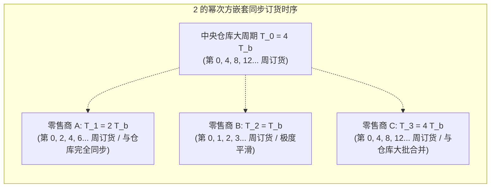

# Lec 4 单仓库多零售商系统的 98% 整数比例批量策略（98%-Effective Lot Sizing for 1-W-N-R Systems）

## TL;DR

- 罗宾·朗迪（Robin Roundy, 1985）攻克了单仓库-多零售商（1-W-N-R）多级确定性批量优化这一经典 NP-hard 难题。
- 创新性地提出了基于 2 的幂次方整数比例再订货间隔策略（Power-of-Two Policies: $T_i = 2^{k_i} T_b$）。
- 在数学上严格证明了该策略的最坏情况性能界限（Worst-case Bound）高达 98%（相对绝对最优成本偏差 $\le 2.06\%$）。

## 一、多级批量（Multi-Echelon Lot Sizing）的组合爆炸难题

在生产运作管理中，最古老的数学模型是福特·哈里斯（Ford Harris）在 1913 年提出的单级经济订货批量模型（EOQ）。然而，当供应链拓展为多级网络——例如一个中央工厂/仓库向多个零售商同时供货时，批量优化的复杂度呈指数级爆炸。

康奈尔大学罗宾·朗迪（Robin Roundy）在 1985 年发表了运筹学史上的传世名篇《单仓库多零售商系统 98% 有效的整数比例批量策略》（Management Science 最佳论文奖）。模型考虑如下结构：
- **网络拓扑**：单一中央仓库（索引 $i = 0$）与 $N$ 个零售商（索引 $i = 1, \dots, N$）。
- **确定性连续需求**：每个零售商面临稳定的外生客户需求率 $d_i > 0$。
- **阶梯成本结构**：
  - 节点 $i$ 每次发出订货或启动生产，产生固定订货/换模设置成本 $K_i > 0$。
  - 物料在各级节点持有产生库存持有成本。令 $e_i$ 为节点 $i$ 的**附加增量持有成本率（Echelon Holding Cost Rate）**。在增值流转中，零售商增量持有成本 $e_i = h_i - h_0 > 0$，仓库增量成本 $e_0 = h_0$。

目标是确定仓库与各零售商的再订货时间间隔向量 $(T_0, T_1, \dots, T_N)$，以最小化全系统长期平均总成本：

$$C(T_0, T_1, \dots, T_N) = \sum_{i=0}^N \left( \frac{K_i}{T_i} + \frac{1}{2} e_i d_i T_i \right)$$

其中约束条件要求：每次零售商订货时，中央仓库必须协同供货。在传统非平稳调度下，任意交错的订货时间会导致仓库库存出现极其复杂的锯齿波跳跃，使得全局精确寻优属于极难的非凸非线性整数规划。

## 二、整数比例与 2 的幂次方策略（Power-of-Two Policies）

朗迪做出了天才般的约束空间剪裁：与其允许各设施选择任意实数再订货周期，不如强加一个极其符合工程排程常识的**嵌套与整数比例约束（Nested & Integer-Ratio Constraints）**。在实际制造工厂与物流配送体系中，如果某个车间每 3.7 天下一次单，而另一个车间每 5.2 天送一次货，交错的非周期性到货将让车间收货月台与仓储管理员陷入无休止的调度混乱之中。

人类工业界天然偏好具有规律时钟周期的节奏排程。朗迪发现，如果强行要求所有设施的订货周期之间具有可整除的嵌套倍数关系，不仅在管理实践上极其易于落地，更在数学上奇迹般地保留了目标函数的全局凸性特征。在所有可能的整数比例选择中，以 2 为底数的幂次方序列展现出最为极致的数学性质。

### 1. 策略结构形式化定义与可除性优势
选取一个基础基准时间单位 $T_b$（例如单一工作日、排班班次或自然周）。所有零售商与中央仓库的再订货间隔 $T_i$ 必须严格满足：

$$T_i = M_i T_b, \quad \text{其中 } M_i \in \{2^k \mid k \in \mathbb{Z}\}$$

即：所有的订货周期必须是基础周期的 **2 的幂次方倍数**（如 $0.5 T_b, T_b, 2T_b, 4T_b, 8T_b, 16T_b, \dots$）。之所以选择以 2 为底数，是因为任意两个 2 的幂次方整数必有包含整除关系（要么 $M_i$ 整除 $M_j$，要么 $M_j$ 整除 $M_i$），这意味着长周期设施订货的时刻点集合，永远是短周期设施订货时刻点集合的真子集，从而实现了全网订货动作在时间轴上的完全自然嵌套。

### 2. 2 的幂次方策略带来的巨大工程协同价值
- **完美时钟嵌套（Synchronization）**：订货时点永远保持周期性严格对齐，彻底消灭了随机交错带来的不规则在制品尖峰。
- **排程与物流极端简便**：仓库与车间调度员再也不需要每天计算复杂的非线性方程，排程日程表永远像时钟齿轮一样精确咬合。

## 三、98% 有效性界限（The 98% Efficiency Proof）的数学震撼

朗迪最震撼学术界的贡献，在于以极其精妙的凸松弛对偶理论，严格证明了这一简化规则所付出的成本代价微乎其微！

::: theorem [朗迪 98% 最坏情况界限定理（Roundy's 98% Bound）]
设 $C^*$ 为在允许任意发散、非平稳、实数周期的无穷维策略空间中，全系统所能达到的**绝对理论成本下界（Infimum Theoretical Cost）**；
设 $C_{\text{PoT}}$ 为通过朗迪多项式时间贪心截断算法所求得的最优 2 的幂次方整数比例策略的总成本。
则对于任意节点数量 $N$、任意需求参数 $d_i$ 与任意成本矩阵 $(K_i, e_i)$，恒有：

$$\frac{C_{\text{PoT}}}{C^*} \le \frac{1}{\sqrt{2 \ln 2}} \approx 1.0206$$

这意味着该策略的最坏情况有效性（Effectiveness）至少为：
$$\text{Efficiency} \ge \frac{1}{1.0206} \approx 98\%$$
:::

### 理论证明直觉解构
1. **构造凸松弛单变量函数**：对于每一个独立的子模块，成本曲线 $g(T) = \frac{K}{T} + H T$ 的最优解为经典 EOQ 点 $T^* = \sqrt{K/H}$。
2. **黄金分割对数映射**：将连续实数最优解 $T^*$ 投影到离散集合 $\{2^k T_b\}$ 中相邻的两个幂次方点 $2^m$ 与 $2^{m+1}$ 之间。
3. **最坏极值分析**：当连续最优解恰好落在两个幂次方断点的几何平均值 $\sqrt{2} \cdot 2^m \approx 1.414 \cdot 2^m$ 时，误差达到局部最大值。通过代数放缩证明：在最坏极值点，函数值相对于底部的偏差上限严格受控于 $\frac{1}{2}(\sqrt{2} + \frac{1}{\sqrt{2}}) \approx 1.06$；进一步通过全局基准周期 $T_b$ 的对数平移优化，将全局最坏偏差直接压缩至 **2.06%**！

::: example [大规模供应链批量优化的现实落地]
在拥有上万种 SKU 的大型分销系统中，如果试图运行混合整数非线性规划（MINLP）求解绝对全局最优解，超级计算机计算三天也无法收敛。而运行 Roundy 算法，只需在毫秒内执行简单的对数除法与四舍五入，即可给出一组**绝对偏差不超过 2%**且车间调度员一眼就能看懂的优雅排程表。
:::

## 我的理解

Roundy 的 98% 理论是运筹学历史上将数学美感与工程实用主义完美统一的典范。

1. **工程决策的 98% 哲学**：工业界许多工程师容易陷入追求“绝对 100% 完美解”的心理强迫症，为了将理论成本再压低 0.5%，设计出包含几百个动态浮点数变量的调度模型。然而这种脆弱的模型一旦遭遇现实中工人的请假或机床的微小变异，系统立即全盘失效。牺牲 2% 的理论最优性，换取系统架构的极致简洁、自解释性与极高容错性，才是真正大师级的运筹格局。
2. **标准时钟节拍（Cadence）的组织力量**：在敏捷开发（Scrum）与现代工厂中，双周冲刺（Two-week Sprint）或按季度发版，本质上就是软件工程领域的 2 的幂次方策略。标准节奏减少了人与人之间反复沟通“你什么时候交付”的协调摩擦，将不确定性限制在确定的时间容器之内。
3. **对偶松弛寻找理论下界的利器**：在面对任何复杂的 NP-hard 现实工程问题时，首先通过拉格朗日松弛（Lagrangian Relaxation）推导出一个坚不可摧的理论下界（Lower Bound）。有了这把尺子，你才能自信地向管理层汇报你的启发式算法究竟已经逼近到了何种优秀水准。
