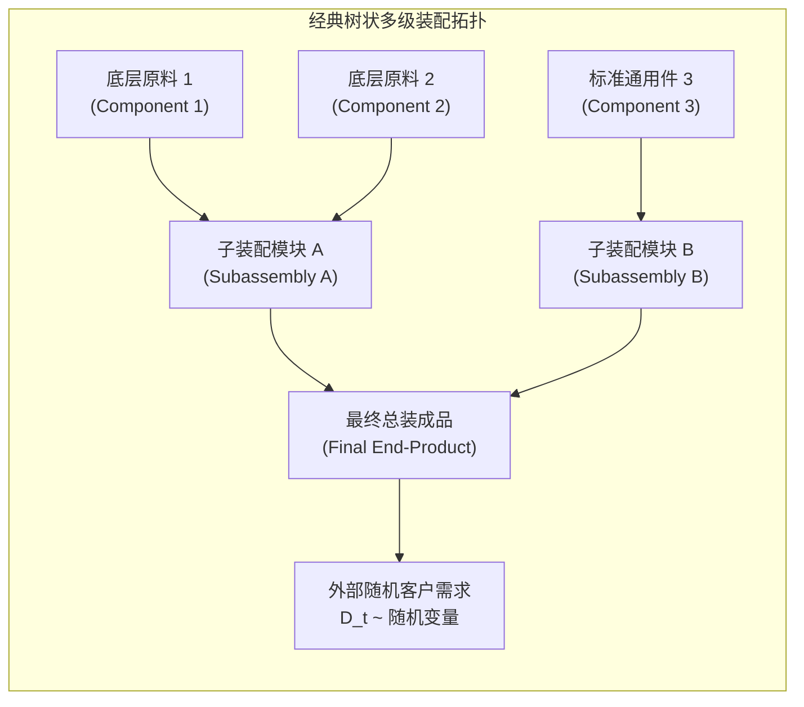

# Lec 5 随机需求下装配系统的最优库存控制（Optimal Inventory Policies for Assembly Systems）

## TL;DR

- 卡伊·罗斯林（Kaj Rosling, 1989）彻底攻克了纯装配系统（Assembly Systems）在随机需求下的多级库存控制难题。
- 创新性地构建了状态空间降维同构映射：将复杂的树状装配树，等价投影为一个极度简洁的串联纯分销系统（Series System）。
- 在数学上严格证明了长期最优控制策略具有广义基准库存形式（Echelon Base-Stock Policy），破除了装配死锁猜想。

## 一、纯装配系统（Pure Assembly Systems）的拓扑特征与死锁挑战

在制造业中，绝大多数物理产品（汽车、个人电脑、航空仪表）的生产拓扑并非单向的一维流水线，而是由成百上千个底层零部件经过多道分层子装配、最终汇总装配为产成品的**树状装配网络（Assembly Trees）**。

在随机终端客户需求驱动下，装配系统面临极其残酷的**物料短缺木桶短板效应（The Missing Component Bottleneck）**：
- 一台拥有 2000 个零件的汽车，即使 1999 个零件已经齐套在库，只要缺少一枚专属微型电容器芯片，整车就无法完成总装出库！
- 如果缺乏系统级的协同库存控制，上游各级子组件将陷入各自为政的混乱排产：有些昂贵的大型冲压件在车间大量积压积灰，而廉价的关键密封圈频繁缺货，造成巨额在制品（WIP）死锁。

在 20 世纪 80 年代之前，学界普遍认为带有随机需求的树状装配系统是不可解的高维控制难题。瑞典著名运筹学者卡伊·罗斯林（Kaj Rosling）在 1989 年发表于《Operations Research》的经典论文彻底改写了这一格局。

## 二、罗斯林（Rosling）状态空间降维与同构映射

罗斯林的核心理论创举在于：**在数学上证明了任意树状装配拓扑，都可以通过严格的拓扑变换，等价同构为一个纯粹的串联系统（Series System）**！

### 1. 广义梯队库存（Echelon Inventory）的定义重构
对于装配树上的任意节点 $i$：
- 节点 $i$ 的**梯队库存（Echelon Stock, $I^e_i$）**定义为：节点 $i$ 自身的在库与在途库存，**加上其所有下游后续子装配节点直至最终产成品中所包含的节点 $i$ 的物料折算总和**。
- 这一抽象彻底跳出了局部仓库物理边界的视野，从整机全链路追踪该零件的物理沉淀总量。

### 2. 组装平衡与同构串联链条映射
罗斯林指出，在最优控制下，由于装配工序要求所有输入零件按固定配比消耗，任何理性的调度器绝不会故意让某种零件的有效可用配额显著脱离其他同级协同零件。

::: theorem [罗斯林同构等价定理（Rosling Equivalence Theorem, 1989）]
考虑任意有限阶段或无限阶段折扣成本下的树状纯装配系统。定义关键虚拟节点序列，将各级子装配节点的累积装配提前期进行累加。
则原先复杂的非线性树状随机动态规划，可以**完全等价保真地映射为一个串联供应链系统（Series System）**；且原装配系统的最优库存控制策略，严格收敛为**梯队基准库存策略（Echelon Base-stock Policy）**！
:::

这意味着：
每一个装配节点 $i$ 只需要维护一个静态标量目标水准 $S_i^e$。当且仅当其梯队库存位置下降至 $S_i^e$ 以下时，节点 $i$ 向上游发出补货指令，指令大小恰好补足差额。

## 三、装配系统最优策略结构与齐套性（Kitting）保障

罗斯林定理对工业制造实践产生了深远的指导意义：

- **消灭工序内部假积压**：定理证明了在合理的增量持有成本假设下（即越往下游组装，物料附加值越高 $h_{\text{下游}} > h_{\text{上游}}$），最优策略在数学上天然保证了上游各零部件的下发节奏呈现严密的**步调一致性（In-sync Alignment）**。
- **齐套性概率保障**：以往车间调度员需要对 20 个零部件各自计算复杂的安全库存联动；通过罗斯林降维，调度员只需为映射后的串联链条设定统一的梯队安全库存，即可从数学上自动保证在总装工作台前的物料齐套率（Kitting Rate）达到预设置信区间。

::: pitfall [脱离梯队视角的局部看板陷阱]
若制造企业在多级装配车间推行纯局部的看板（Local Kanban），每个子车间只监控自己货架上的物料。一旦下游发生大单突发拉动，局部看板由于看不到上游更深层原材料的长提前期瓶颈，将导致局部工位过度生产、而关键卡脖子子件断供，引发系统性生产踩踏。
:::

## 我的理解

罗斯林装配系统模型为我们理解复杂多输入工程系统提供了无与伦比的美学典范。

1. **同构映射化繁为简的威力**：面对看似极其错综复杂的网状依赖系统，优秀的理论家从不硬碰硬地用暴力计算去硬解。找到系统内在的保守守恒律（如装配固定消耗配比），将其投影降维到我们已经彻底理解的一维简单空间中，这种数学化归思想是解决一切复杂工程问题的通用法门。
2. **现代制造齐套率（Kitting）的本质**：在汽车总装与复杂机电制造中，“缺一件等于全缺”。盲目追求各个单一车间的“高设备利用率”，只会制造出一堆由于无法齐套而根本无法交付给客户的半成品垃圾。必须以最终交付的齐套率作为全链路考核的唯一指挥棒。
3. **软件依赖管理的同构启示**：在现代大型分布式软件系统构建（如微服务单体化编译打包或复杂跨库包管理 Maven/npm）中，依赖解析树面临完全相同的齐套死锁问题。引入梯队版本基准线，确保所有依赖子模块在接口契约上同频演进，正是罗斯林思想在代码世界的数字重现。
