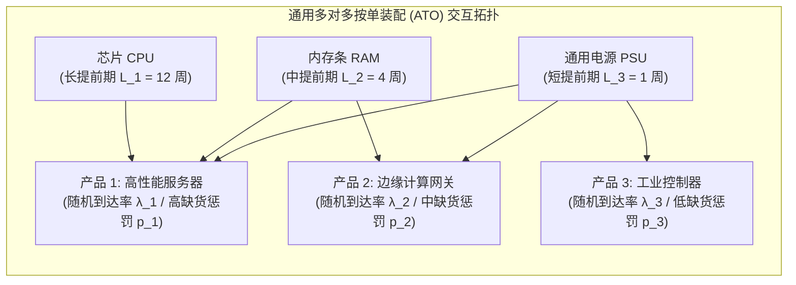

# Lec 6 随机装配系统中的组件采购启发式策略（Component Procurement in Stochastic Assembly Systems）

## TL;DR

- 加利安与温（Jérémie Gallien & Lawrence Wein, 2001）开创了随机装配系统组件采购与排产控制的新经典。
- 将带有非齐次泊松到达、多组件独立补货周期的通用 ATO 系统，严格建模为受控广义排队网络（Queueing Network）。
- 推导提出了结构优雅且计算轻量的组件采购启发式规则，在大规模工业模拟中展现出逼近理论最优的卓越性能。

## 一、通用随机装配系统（Stochastic ATO Systems）的现实挑战

在第 5 讲中我们研讨了罗斯林纯装配模型，但该模型建立在“一种最终产成品”的单树假设之上。在当今全球工业界的真实按订单装配（Assemble-to-Order, ATO）场景中（如戴尔定制 PC、惠普定制服务器或高端工程机械），环境面临更高级别的维度复杂性：

- **多产品共享通用组件（Component Commonality）**：$M$ 种不同的最终产成品由 $N$ 种不同的基础元器件按不同的 BOM 配方交叉组装而成。某一款高性能电源可能同时供给 5 款不同的服务器机型。
- **随机需求突发与混合优先级**：不同终端产品的客户订单以独立的泊松过程随机到达，且不同产品具有不同的缺货惩罚与交期容忍度。
- **组件提前期的异质性**：高价值专用芯片可能需要长达 16 周的跨洋采购提前期，而通用金属机箱只需本地供应商 2 天送达。

麻省理工学院斯隆管理学院教授热雷米·加利安（Jérémie Gallien）与劳伦斯·温（Lawrence Wein）在 2001 年发表了里程碑式的学术论文《随机装配系统的一种简单高效的组件采购策略》。

当某共享元器件发生局部短缺时，调度系统面临严峻的双重决策困境：
1. **采购控制（Procurement Control）**：每个周期应当向上游各异质供应商下达多少组件采购订单？
2. **分配控制（Allocation Control）**：有限的在库组件应当优先分配给哪一款高优先级产品，还是保留给未来可能到达的更高利润订单？

## 二、广义排队网络建模与数学规划构造

加利安与温独辟蹊径，打破了传统马尔可夫决策过程（MDP）的纯离散状态穷举，将随机装配系统抽象为一个**带有同步匹配约束的受控排队网络（Queueing Network with Synchronization Stations）**。

### 1. 系统动力学方程
设 $I_i(t)$ 为组件 $i$ 在时刻 $t$ 的可用物理在库量，$B_j(t)$ 为最终产品 $j$ 的未满足积压订单队列。
当产品 $j$ 的一个外部客户需求到达时：
- 若所有生产产品 $j$ 所需的组件集合 $C(j)$ 均有可用库存（即 $\forall i \in C(j), I_i(t) \ge 1$），总装线在秒级内完成组装出库，各组件库存瞬间扣减 1 单位。
- 若任一组件缺失，该订单被强制推入积压队列 $B_j(t)$，直至后续补货到齐触发“同步装配释放”。

### 2. 稳态优化问题的凸松弛
全系统的长期时间平均期望总成本函数为：

$$\min \lim_{T \to \infty} \frac{1}{T} \int_0^T \left[ \sum_{i=1}^N h_i I_i(t) + \sum_{j=1}^M p_j B_j(t) \right] dt$$

加利安与温通过建立排队网络在重交通条件下的守恒律关系，将错综复杂的跨组件动态博弈松弛为一个**凸二次规划（Convex Quadratic Program）**，从而彻底规避了高维动态规划的计算黑洞。

## 三、加利安-温（Gallien-Wein）启发式采购策略解析

基于严格的极限定理分析，作者推导提出了一套在工业界极其易于部署的**线性分离组件采购启发式规则**：

1. **解耦安全库存基准线**：对每个组件 $i$ 设定一个独立的基准库存水位 $S_i^*$。该水位的确定充分吸收了该组件被各下游产品调用的加权重要性与其采购提前期方差。
2. **贪心最大缺货指数分配准则（Greedy Priority Rule）**：当稀缺组件运抵仓库时，系统计算各积压订单队列的边际缺货惩罚指数：
$$\gamma_j = p_j \cdot \mathbb{P}(\text{其他协同组件在短期内可齐套})$$
优先将组件分配给能够以最高置信度“立刻完成整机组装交付”的产品，杜绝将宝贵组件锁死在另一个依然缺少其他大件的未决半成品中。

::: example [大规模工业仿真对标验证]
加利安与温在论文中构建了包含数十种异质零部件与十余种终端产品的庞大 ATO 系统仿真测试。对标实验表明：相较于工业界普遍采用的启发式经验法则，Gallien-Wein 策略将全系统总库存持有与积压惩罚成本平均降低了 **15% 至 30%**；更令人赞叹的是，其成本表现与理论绝对最优界的偏差普遍小于 **3%**，展现出极高的理论鲁棒性。
:::

## 我的理解

Gallien-Wein 模型展现了顶尖运筹学者在理论严谨性与工业实用性之间的精妙平衡。

1. **共享件（Commonality）的双刃剑认知**：在工程设计中，我们极度推崇提高通用件比例，因为直觉告诉我们通用件能带来风险共担。但 Gallien-Wein 模型揭示了其潜在的反噬风险：如果分配规则设计不当，共享组件极易被低优先级的走量产品过早“抢食偷吃”，导致利润极高的高端订单因缺料陷入瘫痪。共享设计必须强制伴随动态配额保护算法。
2. **排队论与库存论的深刻融合**：传统的库存理论往往忽视物料流动的时间动态，而传统的排队理论往往只关注服务台效率忽视零部件物料实体。将两者的数学工具（泊松点过程、离队流平衡、拟生死过程）融会贯通，是攻克现代复杂供应链与智能制造系统的终极钥匙。
3. **算法落地的工程边界**：一个在学术上证明最优的算法如果需要产线工人每分钟在终端输入二十个参数，项目必死无疑。Gallien-Wein 策略的伟大之处在于其最终形态依然是车间熟悉的基准库存与优先级列表，复杂的二次规划被深埋在后台，赋予了一线操作极简的用户体验。
