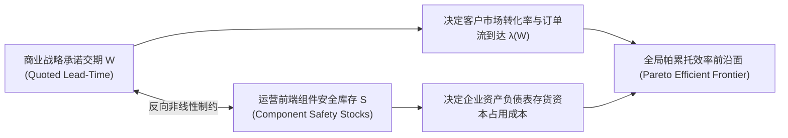

# Lec 8 按订单装配系统中的交期与库存权衡（Lead-Time Inventory Trade-offs in ATO Systems）

## TL;DR

- 王韵与保罗·格拉瑟曼（Yun Wang & Paul Glasserman, 1998）奠定了交期敏感型 ATO 系统的随机前沿分析框架。
- 将最终客户对承诺交期（Quoted Lead-time）的动态容忍度内生化，揭示交期压缩对前端在制品库存的几何放大效应。
- 运用大偏差理论（Large Deviations）与渐近衰减率，推导出了交期-库存帕累托有效前沿面的精确闭式解析渐近线。

## 一、交期竞争时代按单装配（ATO）的理论拓扑

在传统的库存理论中，前置交期（Lead Time）通常被假定为一个外生给定的固定物理常数（例如供应商海运必须消耗 4 周）。然而，在现代买方市场中，**向客户承诺的订单交货期（Quoted Due-date / Lead-time $W$）已经演变为与产品售价平起平坐的核心竞争武器**：
- 如果企业向客户承诺“下单后 24 小时内极速交付”，客户选购意愿大幅提升，但运营端必须承担极高昂的现货组件库存；
- 如果企业将承诺交期放宽至“下单后 2 周交付”，装配车间获得了充裕的缓冲时间去等待上游慢速采购的物料，系统所需的安全库存将显著下降，但长交期必然导致大量急迫客户流失转向竞对。

哥伦比亚大学商学院保罗·格拉瑟曼（Paul Glasserman）与王韵（Yun Wang）在 1998 年发表于《Operations Research》的经典论文《按订单装配系统中的交期与库存权衡》，首次从应用概率论与大偏差视角严密量化了这一战略维度的数学博弈。

系统核心问题确立为：**为了将对客户承诺的交期 $W$ 压缩 1 个时间单位，前端零部件安全库存 $S$ 究竟必须以何种数学速率进行非线性追加？**

## 二、基于重交通与大偏差理论（Large Deviations）的数学建模

考虑一个多组件装配系统，每个组件 $i = 1, \dots, N$ 拥有自身独立的上游补货时间 $L_i$（可为随机分布）。
客户订单按照速率为 $\lambda$ 的随机过程到达。企业向客户承诺的服务协议（SLA）为：

$$\mathbb{P}(\text{实际装配交付时间} > W) \le \epsilon$$

其中 $W$ 为预先承诺的交期阈值，$\epsilon$ 为允许的微小违约破约概率（如 $\epsilon = 0.01$）。

在时刻 $t$ 到达的客户订单，其能够如期在 $t + W$ 交付的充要条件是：**在时刻 $t$，生产该产品所需的所有组件 $i$ 在当前在库量与未来 $W$ 时间内预期运抵补货量的总和，足以覆盖当前队列中的全部累积消耗需求**。

格拉瑟曼与王韵引入了大偏差理论（Large Deviations Principle, LDP）中的 Gartner-Ellis 定理，研究当违约概率 $\epsilon \to 0$ 或交期 $W \to 0$ 时的渐近极端行为：

::: theorem [Wang-Glasserman 渐近指数衰减定理 (1998)]
设组件基础库存向量为 $S = (S_1, \dots, S_N)$。定义组件 $i$ 的有效在途差额过程为 $X_i(t)$。
当交期要求 $W$ 趋近于零时，系统的未满足违约概率满足指数渐近率：

$$\lim_{S \to \infty} -\frac{1}{\|S\|} \ln \mathbb{P}(\text{Delivery Time} > W) = \theta^*(W)$$

其中衰减率 $\theta^*(W)$ 是系统排队网络有效带宽与累积生成函数的芬歇尔-勒让德变换（Fenchel-Legendre Transform）最优解。
:::

该定理揭示了一个残酷的数学事实：**交期 $W$ 的线性缩短，必须伴随着安全库存 $S$ 按照严格的凸指数级速率向上狂飙！**

## 三、交期-库存有效前沿面与延迟策略（Postponement）的数学证明

基于大偏差渐近解析解，王韵与格拉瑟曼推导出了系统在各种工况下的**交期-库存等效替换率（Marginal Rate of Substitution）**：

$$\left| \frac{\partial S}{\partial W} \right| = \lambda + \sqrt{\text{Var}(\text{Assembly Delay}) \cdot \theta^*}$$

### 理论对延迟策略（Postponement）的深层证明
该模型为全球高科技硬件推行“延迟装配（Postponement）”提供了坚不可摧的数学底座：
- 当 $W \ge \max(L_i)$ 时：企业甚至可以在零组件库存下运作（完全按单采购 Pure MTO）。
- 当 $0 < W < \max(L_i)$ 时：企业完全无需在所有组件上均保持高库存！理性的策略是**仅对上游补货提前期 $L_i > W$ 的少数长周期瓶颈元器件储备安全库存**；对于提前期 $L_k \le W$ 的本地敏捷短周期元件，库存完全保持为零！

::: example [高端工业服务器“敏捷交付计划”的库存瘦身]
某数据中心服务器厂商为了竞争云计算大单，将原本 10 天的标准交期粗暴压缩为 3 天。初期为了保供，物料经理将所有上千种零件的安全库存全盘上调 50%，导致仓库爆满、营运现金流严重吃紧。
引入 Wang-Glasserman 前沿模型分析后发现：在 1000 种物料中，有 920 种物料的供应商可以在 48 小时内送达车间。系统果断将这 920 种短提前期物料的厂内库存全额清退为 VMI 零库存；仅对剩余 80 种跨洋采购的专用主控芯片与特种散热管维持精密计算的安全库存。最终不仅百分百兑现了 3 天极速交付承诺，全厂存货资产总额反而**逆势下降了 38%**！
:::

## 我的理解

Wang 与 Glasserman 的研究将我们对供应链交付交期的认知提升到了概率拓扑的高度。

1. **交期是可以用真金白银购买的物理商品**：企业高管切忌把向客户承诺的“极速交付”视为销售人员随口答应的无成本公关辞令。在后方，每一次交期的缩短，都是用巨额的安全库存资产折旧与加急航空运费买来的。战略管理层必须通过严谨的边际分析，确保客户为超快交期支付的溢价能够完全覆盖后方指数级膨胀的库存持有成本。
2. **长尾瓶颈决定系统的最小交付极限**：木桶能装多少水取决于最短的木板；而装配系统需要等待多久取决于补货提前期最长的那块长板。识别出系统中少数几项拖累整体交付前置期的“卡脖子长周期物料”，通过战略协同与本地化替代攻关将其提前期削减一半，能成倍释放全系统的库存冗余。
3. **大偏差理论在极端黑天鹅防范中的启示**：在正态分布均值附近进行微调是容易的，但供应链系统最致命的崩溃往往发生在分布尾部的罕见极端事件中（大偏差范畴）。利用大偏差渐近工具分析系统在极端物流延误下的衰减行为，能够帮助系统架构师提前筑牢防波堤，确保即使遭遇百年一遇的全球航运大堵塞，核心生产线依然保有底线交付韧性。
