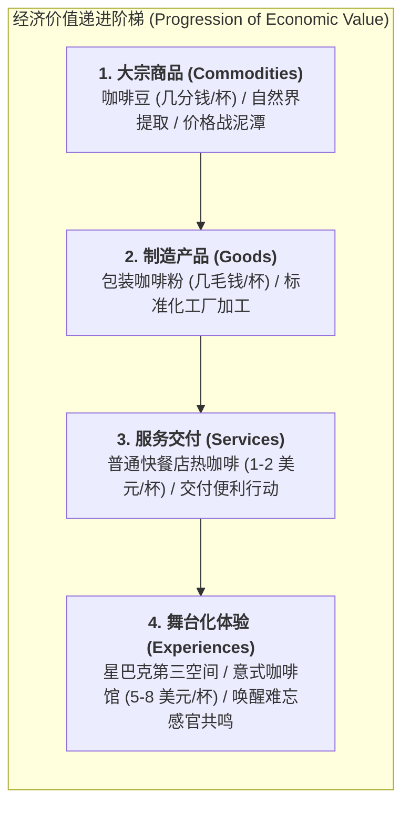

# Lec 1 服务运营管理导论：体验经济与服务本质（Introduction to Service Operations: Experience Economy & Service Nature）

## TL;DR

- 全球经济向服务主导逻辑（S-D Logic）的历史跃迁：从实物交付到价值共创。
- 服务运营的 IHIP 四大物理特性：无形性、异质性、不可分割性与不可储存性。
- 体验经济（Experience Economy）四象限模型与服务包裹（Service Package）解构。

## 一、全球经济的服务化浪潮与范式革命

在过去一个世纪中，工业工程和运营管理主要围绕着实体产品的制造展开：泰勒的科学管理、福特的流水装配线、丰田的精益生产。
然而，在 21 世纪的今天，全球主要发达经济体中，**服务业（Service Sector）创造的 GDP 占比已超过 75% 至 80%，吸纳了绝大多数社会就业人口**。

与此同时，传统的制造巨头（如 IBM 转型为企业解决方案咨询商、劳斯莱斯按飞行小时收取航空发动机“动力租赁服务”服务费而非买断发动机）全面拥抱“服务化转型（Servitization）”。
沃戈与卢施（Vargo & Lusch）提出的**服务主导逻辑（Service-Dominant Logic, S-D Logic）**指出：**实物商品不过是传递服务能力的短暂载体，一切商业的本质都是服务的交换与价值共创！**

## 二、服务运营的经典 IHIP 四重物理属性

服务运营之所以比工厂制造复杂得多，根源于其内在固有的 **IHIP 特性**：

::: definition [服务四大根本物理属性（IHIP Framework）]
1. **无形性（Intangibility）**：
   服务是一种过程、体验或心理状态，购买前无法触摸、称重或在显微镜下检验，导致客户在购买前面临巨大的信息不对称与信任风险；
2. **异质性（Heterogeneity / Inconsistency）**：
   服务是由具体的人（医生、发型师、顾问）交付给具有不同情绪偏好的具体客户，每一次交互的质量高度波动，极难推行完全绝对的六西格玛无方差标准化；
3. **不可分割性（Inseparability / Co-Production）**：
   生产过程与消费过程在时间和空间上**同步并发发生**。客户作为核心输入要素肉身参与其中，客户自身的配合度直接决定最终结果；
4. **易腐性/不可储存性（Perishability）**：
   服务无法被打包放入仓库以备下月使用。今晚空置的高铁座席或未被预订的手术室工时，其经济价值在时间流逝的瞬间永久灭失！
:::

## 三、服务包裹（The Service Package）多维解构

设计一个卓越的服务运营系统，必须将无形的服务体验拆解为具体可度量的**服务包裹（Service Package）五大要素**：

1. **支持性设施（Supporting Facility）**：
   开展服务所必需的物理场地与重资产设备（如医院大楼、核磁共振仪、高尔夫球场草坪）；
2. **辅助性物品（Facilitating Goods）**：
   在服务过程中由客户消耗或带走的实物商品（如手术缝合线、餐厅的牛排食材、酒店的洗漱用品）；
3. **显性服务（Explicit Services）**：
   客户能够明确感知、构成服务核心功能的基本利益（如骨折被成功接好接骨、航班安全平稳准时降落）；
4. **隐性服务（Implicit Services）**：
   附带的心理感受、精神地位与情感体验（如五星级酒店迎宾员尊崇的问候、名牌商学院校友身份带来的圈层归属感）；
5. **数字信息（Information Architecture）**：
   驱动服务精准流转的数字化数据（如电子病历、航旅纵横实时登机口变动通知）。

## 我的理解

服务运营是一门将冰冷工程学与细腻心理学融为一体的艺术。在工厂里，变异被视为必须彻底消灭的魔鬼；而在服务世界中，客户的多样性恰恰是商业溢价的源泉。理解 IHIP 特性，让我们明白为什么不能把工人管理流水线的方式粗暴套用在知识与情感劳动中。卓越的服务运营者不仅是在调度工时和场地，更是在人类情感与体验的舞台上编排一场精密动人的交响乐。
