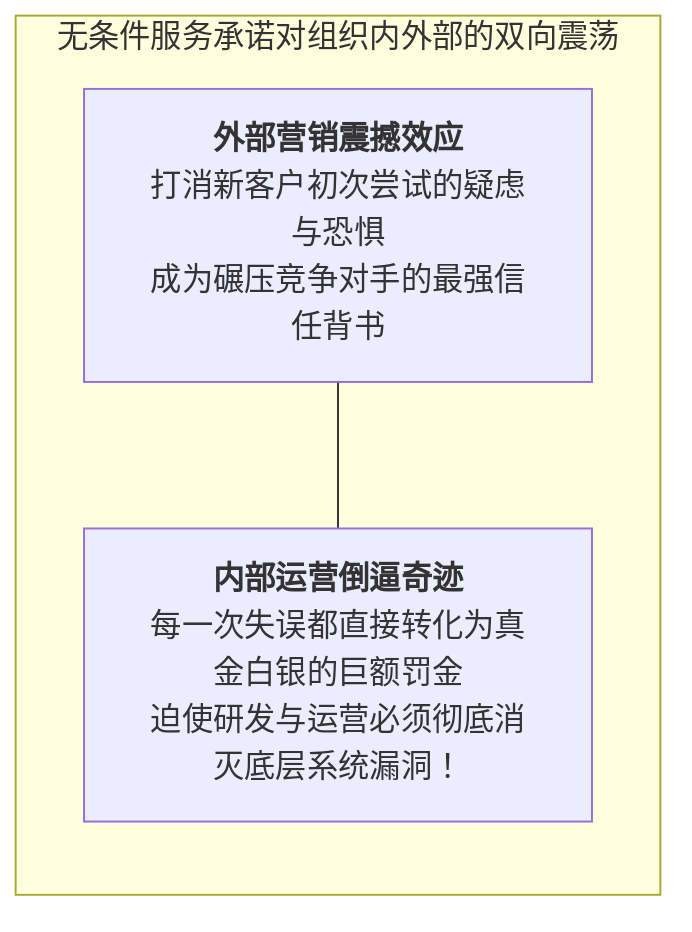
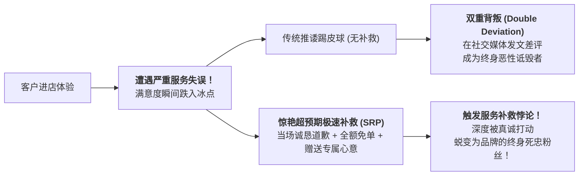

# Lec 10 服务运营分析框架 III：服务承诺担保与服务补救悖论（Service Operations Frameworks III: Service Guarantees & Recovery Paradox）

## TL;DR

- 哈利·斯莱辛格（Schlesinger）无条件服务承诺担保（Unconditional Guarantees）的战略威力。
- 服务补救悖论（Service Recovery Paradox）：从毁灭性失误反转为终身死忠客户的机制。
- 双重防线构建：事前主动识别缺陷与事后极速赋能补救流程闭环。

## 一、无条件服务承诺（Service Guarantees）的战略核武器

在制造业中，产品如果坏了可以退货退款；
但在很多传统服务企业，服务员把汤泼在客人身上、或者网络卡顿一整天，经理人往往两手一摊：“服务已经发生了，概不退赔”。这种推诿让客户在购买前充满了极度的焦虑与不信任。

哈佛商学院克里斯托弗·哈特（Christopher Hart）提出了**无条件服务承诺担保（Unconditional Service Guarantee）**：
企业向市场公开发布一条掷地有声的硬性承诺：**“如果您对我们的服务有任何不满意，无论原因何在，全额免单并当场额外赔偿！”**

::: definition [卓越服务承诺的四大黄金法则]
1. **无条件（Unconditional）**：绝不包含“如果遇到特殊情况、解释权归本店所有”等微小免责文字陷阱；
2. **极易理解与沟通（Easy to Understand）**：一句话说清楚（如“达美乐披萨：30 分钟未送达，免费赠送！”）；
3. **有实质意义与分量（Meaningful）**：赔偿力度必须能让客户感受到真正的诚意与肉痛；
4. **索赔流程极简毫无门槛（Easy to Invoke）**：客户只需一句话，无需填写冗长的三联审批表或出示身份证证明。
:::

## 二、服务补救悖论（Service Recovery Paradox, SRP）

在服务交付过程中，100% 杜绝失误在统计学上是不可能的。
然而，运筹与消费者行为学研究发现了一个极其反常识的奇妙现象——**服务补救悖论（Service Recovery Paradox）**！

::: theorem [服务补救悖论（Service Recovery Paradox）]
当一个客户遭遇了严重的服务失误（如酒店预订丢失、菜品出现异物），如果企业能够以**极其真诚、惊艳且超预期的速度当场进行极速补救**：
该客户在补救后的长期满意度与品牌忠诚度，**竟然显著超越了那些从头到尾从未经历过任何服务失误的普通客户**！
:::

### 为什么会发生悖论？
在平稳正常的履约中，客户感受到的只是冷冰冰的“理所当然的合同兑现”；
而唯有在危机爆发时，企业展现出的**担当、温度、对客户尊严的极致捍卫**，才能在情感深处产生剧烈的心灵震荡。

## 三、构建自愈型服务补救系统（Service Recovery System）

企业绝不能心存侥幸主动制造失误去博取悖论（因为一旦补救失败，客户将陷入毁灭性的“双重背叛”绝境）。必须建立自愈型补救体系：

1. **鼓励客户大胆抱怨投诉（Encouraging Complaints）**：
   - 数据表明：不满意却保持沉默的客户，90% 会直接悄悄离开转投竞品；而敢于当场投诉的客户，恰恰是对企业心存希望的拯救者；
   - 建立“投诉奖励机制”，把挑刺的客户视为全网免费的质量质检员；
2. **一线员工现场全权裁决权（On-the-spot Empowerment）**：
   - 严禁对一线说“请稍等，我打个电话向总监请示一下”；时间每拖延 1 分钟，客户的愤怒就指数级翻倍；一线人员必须拥有当场免单、赠券、调换最高等级套房的完整权限；
3. **闭环根因根本性消除（Root-Cause RCA）**：
   - 补救不仅仅是安抚单个客户，每一次补救事件必须在 24 小时内录入系统，召开复盘会议，从工艺和软件层面根除同一漏洞的再次发生。

## 我的理解

服务承诺担保与服务补救悖论，展现了商业伦理与运筹管理最深邃的辩证统一。敢于向全世界作出无条件担保的企业，不是狂妄自大，而是对自身系统能力的绝对自信与破釜沉舟的倒逼决绝。而在危机爆发时展现出的诚恳与担当，更是检验一个组织是否有灵魂的试金石。失误是物理世界不可避免的阴影，而卓越的补救，则是人类用真诚与智慧将阴影淬炼为璀璨信任的至高奇迹。
