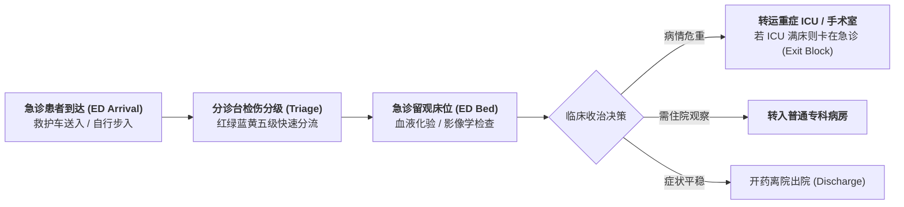

# Lec 11 医疗健康服务运营：急诊流转、手术室排程与瓶颈消解（Healthcare Service Operations: Patient Flow & ER Bottlenecks）

## TL;DR

- 医院高复杂度服务系统特征：高度异质性临床路径与生老病死的伦理约束。
- 急诊科（ED）拥堵的系统动力学成因：急救、普通门诊与重症监护（ICU）转运拥塞。
- 手术室（OR）昂贵固定资产排程优化：块状排程（Block Scheduling）与急诊插单应对。

## 一、现代综合医院的极端运营复杂度

大型三甲综合医院是人类社会组织中最复杂的运营系统之一。与标准化工厂相比，医疗运营面临独特的硬约束：
- **生命攸关的道德与法律红线**：拒诊或排队延误可能直接导致患者伤残或死亡，不能简单以“利润最大化”作为调度目标；
- **极度的临床路径异质性**：两位同样被初步诊断为“胸痛”的患者，一人可能是致命的急性心肌梗死，需要 10 分钟内送入心导管室支架抢救；另一人可能只是胃食管反流，只需开具胃药即可离院；
- **重资产与跨科室强耦合**：手术室、重症监护病房（ICU）、医学影像（CT/MRI）与化验检验科室高度共享，任何一个科室的微小拥堵，会迅速引发全院级连锁瘫痪。

## 二、急诊科拥堵的“出口阻断（Exit Block）”病理学

许多医院院长看到急诊大厅人满为患、担架在走廊排成长龙时，往往下意识地认为是“急诊科医生手脚太慢”或者“分诊台护士效率低下”。
然而，麻省理工学院运筹团队通过全院患者流转（Patient Flow）分析揭示了一个惊人真理：
**急诊科拥堵的根本根因，往往不在急诊科本身，而是因为下游病房的“出口受阻（Exit Block / Bed Boarding）”！**

::: definition [急诊出口阻断（Exit Block）机理]
急诊科医生已经完成了诊断和初期急救，判定该患者必须立即转入心内科住院病房或 ICU；
但是，楼上的心内科病房因为昨天出院的病人迟迟未办完离院手续、护工未完成床位消毒打扫，导致**住院病房床位空置但不可用**！
结果：该危重患者不得不继续躺在急诊科的抢救床上，死死占住急诊抢救资源数小时甚至数天。急诊科无法腾出床位接纳门外救护车送来的新患者，造成全院急诊大拥堵！
:::

### 消除出口阻断的系统工程对策
1. **上午出院激励（Discharge by Noon）**：
   重构主治医师查房与药房发药流程，将病人出院时间由下午集中拥挤提前至上午 11 点前完成，为下午急诊转入腾出 4 小时的周转窗口；
2. **缓冲过道预收容（Hallway Protocol）**：
   当急诊床位告急时，强行将已确诊待住院患者推至各专科楼层过道等待，将急救床位无条件腾还给生死一线的急救入口。

## 三、手术室（Operating Room, OR）排程优化

手术室是综合医院最昂贵的核心盈利中枢（每分钟折旧与能耗高达上百美元），也是外科医生、麻醉师、特种护士与重型设备高度交汇的瓶颈。

### 块状排程法（Block Scheduling）与两阶段优化
现代医院普遍采用**块状排程体系**：
- **第一阶段（事前战略分配）**：将每周的手术室机位按大块时间（如每周二上午 8:00 - 12:00）分配给骨科、普外科等专科医疗组；
- **第二阶段（事后战术微调与释放）**：各专科医疗组必须在手术日前 48 小时前锁定并提交具体患者手术清单；**若预订时间内预计有剩余空闲，未用配额被系统强制释放至全院公共池，供其他科室或择期急诊手术抢占**！

::: pitfall [手术工时预测变异陷阱]
外科医生为了多排手术，往往倾向于严重低估自己的手术时长（把实际需要 3 小时的复杂关节置换报成 1.5 小时），导致当天后续所有手术全部严重延误，医生护士被迫通宵疲劳加班。
现代系统引入**历史机器学习校准算法**：根据该主刀医生过去 50 台同类手术的真实分布方差，自动修正申报时长并加上 15% 的安全时间垫量，有效消灭了全院手术日延误。
:::

## 我的理解

医疗健康运营是一场与死神争分夺秒的系统工程。它深刻证明了局部最优不仅没有意义，甚至可能带来致命的危害。仅仅斥责急诊医生动作慢，是典型的官僚主义盲目；唯有顺着患者流动的全生命周期，打通从急诊、检验、ICU 到出院结算的全部阻碍通道，医院才能真正化身为高效救死扶伤的生命方舟。运筹学在医疗系统的落地，是技术理性对人类生命的最高守护。
