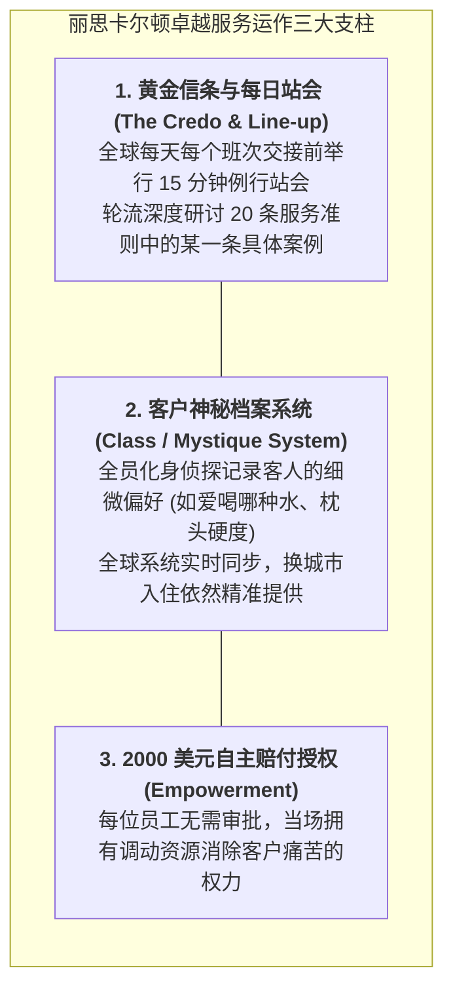
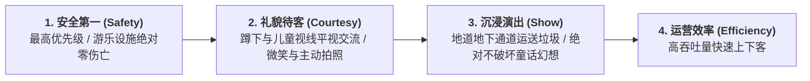

# Lec 12 酒店旅游与零售体验服务管理：迪士尼与丽思卡尔顿（Hospitality & Retail Service Management: Disney & Ritz-Carlton）

## TL;DR

- 全球奢华酒旅服务标杆：丽思卡尔顿（Ritz-Carlton）绅士淑女服务黄金准则与神秘档案。
- 主题乐园人流控制与沉浸式造梦工程：迪士尼乐园（Disney）舞台化（Show）管理法则。
- 微观体验触点（Micro-touchpoints）设计与离店告别仪式对记忆峰终定律（Peak-End Rule）的塑造。

## 一、丽思卡尔顿（Ritz-Carlton）的传奇服务哲学

丽思卡尔顿是全球唯一两次荣获美国国家质量奖（Malcolm Baldrige National Quality Award）的奢华酒店集团。
其服务管理体系被全球各大商学院奉为殿堂级经典。其核心灵魂凝练在著名的**座右铭（Motto）**中：
> **“我们是以绅士淑女的态度为绅士淑女服务的忠诚使者（We are Ladies and Gentlemen serving Ladies and Gentlemen）。”**

这一座右铭彻底粉碎了传统服务业将服务员视为“低声下气伺候人”的卑微视角，确立了员工与高端客户之间**人格尊严上的平等对等**：只有自信、高贵、受到充分尊重的员工，才能展现出优雅得体的顶级服务。

## 二、迪士尼乐园（Disney）的舞台化演出管理

迪士尼乐园将整个商业运营彻底解构为一场**宏大的沉浸式舞台戏剧表演（Theatrical Performance）**。在迪士尼的组织字典中，没有常规的企业词汇：
- 员工不叫“员工”，统一被称为**“演职人员（Cast Members）”**；
- 游客不叫“消费者”，统一被称为**“尊贵嘉宾（Guests）”**；
- 公共运营区被称为**“台前（Onstage）”**，办公后勤区被称为**“幕后（Backstage）”**；
- 工作职责被称为**“角色角色扮演（Role）”**。

::: definition [迪士尼演出完整性原则（Show Integrity）]
演职人员一旦迈过可视线踏入“台前”，必须 100% 沉浸在角色中：
- 扮演白雪公主的演员绝不允许被游客看到一边喝可乐一边刷智能手机；
- 绝不允许“明日世界”未来宇航服的演职人员穿过“西部牛仔小镇”（破坏时空沉浸感，所有后勤走地下暗道 Utilidor Network）；
- 即使是扫地保洁员，也被培训用拖把蘸水在水泥地面画唐老鸭速写，把枯燥的清洁转化为令路人驻足喝彩的街头艺术表演！
:::

## 三、峰终定律（Peak-End Rule）在体验设计中的落地

诺贝尔经济学奖得主丹尼尔·卡尼曼（Daniel Kahneman）提出了人类认知心理学的**峰终定律（Peak-End Rule）**：
**人们对一段体验的整体记忆与评价，并不取决于全部过程的平均感受，而是几乎完全由两个关键瞬间决定：最高峰（最好或最差）的那个瞬间（Peak），以及整个体验结束那一刻的终点体验（End）！**

::: example [宜家（IKEA）1 元冰淇淋的峰终运筹学]
宜家家居的动线设计极其漫长（甚至强迫顾客绕行数公里），顾客在选购大件家具、徒手从高位货架搬运沉重平板包装箱、排队结账的过程中，往往积累了巨大的身体疲劳与烦躁（体验低谷）。
然而，宜家在结账出门的**终点出口处（End）**，设置了一家廉价小吃吧，以不可思议的 **1 元钱超低价**向每位出门的顾客销售一支美味甜筒冰淇淋！
冰凉甘甜的冰淇淋在舌尖融化的瞬间，瞬间刷新了多巴胺分泌，**将顾客出门前的终点感受拉升至甜蜜愉悦的峰值**，让顾客彻底忘却了中间搬货的痛苦，带着美好的回忆心满意足地离开，并在两周后再次光顾。
:::

## 我的理解

酒旅与体验服务管理的终极境界，是**在冰冷的物理世界中重塑人类的情感记忆**。丽思卡尔顿用尊重赋予平凡岗位以崇高的灵魂，迪士尼用极致的舞台严谨为成年人守护纯真的童梦，而峰终定律则向我们揭示了人类心灵最奇妙的认知密码。懂得在最重要的关键时刻点亮微光，我们交付的就不仅仅是一张床位、一张门票，而是足以温暖人一生的璀璨瞬间。
