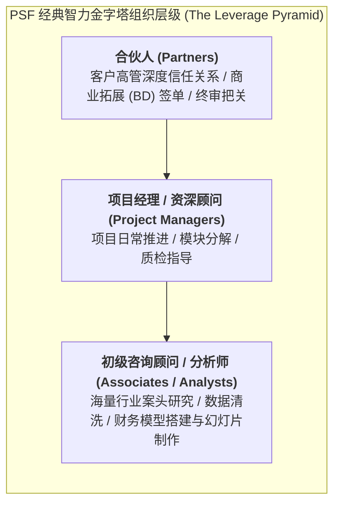

# Lec 13 金融与专业服务机构运营：知识密集型智力杠杆与交付合规（Financial & Professional Services Operations: Leveraged Knowledge）

## TL;DR

- 专业服务机构（PSF）：律所、投行与麦肯锡式顶级管理咨询公司的运营本质。
- 经典金字塔合伙人杠杆模型（Leverage Model）：大脑、灰发与程序型项目的配比。
- 计费工时利用率（Billable Utilization）与知识资产复用沉淀的系统权衡。

## 一、专业服务机构（PSF）的组织基因

专业服务机构（Professional Service Firms, PSF，如高盛、麦肯锡、普华永道、金杜律所）与普通服务企业的核心区别在于：
- **生产要素是纯粹的智力资本（Intellectual Capital）**：企业唯一的固定资产就是“每天乘电梯下班的员工大脑”；
- **客户面临极端的高维信息不对称**：企业客户花费数百万美元聘请咨询顾问制定战略并购方案，由于缺乏专业背景，在项目实施前甚至实施后数年内，都极难客观验证该方案是否真正最优（信誉品 Credence Goods 特性）；
- **合伙人所有制（Partnership Structure）**：资深专家既是直接在一线干活的业务骨干，又是拥有股权并按年终利润分红的企业所有者。

## 二、大卫·梅斯特的三类项目与杠杆配比模型

大卫·梅斯特在其经典著作《管理专业服务机构》（Managing the Professional Service Firm）中，将 PSF 承接的业务项目划分为三类，并指出其所匹配的**人员杠杆比率（Leverage Ratio）**截然不同：

::: definition [专业服务项目的三大类型]
1. **“大脑型”项目（Brain Projects / Expertise）**：
   - 极其前沿、首次出现、无任何现成先例可循的疑难杂症（如反垄断世纪诉讼、超大型跨国敌意收购反击战）；
   - **组织配比**：合伙人与初级人员比例接近 1:1，要求资深专家亲自肉身下场肉搏，收费极高但由于缺乏杠杆，利润率往往并非全所最高；
2. **“灰发型”项目（Grey-Hair Projects / Experience）**：
   - 难度较高但并非全新，需要极其丰富的实战经验与行业声誉（如企业 ERP 系统选型、跨国供应链网络诊断）；
   - **组织配比**：标准金字塔比例（1 个合伙人带 2 个经理和 4 到 6 个分析师），复用成熟框架与工具集；
3. **“程序型”项目（Procedural Projects / Efficiency）**：
   - 高度成熟、高度标准化、按既定标准模板流程执行的业务（如年度常规财务报表审计、合规尽职调查）；
   - **组织配比**：极度扁平的高杠杆（1 个合伙人带数十名初级分析师和外包外协团队），追求极低人力成本和工业化流转。
:::

## 三、计费工时利用率（Billable Utilization）与知识沉淀的张力

在 PSF 的日常运营报表中，最关键的核心指标是**可计费工时利用率（Billable Utilization Rate）**：
$$\text{利用率} = \frac{\text{向客户正式出具账单计费的小时数}}{\text{员工全年标准法定工作总小时数 (如 2000 小时)}} \times 100\%$$

对于初级分析师，利用率指标往往被残酷压榨至 **80% 至 95%（甚至常年每周加班 80 小时以上）**。
然而，过度追求短期 100% 账单利用率会导致企业陷入**“智力破产”**：
- 员工疲于奔命奔波在各个项目中，没有任何闲暇时间进行行业深耕和前沿自学；
- 每个项目组都在重复“重新发明轮子”，上一个项目辛辛苦苦积累的行业洞察和测算模型没有被及时清洗入库；
- 资深员工身心俱疲大批离职，带走宝贵的人脉和认知资产。

::: insight
顶尖 PSF 强制推行**“15% 知识资产税（Knowledge Tax）”**：
项目结项后，项目组必须预留整整一周的可计费工时，由专职知识管理总监（CKO）牵头，将项目中的敏感商业数据脱敏，将核心分析框架和模型提炼为标准白皮书、行业 Benchmark 数据库录入内部中台知识库，实现全球数万名顾问的无缝调用复用。
:::

## 我的理解

专业服务机构的运营，是知识资本与人性组织杠杆的最复杂搏杀。它没有一砖一瓦的物理库存，却有最脆弱、流动性最高的“认知库存”。大卫·梅斯特的金字塔杠杆模型揭示了知识工业化的客观规律：一家伟大的智力机构，不仅要有一两个能解天下难题的天才合伙人，更要有一套能将天才洞见沉淀为标准化模块、由数千名年轻分析师高效执行的工业化流水线。在智慧与规模之间找到平衡，是知识经济时代最崇高的运营艺术。
