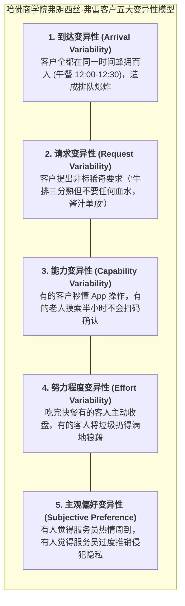

# Lec 14 客户协同生产与服务体验设计工效学（Customer Experience Design and Co-Production）

## TL;DR

- 客户不仅是消费者更是部分员工：协同生产（Co-Production）的双刃剑效应。
- 弗朗西丝·弗雷（Frances Frei）客户五大变异性模型：到达、能力、请求、努力与偏好。
- 在经典容忍（Accommodation）与削减（Reduction）之间平衡服务体验与交付成本。

## 一、客户即“兼职雇员（Partial Employees）”

在传统制造工厂中，流水线上的装配工必须经过数周严格岗前培训、通过考核并严格听从车间主任的调度指挥。
但在服务运营中，企业面临一个极其奇葩但无法逃避的现实：
**客户作为未经过任何面试、未经过系统培训、未签署劳动合同的“兼职雇员”，肉身直接闯入了你的生产作业现场！**

- 在宜家家居（IKEA），顾客自己推着板车在仓库中辨认货号搬运板件，回家自己拿着六角扳手对照图纸拧螺丝组装家具；
- 在自助火锅店，顾客自己去调料台搭配蘸料、自己在电磁炉前涮煮牛肉；
- 在手机银行 App 上，用户自己输入收款人银行账号并仔细核对转账金额。

协同生产（Co-Production）为企业带来了**大幅削减一线劳动力成本**与**让客户享受掌控感与速度**的巨大收益；但同时也引入了整个服务运营系统最大的破坏性因子——**客户变异性（Customer-Induced Variability）**！

## 二、经典容忍策略（Accommodation）vs. 削减策略（Reduction）

哈佛商学院弗朗西丝·弗雷（Frances Frei）指出，面对这五大变异性，企业通常在两种对立的哲学之间做出选择：

| 变异类型 | 传统经典容忍策略（Classic Accommodation） | 经典削减策略（Classic Reduction） |
| :--- | :--- | :--- |
| **到达变异** | 聘用海量冗余兼职员工，随时待命以应付突发客流高峰（成本高昂） | 实行严苛的预约制与早鸟降价错峰分流机制 |
| **请求变异** | 配备全能超级专家顾问，有求必应满足一切奇葩定制需求 | 菜单仅保留 8 道爆款经典菜，严格写明“配方固定概不修改” |
| **能力变异** | 安排专职一对一客服坐在旁边手把手指导操作（如私人银行理财室） | 极简化人机交互界面（UI/UX），推行图形化防呆引导 |
| **努力程度** | 增派保洁工人在大厅四处巡视随时帮客人收拾烂摊子 | 设计物理互锁装置（如唯有将餐盘放入回收架才能拿回押金） |
| **偏好变异** | 记住每位常客的细微特殊偏好（丽思卡尔顿模式） | 明确锁定细分客群心智，不符合调性的客户宁可断然拒绝 |

## 三、高级妥协与行为工效学（Behavioral Accommodation）

最顶尖的服务体验设计师绝不会简单地在“昂贵的容忍”与“粗暴的削减”之间二选一，而是采用**行为心理学工效学（Behavioral Design）**，让客户自愿、快乐且高效地参与协同生产：

::: example [星巴克杯型语言与动线引导]
在星巴克门店中：
- 店员绝不使用传统的“大杯、中杯、小杯”，而是训练顾客使用专属词汇“Tall、Grande、Venti”，让顾客在协同点单中感受到一种“咖啡文化行家”的身份认同与智力满足感；
- 取餐吧台与点餐台呈直线横向拉开，顾客点完单后必须顺着透明玻璃糕点柜走向取餐台，在短短 30 秒的步行中，顾客不仅消除了干坐等待的焦虑，更有 20% 的顾客在途中临时起意加购了一块柜台里的芝士蛋糕！
:::

## 我的理解

客户协同生产是体验经济最迷人的双面镜。它既是成本削减的终极法宝，也是体验灾难的始作俑者。把客户当成“兼职雇员”，不代表把活无脑甩给客户；真正的大师深谙行为工效学的妙境——通过精妙的物理动线设计、情感奖励与防呆界面，让客户在毫无察觉中替企业完成了生产闭环，同时还满怀成就感地以为自己获得了至高无上的自主权。这是运营工程学与人性心理学共舞的至高境界。
